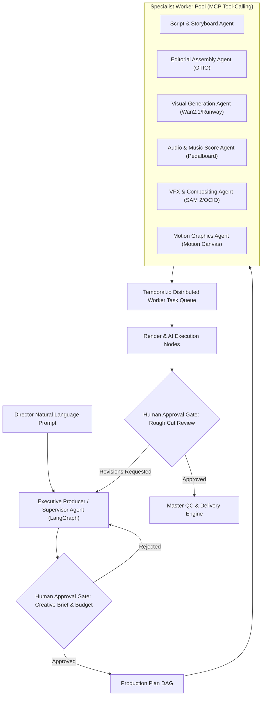
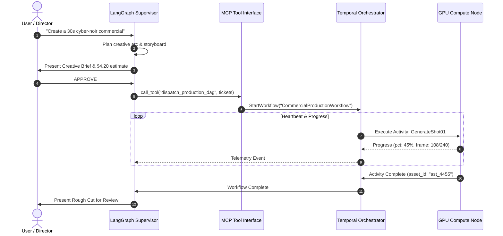

# Agent Architecture & Workflow Orchestration
**Project:** Universal AI Video Production Studio  
**Document Version:** 1.0.0  
**Status:** Approved Master Specification  
**Lead Architect:** Principal AI Systems & Workflow Engineer  
**Verification Date:** 2026-11-21  

---

## 1. Runtime Isolation Principle

**Crucial Mandate:** Developer assistants and coding tools (such as Google Antigravity and Anthropic Claude Code) are **development-time engineering environments**. They must **never** be embedded into or relied upon as the runtime engine of the production studio.

The production studio runtime is a **standalone, self-contained, enterprise software system** implemented in Python, Node.js, C++, and Temporal.io, executing deterministically on servers, local workstations, or cloud clusters.

---

## 2. Hierarchical Agent Topology

The studio utilizes a **Supervisor-Specialist Agent Topology** designed as a directed state machine.

---

## 3. The Two-Layer Orchestration Engine

The agent runtime is strictly separated into two architectural layers:
1. **Decision Layer (Cognitive State Graph):** Implemented via **LangGraph**. Governs multi-agent debate, creative problem solving, departmental task delegation, and stateful human approval checkpoints.
2. **Execution Layer (Durable Task Engine):** Implemented via **Temporal.io**. Governs long-running distributed compute activities, network retries, GPU worker leasing, video rendering, and hardware failure recovery.

### Why this dual architecture?
LLMs are probabilistic and non-deterministic; media rendering is deterministic and time-intensive. An LLM agent should never directly hold an open HTTP socket waiting 40 minutes for a 4K Cycles render or Wan2.1 diffusion batch. LangGraph emits a structured `JobTicket`; Temporal executes the activity durably, heartbeating progress every 5 seconds.

---

## 4. Model Context Protocol (MCP) Tool Integration

All capabilities of the 22 studio departments are exposed to agents using the **Model Context Protocol (MCP)** specification. This isolates agent logic from tool implementations.

### Standardized MCP Studio Tool Declarations
- `studio_timeline_inspect(project_id, track_id)`: Returns OTIO track clips, gaps, and durations.
- `studio_timeline_append_clip(project_id, track_id, asset_id, in_point, out_point)`: Slices and appends media to the editorial timeline.
- `studio_asset_search(query, domain, min_duration)`: Queries TwelveLabs and vector database for matching b-roll footage.
- `studio_generate_video(prompt, seed, reference_asset_id, provider)`: Submits a generative video job ticket.
- `studio_mix_audio(project_id, track_specs, target_lufs)`: Triggers multitrack mixing via Spotify Pedalboard.
- `studio_request_human_approval(title, description, preview_asset_id, cost_cents)`: Pauses agent workflow until the user signs off in the Studio UI.

---

## 5. Human-in-the-Loop (HITL) Gateways

The system enforces three mandatory human-in-the-loop checkpoints:
1. **Gate 1: Creative Direction & Budget Gate:**
   - Triggered before any paid API or GPU generation begins.
   - User approves the script, storyboard, visual style references, and estimated compute cost.
2. **Gate 2: Keyframe & Character Consistency Signoff:**
   - User reviews character turnaround sheets and concept frames before full video generation.
3. **Gate 3: Editorial Rough Cut Signoff:**
   - User scrubs the assembled OTIO rough cut with proxy audio before triggering final 4K master rendering and color grading.

---

## 6. Durable State Snapshotting & Crash Recovery

- State snapshots are saved to disk / database after every node transition in LangGraph.
- If a machine reboots, crashes, or loses power during a 2-hour production run, the engine resumes from the exact last verified checkpoint.
- Completed asset generation jobs are immutable and stored in the Asset Registry (`SHA-256`); tasks are never redundantly re-executed.
