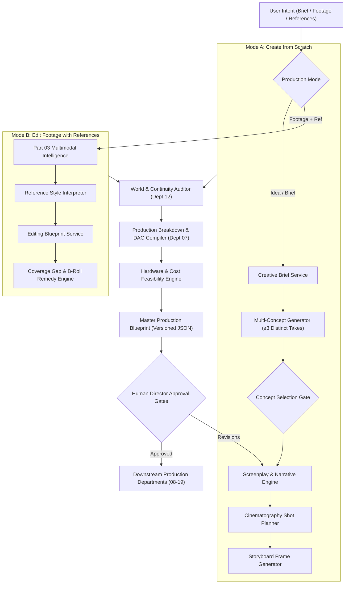

# AI Director & Creative Reasoning Architecture
**Project:** Universal AI Video Production Studio  
**Document Version:** 1.0.0  
**Status:** Approved Master Architecture  
**Department:** 06 Creative Direction & 07 Production Planning  
**Last Verified:** 2026-11-21  

---

## 1. Executive Summary & Design Philosophy

The **AI Director** is the cognitive creative brain and production planner of the Universal AI Video Production Studio. It is not a prompt wrapper or an LLM chatbot that hallucinates video generation prompts. It is an agentic, structured decision-making engine that bridges human intent, narrative structure, cinematographic principles, and physical/computational constraints into machine-readable, versioned **Production Blueprints**.

---

## 2. Core Operational Modes

The AI Director natively supports two distinct operational modes:

### 2.1 Mode A: Create from Scratch (Generative Production)
- **Input:** Natural language brief, theme, target platform, duration, or rough script.
- **Workflow:**
  1. **Brief Ingestion & Assumption Analysis:** Parses text into a canonical `CreativeBrief`. Detects missing technical or narrative parameters and formulates clarification questions while explicitly logging assumptions.
  2. **Multi-Concept Synthesis:** Generates at least 3 materially distinct concepts (e.g. *The Cinematic Journey*, *Kinetic Velocity*, *Engineered Minimalism*) with contrasting hooks, palettes, and complexity scores.
  3. **Screenplay & Spoken Pacing Engine:** Decomposes the approved concept into a multi-scene screenplay, computing exact speech durations via a word-per-minute heuristic and punctuation pause model.
  4. **Cinematography & Shot Planning:** Translates scenes into `PlannedShot` records detailing lens focal length (mm), camera angle, movement vectors, lighting setups, and depth of field.
  5. **Storyboard Formulation:** Creates visual prompt specifications and compositional rules for generative AI and artists.

### 2.2 Mode B: Edit Existing Footage using References (Editorial Reasoning)
- **Input:** Uploaded footage assets, reference video asset IDs, and editorial instructions.
- **Workflow:**
  1. **Multimodal Analysis Linkage:** Ingests shot boundaries, cut frequencies (CPM), Average Shot Length (ASL), camera movements, and audio beat grids from Part 03's `ReferenceProfile`.
  2. **Rhythmic Alignment & Mapping:** Maps source clips to the target timeline sequence, respecting reference pacing and cut timing.
  3. **Missing Coverage Detection:** Identifies gaps in narrative coverage or missing shot scales (e.g., missing extreme close-up or drone establishers) and recommends targeted solutions (AI generation, stock footage, or motion graphics).

---

## 3. Departmental Boundaries & Separation of Concerns

In compliance with the studio's 22-department architecture:
- **Department 06 (Creative Direction):** Owns brief parsing, concept generation, scriptwriting, cinematography planning, storyboard prompts, and reference style transfer.
- **Department 07 (Production Planning):** Owns production breakdown, task dependency DAG compilation, editing blueprinting, and hardware/cost feasibility evaluation.
- **Department 12 (Character Production):** Owns character profiles, wardrobe rules, environment definitions, and spatial/lighting continuity auditing.
- **Central Asset Registry (`core/assets/database.py`):** Persists all entities with relational integrity across 11 dedicated planning tables.

