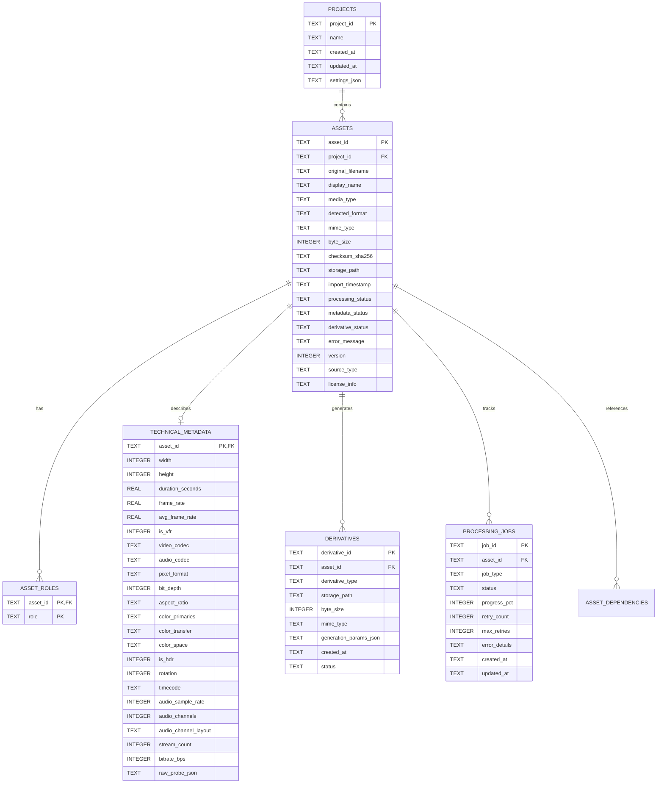

# Central Asset Registry Schema Specification
**Project:** Universal AI Video Production Studio  
**Phase:** Part 02 Specification  
**Database Engine:** SQLite 3.x  
**File Location:** `projects/studio_asset_registry.db`  

---

## 1. Entity-Relationship Model

---

## 2. Table Definitions

### Table: `projects`
- `project_id` (TEXT, PK): UUIDv4 string.
- `name` (TEXT): Project title.
- `created_at` (TEXT): ISO-8601 UTC timestamp.
- `updated_at` (TEXT): ISO-8601 UTC timestamp.
- `settings_json` (TEXT): Serialized project configurations (frame rate, canvas dimensions, audio rate).

### Table: `assets`
- `asset_id` (TEXT, PK): Unique immutable identifier.
- `project_id` (TEXT, FK): Parent project reference.
- `original_filename` (TEXT): Exact original filename uploaded by user.
- `display_name` (TEXT): User-facing customizable name.
- `media_type` (TEXT): Enumeration: `VIDEO`, `AUDIO`, `IMAGE`, `SUBTITLE`, `ANIMATION`, `THREE_D`, `PRODUCTION_DOCUMENT`, `UNKNOWN`.
- `detected_format` (TEXT): Lowercase container / format identifier (`mp4`, `wav`, `png`, `gltf`, `obj`).
- `mime_type` (TEXT): Canonical MIME type.
- `byte_size` (INTEGER): Exact file size in bytes.
- `checksum_sha256` (TEXT): 64-character hexadecimal SHA-256 hash.
- `storage_path` (TEXT): Relative path to preserved original file.
- `import_timestamp` (TEXT): ISO-8601 UTC timestamp of import.
- `processing_status` (TEXT): `QUEUED`, `PROCESSING`, `COMPLETED`, `FAILED`.
- `metadata_status` (TEXT): Status of technical stream metadata extraction.
- `derivative_status` (TEXT): Status of proxy/thumbnail generation.
- `error_message` (TEXT, Nullable): Diagnostic error string upon failure.
- `version` (INTEGER): Version number (default 1).
- `source_type` (TEXT): `UPLOAD`, `LOCAL_IMPORT`, `GENERATED`.
- `license_info` (TEXT, Nullable): Commercial licensing notes or attribution strings.

### Table: `asset_roles`
Enables assigning multiple production roles to a single physical asset without file duplication.
- `asset_id` (TEXT, FK): Asset reference.
- `role` (TEXT): `SOURCE_FOOTAGE`, `REFERENCE_VIDEO`, `REFERENCE_AUDIO`, `REFERENCE_IMAGE`, `MUSIC`, `SOUND_EFFECT`, `VOICE_RECORDING`, `GENERATED_VIDEO`, `GENERATED_IMAGE`, `CHARACTER_REFERENCE`, `ANIMATION_ASSET`, `THREE_D_MODEL`, `TEXTURE`, `LUT`, `SUBTITLE`, `SCRIPT`, `PROJECT_DOCUMENT`.

### Table: `technical_metadata`
Detailed stream attributes extracted by FFprobe and specialized parsers.

### Table: `derivatives`
Tracks generated auxiliary files (proxies, thumbnails, contact sheets, extracted WAV stems, waveforms).

### Table: `processing_jobs`
Durable tracking for background workers, progress percentage, and retry attempts.
