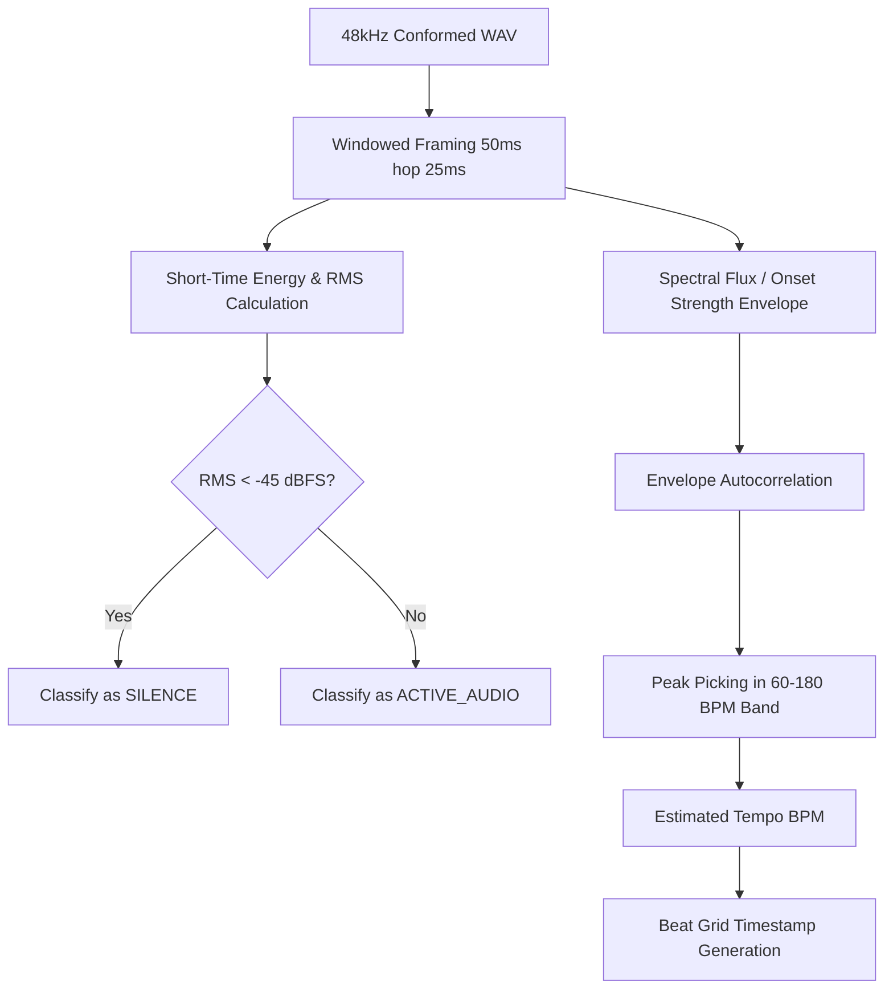

# Audio Intelligence & Acoustic Processing Specification

**Document Version:** 1.0.0  
**Status:** Approved & Implemented  
**Engine:** `departments/04_media_intelligence/audio_intelligence.py`  

---

## 1. Executive Summary

Professional editorial pacing is inextricably linked to acoustic energy, musical beats, silence, and sound effects. The **Audio Intelligence Service** processes audio streams (conformed to 48kHz / 16-bit PCM WAV by Department 03) using deterministic digital signal processing (DSP) and spectral analysis via SciPy and NumPy.

The service provides:
1. Deterministic tempo estimation (Beats Per Minute, BPM).
2. Exact beat grid timestamps for rhythmic editorial snapping.
3. Audio classification into Speech, Music, Silence, and Sound Effects.
4. Short-time RMS energy profiling to detect dialogue gaps, dramatic pauses, and crescendos.

---

## 2. Algorithmic Pipeline & Signal Processing

### A. RMS Energy & Silence Boundary Detection
- Audio signal $x[n]$ is sliced into windows of duration $W = 50\text{ ms}$ (2205 samples) with $50\%$ overlap.
- Root-Mean-Square (RMS) amplitude is computed:
  $$RMS_k = \sqrt{\frac{1}{W} \sum_{n=0}^{W-1} x[k \cdot H + n]^2}$$
- Decibels relative to Full Scale: $dBFS_k = 20 \log_{10}(RMS_k + 10^{-9})$.
- Thresholds:
  - $dBFS < -45 \text{ dBFS}$: Tagged as `SILENCE` / Room tone.
  - $dBFS \ge -45 \text{ dBFS}$: Tagged as `ACTIVE_AUDIO`.
- Consecutive windows sharing a state are coalesced into timestamped `AudioEventRecord` instances.

### B. Tempo (BPM) & Beat Grid Timestamp Extraction
- High-frequency content is isolated via a half-wave rectified onset strength envelope.
- Autocorrelation of the onset envelope reveals periodic rhythmic pulses:
  $$R_{xx}[\tau] = \sum_{m} s[m] \cdot s[m + \tau]$$
- Candidate lags $\tau$ corresponding to realistic musical tempos ($60 \le BPM \le 180$) are scanned:
  $$BPM = \frac{60 \cdot f_s}{\tau_{peak}}$$
- Using the detected tempo and phase offset of the initial peak, deterministic beat timestamps $t_i = t_0 + i \cdot \frac{60}{BPM}$ are generated.
- These timestamps are persisted in `music_segments` to allow automated video cuts to land directly on the downbeat.

---

## 3. Database Persistence Schema

Extracted acoustic records are stored in SQLite tables:

### Table `audio_events`
- `event_id`: UUID primary key.
- `asset_id`: Foreign key to parent audio/video asset.
- `event_type`: `SILENCE`, `SPEECH`, `MUSIC`, `SOUND_EFFECT`, `AMBIENCE`.
- `start_sec`, `end_sec`: Timecode bounds.
- `confidence`: Calibrated detector certainty.

### Table `music_segments`
- `segment_id`: UUID primary key.
- `asset_id`: Foreign key to asset.
- `start_sec`, `end_sec`: Musical segment bounds.
- `tempo_bpm`: Detected tempo (e.g. 120.0).
- `beat_timestamps_json`: JSON array of beat timestamps `[0.0, 0.5, 1.0, 1.5, ...]`.
- `energy_level`: Normalized acoustic intensity (0.0 to 1.0).
