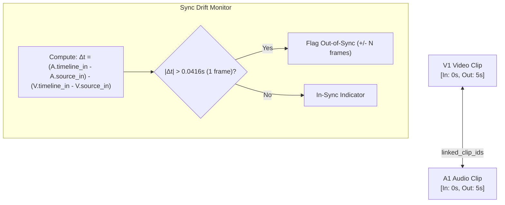

# Audio-Video Synchronization Specification
**Project:** Universal AI Video Production Studio  
**Document Version:** 1.0.0  
**Status:** Approved Master Specification  
**Lead Architect:** Principal Video Editing Systems Architect  
**Verification Date:** 2026-11-21  

---

## 1. Synchronization Architecture

In non-linear video editing, video and audio streams from production footage must remain synchronized, while simultaneously allowing creative split edits (J-cuts, L-cuts) and independent track adjustments.

The **Audio-Video Synchronization Engine** (`departments/08_video_editing/sync_engine.py`) provides:
1. Bidirectional clip linking (`linked_clip_ids`).
2. Real-time sync drift detection.
3. Independent audio/video trimming while tracking offset delta.
4. Programmatic J-cut and L-cut generation.

---

## 2. Sync Drift Detection Formulation

For a linked video clip $V$ and audio clip $A$:
The intended temporal offset established at capture is:
$$\text{Expected Offset} = V.\text{source\_in} - A.\text{source\_in}$$
$$\text{Actual Timeline Offset} = V.\text{timeline\_in} - A.\text{timeline\_in}$$
$$\text{Drift } \delta = \text{Actual Timeline Offset} - \text{Expected Offset}$$

If $|\delta| > \text{RationalTime}(1, \text{frame\_rate})$ (more than 1 frame difference), the engine marks the pair as **out of sync** and reports the exact frame offset (e.g. `+3 frames out of sync`).

---

## 3. Split Edits: J-Cuts and L-Cuts

Split edits decouple the visual cut point from the acoustic cut point to create natural conversational flow in dialogue scenes.

### 3.1 J-Cut Construction
The audio of the incoming scene leads the visual cut:
- Audio begins earlier than video: $A_{\text{incoming}}.\text{timeline\_in} < V_{\text{incoming}}.\text{timeline\_in}$.
- Implementation: `create_j_cut(timeline, video_clip, audio_clip, lead_duration)`:
  - Extends `audio_clip.timeline_in` backward by `lead_duration`.
  - Adjusts `audio_clip.source_in` backward by `lead_duration`.
  - Preceding audio clip on the track is trimmed backward by `lead_duration` to prevent collision.

### 3.2 L-Cut Construction
The video cuts to the incoming scene while the audio from the outgoing scene carries over:
- Audio extends beyond video: $A_{\text{outgoing}}.\text{timeline\_out} > V_{\text{outgoing}}.\text{timeline\_out}$.
- Implementation: `create_l_cut(timeline, video_clip, audio_clip, lag_duration)`:
  - Extends `audio_clip.timeline_out` forward by `lag_duration`.
  - Adjusts `audio_clip.source_out` forward by `lag_duration`.
  - Incoming audio clip on the track is trimmed forward by `lag_duration`.

---

## 4. Sync Locks & Group Operations
- When a track has **Sync Lock** enabled, ripple edits, insertions, and deletions on one track automatically insert corresponding gaps or ripple shifts across all sync-locked tracks.
- This prevents downstream audio from losing sync with downstream video when an edit occurs upstream on `V1`.
