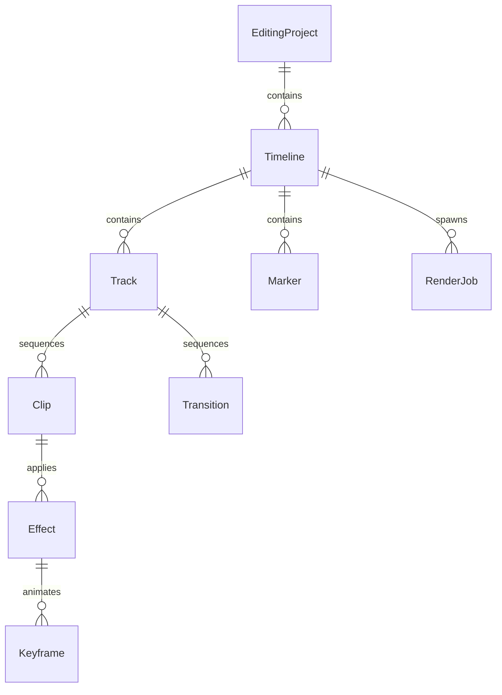

# Canonical Timeline Schema Specification
**Project:** Universal AI Video Production Studio  
**Document Version:** 1.0.0  
**Status:** Approved Master Specification  
**Lead Architect:** Principal Video Editing Systems Architect & NLE Engineer  
**Verification Date:** 2026-11-21  

---

## 1. Architectural Overview

The Canonical Timeline Schema provides a mathematically rigorous, persistent, multi-track timeline data model for non-linear video editing. It is decoupled from any proprietary NLE format while maintaining seamless, lossless bidirectional conversion with **OpenTimelineIO (ASWF)**.



All temporal attributes in this schema are defined strictly via **Rational Time Arithmetic** (`RationalTime(value, rate)`), guaranteeing zero floating-point accumulation drift across long sequences, sub-frame edits, or mixed frame rate conforms.

---

## 2. Core Entity Schemas

### 2.1 EditingProject
The root project container managing editorial sequences, output defaults, and global settings.

```json
{
  "project_id": "prj_e9a1b2c3-4d5e-6f7a-8b9c-0d1e2f3a4b5c",
  "name": "Commercial Master Campaign",
  "base_frame_rate": 24.0,
  "default_resolution": [1920, 1080],
  "color_space": "Rec.709",
  "created_at": "2026-11-21T18:00:00Z",
  "updated_at": "2026-11-21T18:00:00Z"
}
```

### 2.2 Timeline
A continuous multi-track assembly representing a complete sequence, reel, or program cut.

```json
{
  "timeline_id": "tl_01h2x3y4z5a6b7c8d9e0f1g2h3",
  "project_id": "prj_e9a1b2c3-4d5e-6f7a-8b9c-0d1e2f3a4b5c",
  "name": "Main Editorial Sequence",
  "timebase": { "value": 0, "rate": 24.0 },
  "duration": { "value": 720, "rate": 24.0 },
  "resolution": [1920, 1080],
  "sample_rate": 48000,
  "tracks": [],
  "markers": [],
  "created_at": "2026-11-21T18:00:00Z",
  "updated_at": "2026-11-21T18:00:00Z"
}
```

### 2.3 Track
A horizontal lane sequencing clips, gaps, and transitions of a single media kind.

```json
{
  "track_id": "trk_v1_main",
  "timeline_id": "tl_01h2x3y4z5a6b7c8d9e0f1g2h3",
  "name": "V1 - Primary Live Action",
  "kind": "VIDEO",
  "index": 1,
  "is_muted": false,
  "is_solo": false,
  "is_locked": false,
  "clips": [],
  "transitions": []
}
```
- `kind`: `TrackType.VIDEO` or `TrackType.AUDIO`.
- `index`: Track ordering integer (1 is bottom primary track; higher indices layer over lower indices).

### 2.4 Clip
An instantiated segment of source media placed at an exact timeline position.

```json
{
  "clip_id": "clp_shot_01a",
  "track_id": "trk_v1_main",
  "asset_id": "ast_raw_footage_001",
  "name": "Establishing Aerial Shot",
  "timeline_in": { "value": 0, "rate": 24.0 },
  "timeline_out": { "value": 120, "rate": 24.0 },
  "source_in": { "value": 24, "rate": 24.0 },
  "source_out": { "value": 144, "rate": 24.0 },
  "speed_multiplier": 1.0,
  "is_reversed": false,
  "is_muted": false,
  "linked_clip_ids": ["clp_audio_01a"],
  "effects": []
}
```
- `timeline_in`: Start position on the timeline in rational time.
- `timeline_out`: End position on the timeline in rational time.
- `source_in`: Media source start trim point.
- `source_out`: Media source end trim point.
- `duration`: Defined as `timeline_out - timeline_in == (source_out - source_in) / speed_multiplier`.
- `linked_clip_ids`: IDs of associated audio or video clips synchronized with this clip.

### 2.5 Transition
An editorial blend between two adjacent clips on the same track.

```json
{
  "transition_id": "trn_dissolve_01",
  "track_id": "trk_v1_main",
  "from_clip_id": "clp_shot_01a",
  "to_clip_id": "clp_shot_01b",
  "transition_type": "CROSS_DISSOLVE",
  "alignment": "CENTER",
  "duration": { "value": 24, "rate": 24.0 },
  "parameters": {
    "curve": "linear"
  }
}
```

### 2.6 Effect & Keyframe
Spatial, colorimetric, optical, or acoustic transformations applied to a clip, animated over time.

```json
{
  "effect_id": "eff_scale_zoom",
  "clip_id": "clp_shot_01a",
  "effect_type": "SCALE",
  "is_enabled": true,
  "parameters": { "uniform": true },
  "keyframes": [
    {
      "keyframe_id": "kfr_01",
      "offset_time": { "value": 0, "rate": 24.0 },
      "parameter_name": "scale",
      "value": 1.0,
      "interpolation": "LINEAR"
    },
    {
      "keyframe_id": "kfr_02",
      "offset_time": { "value": 120, "rate": 24.0 },
      "parameter_name": "scale",
      "value": 1.15,
      "interpolation": "EASE_IN_OUT"
    }
  ]
}
```

### 2.7 Marker
A point or duration annotation pinned to an exact rational timepoint.

```json
{
  "marker_id": "mrk_beat_01",
  "timeline_id": "tl_01h2x3y4z5a6b7c8d9e0f1g2h3",
  "name": "Bass Drop",
  "time": { "value": 72, "rate": 24.0 },
  "duration": { "value": 0, "rate": 24.0 },
  "color": "cyan",
  "comment": "Cut to product hero shot on this beat"
}
```

### 2.8 RenderJob
Execution ticket for rendering a timeline to an output format.

```json
{
  "render_job_id": "rnd_9f8e7d6c",
  "timeline_id": "tl_01h2x3y4z5a6b7c8d9e0f1g2h3",
  "preset_name": "H264_MASTER",
  "status": "COMPLETED",
  "progress_percentage": 100.0,
  "output_path": "/Users/badal11/Desktop/Video House /temp/renders/final_master.mp4",
  "error_message": null,
  "created_at": "2026-11-21T18:05:00Z",
  "completed_at": "2026-11-21T18:05:15Z"
}
```

---

## 3. SQLite Relational Persistence

The schema maps directly to 9 ACID-compliant relational tables in `core/assets/database.py`:
- `editing_projects`: Project root metadata.
- `timelines`: Sequence container definitions.
- `tracks`: Tracks linked via `timeline_id` foreign key with cascade deletion.
- `clips`: Clips linked via `track_id` foreign key with temporal indexes.
- `transitions`: Transitions between adjacent clips on a track.
- `effects`: Effects attached to clips with cascade deletion.
- `keyframes`: Animated parameter curves attached to effects.
- `timeline_markers`: Annotation markers on timelines.
- `render_jobs`: Render execution logs and progress metrics.
