# CI/CD Pipeline & Automated Release Architecture
**Project:** Universal AI Video Production Studio  
**Document Version:** 1.0.0  
**Status:** Approved Automation Specification  

---

## 1. Automated Pipeline Architecture

The Continuous Integration & Continuous Delivery (CI/CD) system automates static analysis, security vulnerability scanning, unit testing, cross-department integration verification, container image generation, and release packaging.

```mermaid
flowchart LR
    Push["Git Push / PR"] --> Lint["Stage 1: Lint & Format (Ruff / Black)"]
    Lint --> TypeCheck["Stage 2: Type Check (Mypy)"]
    TypeCheck --> SecurityScan["Stage 3: Security & License Scan (Bandit / pip-audit)"]
    SecurityScan --> UnitTests["Stage 4: Unit Test Suite (249 tests)"]
    UnitTests --> IntegrationTests["Stage 5: Integration & E2E Pipeline Tests"]
    IntegrationTests --> Build["Stage 6: Docker Multi-Stage Build"]
    Build --> Release["Stage 7: Release Tagging & Manifest Packaging"]
```

---

## 2. Pipeline Stages & Quality Gates

### Stage 1: Static Formatting & Linting
- **Tooling:** `ruff check .`, `black --check .`
- **Execution Time:** ~2.5 seconds
- **Pass Criteria:** Zero syntax errors, zero unused imports, zero formatting deviations.

### Stage 2: Static Type Checking
- **Tooling:** `mypy core departments`
- **Execution Time:** ~6.0 seconds
- **Pass Criteria:** Strict type compliance across core interfaces and data models.

### Stage 3: Security & Dependency Vulnerability Scanning
- **Tooling:** `bandit -r core departments -ll`, `pip-audit --desc`
- **License Hygiene:** Validates `LICENSE_REGISTRY.csv` to ensure 0% non-compliant AGPL-3.0 or unlicensed packages.
- **Pass Criteria:** Zero High or Critical security advisories.

### Stage 4: Comprehensive Unit Test Suite
- **Tooling:** `python3 -m unittest discover tests/unit/ -p "test_*.py"`
- **Scope:** 249 tests covering all 15 parts.
- **Pass Criteria:** 100% pass rate in <15 seconds; zero regressions.

### Stage 5: End-to-End Cross-Department Integration
- **Tooling:** `python3 -m unittest discover tests/integration/ -p "test_*.py"`
- **Scope:** Full project lifecycle, media format matrix, job recovery, and security boundary tests.
- **Pass Criteria:** 100% pass rate; verified file outputs with valid SHA-256 checksums.

### Stage 6: Multi-Stage Container Validation
- **Tooling:** `docker build --target production -t video-house:latest .`
- **Pass Criteria:** Container builds cleanly; image size <500 MB; non-root user execution verified.

---

## 3. Environment Progression & Promotion Rules

| Environment | Trigger | Deployment Strategy | Rollback Mechanism |
| :--- | :--- | :--- | :--- |
| **Development** | Feature branch push | Local execution / Dev Container | Local git reset |
| **Testing / CI** | Pull Request to `main` | Ephemeral GitHub Actions runner | Automated job abort |
| **Staging** | Merge to `main` branch | Blue/Green container deployment | Immediate traffic switch to Blue |
| **Production** | Semantic release tag (`vX.Y.Z`) | Canary rolling update (10% -> 50% -> 100%) | Instant container rollback on alert |
