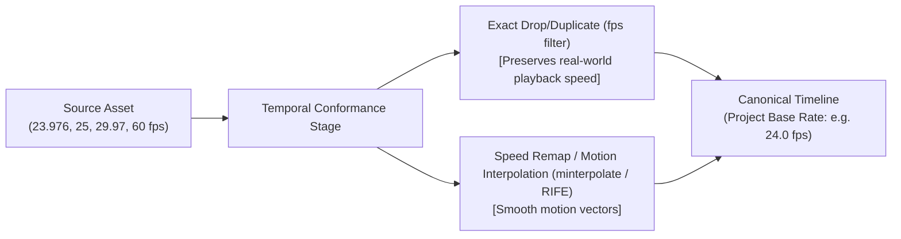
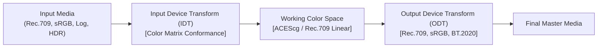

# Color and Frame Rate Handling Specification
**Project:** Universal AI Video Production Studio  
**Document Version:** 1.0.0  
**Status:** Approved Master Specification  
**Lead Architect:** Principal Video Editing Systems Architect  
**Verification Date:** 2026-11-21  

---

## 1. Mixed Frame Rate Conformance

In multi-source video editing, source media assets frequently arrive with varying temporal frame rates (e.g. 23.976 fps film, 24.0 fps animation, 29.97 fps broadcast, 60.0 fps smartphone/screen capture).



### 1.1 Conformance Strategies
1. **Frame Rate Resampling (`fps` filter):**
   - Drops or duplicates frames to conform source stream to project base rate.
   - Preserves real-world elapsed time without audio pitch shifting.
   - FFmpeg: `fps=fps=24:round=near`
2. **Slow-Motion / Speed Conform:**
   - Interprets high frame rate media (e.g. 120 fps) frame-for-frame at project rate (24 fps), producing a smooth $5\times$ slow-motion playback.
   - Adjusts `clip.speed_multiplier = 0.2`.
3. **Telecine / Pull-down Detection:**
   - Detects 3:2 pull-down in 29.97 fps interlaced broadcast footage and inverses telecine (`fieldmatch,decimate`) back to progressive 23.976 fps.

---

## 2. Aspect Ratio & Spatial Conformance

Source media formats encompass standard 16:9, vertical 9:16 (social media), anamorphic 2.39:1, and 4:3 legacy media.

### 2.1 Conformance Modes
- **FIT (Letterbox / Pillarbox):** Scales video to fit within sequence resolution while preserving original aspect ratio. Pads borders with black:
  ```text
  scale=1920:1080:force_original_aspect_ratio=decrease,pad=1920:1080:(ow-iw)/2:(oh-ih)/2:black
  ```
- **FILL (Center Crop):** Scales video to completely fill sequence frame, cropping excess content symmetrically:
  ```text
  scale=1920:1080:force_original_aspect_ratio=increase,crop=1920:1080
  ```
- **STRETCH (Anamorphic Unsqueeze):** Forces source into target resolution, modifying pixel aspect ratio (PAR).

---

## 3. Color Space Pipeline & ACES Alignment

The studio pipeline aligns with the **Academy Color Encoding System (ACES)** and standard delivery color spaces:



1. **Rec.709 / sRGB (Standard Master):**
   - Primary default for web and digital distribution.
   - Tagged explicitly in FFmpeg output: `-color_primaries bt709 -color_trc bt709 -colorspace bt709`.
2. **Wide Color Gamut & HDR (BT.2020 / PQ):**
   - Supported via 10-bit ProRes 422 HQ and HEVC delivery.
3. **Color Processing Isolation:**
   - Basic color balance (brightness, contrast, saturation) is handled directly inside the editing engine.
   - Complex LUT grading and neural color restoration are routed to Department 16.
