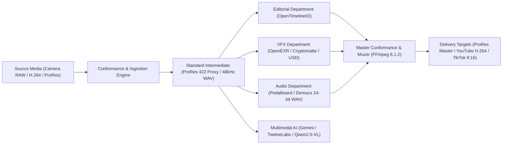

# Production Compatibility & Interchange Matrix
**Project:** Universal AI Video Production Studio  
**Document Version:** 1.0.0  
**Status:** Active Specification  
**Last Verified:** 2026-11-21  

---

## 1. Architectural Scope

Professional video production requires seamless handoffs between specialized systems: editorial NLEs, 3D DCC tools, node compositors, audio DAWs, and AI inference engines. This document specifies the supported container formats, codecs, scene graph schemas, color encodings, and runtime execution targets across the studio.

---

## 2. Media Codec & Container Support

| Format / Codec | Extension | Support Level | Hardware Acceleration | Studio Role |
| :--- | :--- | :---: | :---: | :--- |
| **Apple ProRes 422 HQ** | `.mov` | **Tier 1 (Master Intermediate)** | VideoToolbox (M4) / Software | Broadcast master delivery, zero-generation loss intermediate. |
| **Apple ProRes 4444 / XQ** | `.mov` | **Tier 1 (VFX Intermediate)** | VideoToolbox / Software | Alpha-channel video overlays, high dynamic range plates. |
| **Apple ProRes Proxy** | `.mov` | **Tier 1 (Editing Proxy)** | VideoToolbox (`-c:v prores_ks -profile:v 0`) | Ultra-fast local editing proxy on Apple M4. |
| **H.264 / AVC (High Profile)** | `.mp4`, `.mov` | **Tier 1 (Universal Web/Preview)** | VideoToolbox / NVENC | General streaming preview, web delivery, social export. |
| **H.265 / HEVC** | `.mp4`, `.mov` | **Tier 1 (High Efficiency Web)** | VideoToolbox / NVENC | 4K delivery with 40% bitrate reduction over H.264. |
| **AV1 (AOMedia Video 1)** | `.mp4`, `.webm` | **Tier 2 (Distribution)** | SVT-AV1 / Hardware decode | Modern next-gen distribution codec. |
| **Avid DNxHR (HQX / SQ)** | `.mxf`, `.mov` | **Tier 2 (Post Interchange)** | FFmpeg native decoder | Broadcast and Avid Media Composer interchange. |
| **OpenEXR (16-bit Half Float)** | `.exr` | **Tier 1 (VFX Multi-pass)** | Memory-mapped I/O | Multi-channel render passes (Beauty, Depth, Cryptomatte, Normal). |
| **Broadcast WAV (BWF)** | `.wav` | **Tier 1 (Audio Master)** | Native uncompressed PCM | 24-bit / 48.0 kHz broadcast audio standard. |
| **FLAC (Free Lossless Audio)** | `.flac` | **Tier 1 (Audio Storage)** | Native FFmpeg | Lossless compressed archival audio. |

---

## 3. Editorial & Scene Graph Interchange

| Standard | Schema / Spec | Compatibility Target | Native Adapter | Department Flow |
| :--- | :--- | :--- | :---: | :--- |
| **OpenTimelineIO** | JSON Schema (`.otio`) | DaVinci Resolve, Adobe Premiere, FCP | **YES** (`opentimelineio`) | Core editorial timeline across all departments. |
| **Final Cut Pro XML** | DTD (`.fcpxml`) | Apple Final Cut Pro, DaVinci Resolve | **YES** (`otio.adapters.fcpxml`) | Import/export of commercial NLE cuts. |
| **Premiere Pro XML** | Adobe XML (`.xml`) | Adobe Premiere Pro | **YES** (`otio.adapters.premiere_xml`) | Timeline handoff to Adobe editors. |
| **CMX 3600 EDL** | ASCII (`.edl`) | Legacy broadcast systems | **YES** (`otio.adapters.cmx_3600`) | Offline cut interchange. |
| **Universal Scene Description** | OpenUSD (`.usd`, `.usda`, `.usdc`) | Blender, Houdini, Maya, Unreal Engine | **YES** (`pxr.Usd`) | 3D character rigs, sets, cameras, and lighting. |
| **glTF 2.0 / GLB** | Khronos Group (`.gltf`, `.glb`) | Web 3D, Three.js, Babylon.js | **YES** (`trimesh`, `bpy`) | Lightweight web 3D asset interchange. |
| **Lottie JSON** | Airbnb / Skia (`.json`) | Web, iOS, Android, Motion Canvas | **YES** (`lottie-web`, Skia) | Vector animations, UI motions, lower-thirds. |

---

## 4. Color Management & Spaces (OCIO & ACES)

The studio implements **OpenColorIO (OCIO) v2** standard color pipeline:
- **Reference Color Space:** ACEScg (AP1 color primaries, linear gamma) for all 3D rendering, visual effects, and generative compositing.
- **Input Color Space Transforms:**
  - Standard Rec.709 / sRGB (Gamma 2.4) -> ACEScg.
  - Apple Log / Sony S-Log3 / Panasonic V-Log -> ACEScg.
- **Display Output Color Transforms:**
  - Rec.709 (BT.1886) for standard SDR Web and TV broadcast.
  - Rec.2020 (PQ / HLG) for HDR delivery.
  - Display P3 for Apple macOS / iOS display optimization.

---

## 5. Runtime OS & Hardware Support Matrix

| OS Platform | Architecture | Local Feasibility | Acceleration Backend | Deployment Target |
| :--- | :---: | :---: | :--- | :--- |
| **macOS 27.x (Darwin arm64)** | Apple Silicon (M1/M2/M3/M4) | **YES (Primary Local Dev)** | Metal Performance Shaders (MPS), Apple Accelerate, VideoToolbox | Editorial workstation, proxy render, orchestration. |
| **Linux (Ubuntu 22.04 / 24.04)** | x86_64 | **YES (Primary Remote GPU)** | NVIDIA CUDA 12.x, TensorRT, NVENC, NVDEC, EGL | Heavy AI inference (Wan2.1, Qwen2.5-VL-72B, SAM 2.1, Cycles). |
| **Linux (Debian / Arch)** | arm64 | **YES (Edge Deployments)** | CPU / OpenCL / Rockchip NPU | Remote edge ingestion and headless transcoding. |
| **Microsoft Windows 11** | x86_64 | **YES (Secondary)** | DirectML, CUDA, Media Foundation | Client GUI workstation. |

---

## 6. Language & Runtime Compatibility

| Language Runtime | Target Version | Host Status | Supported Libraries |
| :--- | :---: | :---: | :--- |
| **Python** | `3.11.x`, `3.12.x`, `3.13.x` | Verified `3.13.7` | `pydantic >= 2.10`, `opencv-python`, `opentimelineio`, `fastapi`, `faster-whisper`. |
| **Node.js** | `20.x`, `22.x`, `24.x` (LTS) | Verified `v24.11.0` | `motion-canvas`, `@ffmpeg/ffmpeg`, `vite`, `typescript`. |
| **C / C++ Compiler** | Clang 16+ / GCC 12+ | Verified Apple Clang 21.0.0 | Native bindings, SIMD vectorization. |
