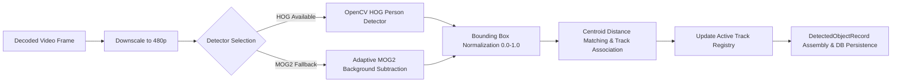

# Computer Vision, Object Tracking & OCR Pipeline

**Document Version:** 1.0.0  
**Status:** Approved & Implemented  
**Engine:** `departments/04_media_intelligence/computer_vision.py` & `departments/04_media_intelligence/ocr_service.py`  

---

## 1. Computer Vision & Object Tracking Pipeline

The **Computer Vision Service** tracks salient visual elements (people, moving foreground objects, faces) across video frames, maintaining persistent `track_id` assignments throughout the asset duration.

### Detection Strategy & Build Portability
1. **Primary: OpenCV HOG Person Detector**:
   - Uses `cv2.HOGDescriptor.getDefaultPeopleDetector()` when available in the OpenCV runtime.
2. **Fallback: MOG2 Motion Saliency & Contour Analysis**:
   - In environments where OpenCV 5.0 lacks legacy `objdetect` headers, the system seamlessly activates `cv2.createBackgroundSubtractorMOG2(history=60, varThreshold=25)`.
   - Morphological opening (`cv2.MORPH_OPEN`) eliminates sensor noise.
   - External contours exceeding $0.5\%$ of frame area are extracted with normalized bounding boxes $(x, y, w, h) \in [0.0, 1.0]$.

### Centroid & IoU Persistent Tracking
- For each frame, detected bounding boxes compute normalized centroid coordinates:
  $$c_x = x + \frac{w}{2}, \quad c_y = y + \frac{h}{2}$$
- Centroids are matched against active tracks using Euclidean distance:
  $$d(c_t, c_{prev}) = \sqrt{(c_x - c_{x,prev})^2 + (c_y - c_{y,prev})^2}$$
- Distance threshold $d_{max} = 0.25$ prevents identity hopping.
- Unmatched detections spawn a new monotonic `track_id`.

---

## 2. On-Screen OCR & Text Detection Pipeline

The **OCR Service** detects and categorizes text overlays (titles, subtitles, lower thirds, credits, brand logos) across video frames without heavy external OCR binaries.

### Morphological Gradient Text Saliency
1. Frames are converted to grayscale and high-frequency edges are highlighted via the Sobel vertical gradient operator:
   $$G_x = \text{Sobel}(I, ddepth=\text{CV\_8U}, dx=1, dy=0, ksize=3)$$
2. Morphological closing with a wide rectangular structuring element ($15 \times 3$ kernel) merges individual letter strokes into coherent horizontal text line bounding boxes.
3. Candidate boxes are filtered by aspect ratio ($w / h \ge 1.5$) and minimum area.

### Spatial Semantic Categorization:
- **`TITLE`**: Center-weighted box located in upper or central vertical third ($0.15 \le y \le 0.50$).
- **`LOWER_THIRD`**: Positioned in the lower left or lower right quadrant ($y \ge 0.65, x \le 0.40$ or $x \ge 0.60$).
- **`SUBTITLE`**: Centered horizontally in the bottom quadrant ($y \ge 0.75, 0.20 \le x \le 0.80$).
- **`GENERAL`**: All other on-screen text observations.

---

## 3. Database Persistence

Detections are written to the Central Asset Registry:
- `detected_objects`: Tracks bounding box coordinates, track ID, frame number, timestamp, and confidence.
- `ocr_observations`: Tracks bounding box, detected text string, spatial category (`TITLE`, `SUBTITLE`, `LOWER_THIRD`), timestamp, and frame index.
