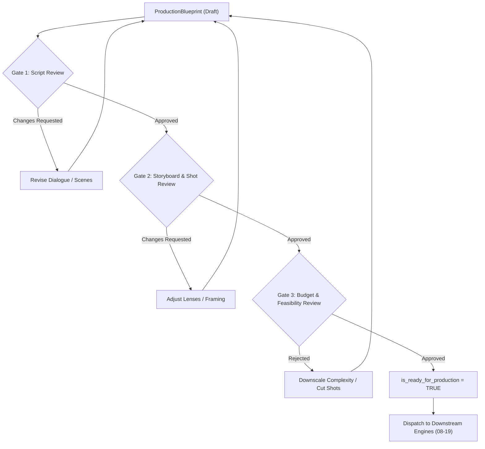

# Creative Approval Workflow & Production Gatekeeper Specification
**Project:** Universal AI Video Production Studio  
**Document Version:** 1.0.0  
**Department:** 07 Production Planning  
**Last Verified:** 2026-11-21  

---

## 1. The Human-in-the-Loop Production Gatekeeper

The studio enforces a strict safety principle: **no expensive generative AI rendering, 3D simulation, or voice dubbing executes until a human director has reviewed and approved the production plan.**



---

## 2. Approval Entity Types & Status Lifecycle

### 2.1 Approval Status Enum
- `DRAFT`: Initial draft compiled by planning services.
- `PENDING_REVIEW`: Awaiting human director inspection.
- `APPROVED`: Explicitly approved with reviewer notes.
- `REVISION_REQUESTED`: Sent back with comments for regeneration.
- `REJECTED`: Disapproved; project halted until restructured.

### 2.2 Approval Data Structure (`CreativeApproval`)
```python
@dataclass
class CreativeApproval:
    approval_id: UUID
    project_id: UUID
    entity_type: PlanningEntityType  # SCRIPT, STORYBOARD, EDITING_BLUEPRINT, etc.
    entity_id: UUID
    version: int
    status: ApprovalStatus = ApprovalStatus.PENDING_REVIEW
    reviewer_notes: str = ""
    approved_by: Optional[str] = None
    approved_at: Optional[str] = None
```

---

## 3. Production Readiness Evaluation

A `ProductionBlueprint` is evaluated for production readiness by `ProductionBlueprintManager.compile_blueprint`:
- Must have at least one approved master planning entity (`SCRIPT`, `EDITING_BLUEPRINT`, or `PRODUCTION_BLUEPRINT`).
- Must **NOT** contain any unaddressed rejections or outstanding revision requests (`REJECTED` or `REVISION_REQUESTED`).
- Only when all conditions are satisfied is `is_ready_for_production` set to `True`, unlocking downstream API calls and Temporal job dispatching.
