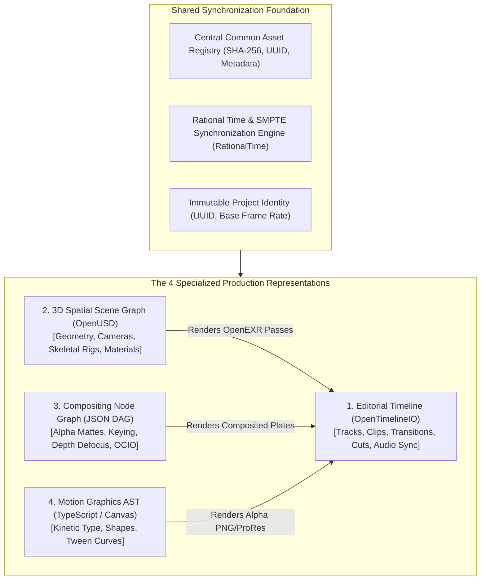

# Data, Timeline & Scene Graph Architecture
**Project:** Universal AI Video Production Studio  
**Document Version:** 1.0.0  
**Status:** Approved Master Specification  
**Lead Architect:** Principal Pipeline & Timeline Architect  
**Verification Date:** 2026-11-21  

---

## 1. The Multi-Representation Architecture

A fundamental failure mode in video software design is attempting to force every aspect of production into a single timeline. An editorial sequence is intrinsically **1-dimensional (temporal tracks)**. A 3D world is **3-dimensional (spatial hierarchies and skeletal transforms)**. A visual effects composite is **node-based (directed acyclic pixel dependency graphs)**. A motion graphic is **code-based (vector scene ASTs and declarative keyframes)**.

The Universal AI Video Production Studio implements a **Quad-Representation Data Architecture**:



---

## 2. Representation 1: Editorial Timeline (OpenTimelineIO)

The editorial timeline is governed exclusively by **OpenTimelineIO (ASWF)**. 

### Core Timeline Hierarchy
- `Timeline`: Top-level container representing a complete sequence or reel. Holds global name and global start timecode.
- `Stack`: A collection of parallel horizontal tracks.
- `Track`: A temporal sequence of media items. Classified strictly by `TrackKind.Video` or `TrackKind.Audio`.
- `Clip`: A reference to external media with `source_range` (in-point, duration in rational time) and `target_range`.
- `Gap`: A temporal empty duration on a track where underlying tracks show through.
- `Transition`: Mathematical blend between adjacent clips (e.g. `SMPTE_Dissolve`).
- `Marker`: Metadata pinned to an exact rational timepoint (e.g. director notes, beat triggers, dialogue lines).

### Rational Time Arithmetic
Floating-point timestamps (e.g. `12.34567 seconds`) accumulate fatal rounding errors in multi-track video editing. OTIO strictly uses rational time arithmetic:

$$\text{RationalTime}(\text{value}, \text{rate})$$

For example, frame 100 at 24 fps is represented exactly as `RationalTime(100, 24)`. 23.976 fps is represented exactly as `RationalTime(1000, 24000/1001)`.

---

## 3. Representation 2: 3D Scene Graph (OpenUSD)

All 3D character assets, cameras, environments, and lighting rigs are authored and stored using **OpenUSD (`.usd`, `.usda`, `.usdc`)**.

### USD Layering Hierarchy
1. `asset.usd`: Base geometric meshes, UV mappings, and MaterialX shaders (e.g. character model, vehicle prop).
2. `rig.usd`: Skeletal bone hierarchy, skinning weights, and deformation blendshapes.
3. `animation.usd`: Time-sampled skeletal rotation quaternions and translation vectors over frames.
4. `shot.usd`: Composition layer assembling the set, character animation, camera trajectory, and lighting for a specific scene.

Editorial linking: When a 3D shot is rendered to multi-pass OpenEXR frames, the resulting image sequence is registered in the Asset Registry and inserted into the OTIO timeline as a standard clip referencing the exact rendered frame range.

---

## 4. Representation 3: VFX & Compositing Node Graph

For visual effects and multi-layer composites (Department 13), scenes are represented as directed acyclic dependency graphs (DAGs) serialized in JSON:

```json
{
  "node_graph_id": "vfx_a1b2c3d4",
  "resolution": [3840, 2160],
  "color_space": "ACEScg",
  "nodes": [
    {
      "id": "node_read_bg",
      "type": "ReadMedia",
      "params": { "asset_id": "ast_plate_01" }
    },
    {
      "id": "node_sam2_matte",
      "type": "NeuralSegmentationMask",
      "params": { "asset_id": "ast_mask_actor", "channel": "alpha" }
    },
    {
      "id": "node_color_correct",
      "type": "CDLTransform",
      "params": { "slope": [1.1, 1.0, 0.95], "offset": [0.0, 0.0, 0.02] }
    },
    {
      "id": "node_over",
      "type": "MergeOver",
      "inputs": { "background": "node_read_bg", "foreground": "node_color_correct", "matte": "node_sam2_matte" }
    },
    {
      "id": "node_output",
      "type": "WriteMedia",
      "inputs": { "source": "node_over" },
      "params": { "codec": "prores_4444", "output_dir": "output/vfx/" }
    }
  ]
}
```

---

## 5. Representation 4: Motion Graphics AST

Programmatic titles, typography, and vector animations (Department 09) are authored using **Motion Canvas** declarative TypeScript syntax:

```typescript
import { makeScene2D, Txt, all } from '@motion-canvas/2d';
import { createRef } from '@motion-canvas/core';

export default makeScene2D(function* (view) {
  const title = createRef<Txt>();
  
  view.add(
    <Txt
      ref={title}
      text="CYBERPUNK REVELATION"
      fontFamily="Inter"
      fontWeight={800}
      fontSize={96}
      fill="#00F0FF"
      opacity={0}
      y={50}
    />
  );

  yield* all(
    title().opacity(1, 0.6),
    title().y(0, 0.6)
  );
});
```

---

## 6. The Central Common Asset Registry Schema

The single source of truth for all project binaries and data assets:

```json
{
  "asset_id": "ast_12345678-abcd-ef01-2345-6789abcdef01",
  "project_id": "proj_a1b2c3d4-e5f6-7890-abcd-1234567890ab",
  "name": "hero_actor_dialogue_take03.wav",
  "asset_type": "audio_isolated_stem",
  "mime_type": "audio/x-wav",
  "uri": "assets/audio/hero_actor_dialogue_take03.wav",
  "proxy_uri": null,
  "checksum_sha256": "e3b0c44298fc1c149afbf4c8996fb92427ae41e4649b934ca495991b7852b855",
  "byte_size": 4829104,
  "timecode": {
    "start_timecode": "01:00:00:00",
    "duration_frames": 240,
    "sample_rate": 48000,
    "fps": 24.0
  },
  "lineage": {
    "parent_asset_ids": ["ast_source_camera_card01_clip04.mov"],
    "generating_department": "14_audio_production",
    "generating_tool": "demucs_v4"
  },
  "metadata": {
    "speaker_id": "SPEAKER_01",
    "stem_category": "vocals",
    "loudness_integrated_lufs": -18.2
  },
  "created_at": "2026-11-21T16:32:00Z"
}
```
