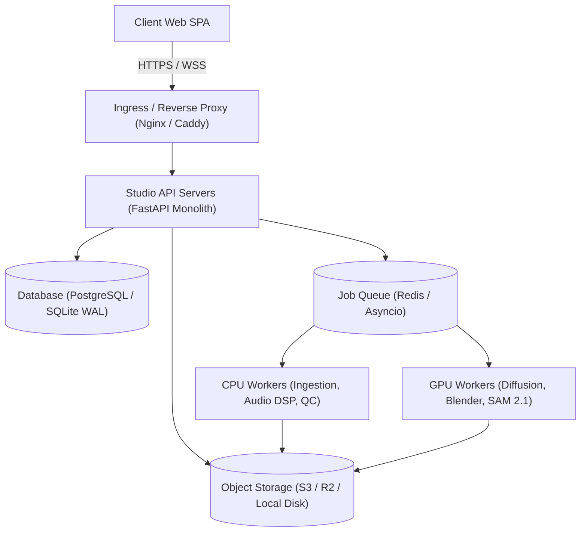

# Deployment Architecture & Production Topologies
**Project:** Universal AI Video Production Studio  
**Document Version:** 1.0.0  
**Status:** Approved Production Deployment Specification  

---

## 1. Deployment Topologies

The studio supports two distinct production deployment targets:

### Topology A: Local Workstation & Edge Studio (Default Baseline)
Designed for local creative engineers and editors running on macOS (Apple Silicon M-series) or Linux workstations.
- Single container / virtualenv process hosting FastAPI + Ingestion Queue + SQLite WAL database.
- Direct access to local filesystem (`assets/`, `projects/`, `temp/`).
- Native hardware acceleration via Apple VideoToolbox ASIC encoders.
- Zero network egress costs for high-bandwidth raw 4K video files.

### Topology B: Distributed Cloud Studio (Enterprise Multi-Tenant)
Designed for distributed teams, multi-node cloud clusters, and automated video generation farms.
- **Frontend / Ingress:** Cloudflare CDN / AWS CloudFront caching static SPA assets (`/ui/*`).
- **API Gateway:** FastAPI container cluster deployed on AWS ECS / Google Cloud Run / Kubernetes.
- **Database:** Managed PostgreSQL 16 with Read Replicas.
- **Queue & Event Bus:** Redis 7 / Valkey cluster with BullMQ / Celery worker pools.
- **Worker Pools:**
  - Standard Workers (arm64 / c7g): CPU audio mastering, proxy generation, QC inspection, and OTIO timeline assembly.
  - GPU Workers (g5 / g6 instances with NVIDIA L4/A10G): High-VRAM video diffusion (Wan2.1), SAM 2.1 video tracking, and Blender Cycles rendering.
- **Object Storage:** AWS S3 / Cloudflare R2 with multipart streaming upload and presigned URLs.

---

## 2. Docker Containerization Standards

The production image uses a multi-stage Docker build based on `python:3.11-slim-bookworm` or `python:3.12-slim-bookworm`:
- Non-root user (`appuser`, UID 10001).
- System dependencies include FFmpeg, libsndfile1, and OpenTimelineIO shared libraries.
- Minimal final image size (<450 MB).
- Read-only root filesystem with explicit `/tmp` and `/app/assets` volume mounts.

---

## 3. High Availability, Zero-Downtime & Graceful Shutdown

1. **Lifespan Context & SIGTERM Handling:**
   Upon receiving `SIGTERM` or `SIGINT`:
   - FastAPI stops accepting new incoming HTTP connections (returns 503 during draining).
   - In-flight HTTP requests have a 30-second grace period to complete.
   - Background worker processes finish their active segment transcode or checkpoint their progress to the database before exiting.
   - Database connections are closed cleanly, and WAL files are flushed.
2. **Readiness & Liveness Probes:**
   - **Liveness Probe (`/api/v1/system/telemetry`):** Returns 200 OK if event loop is unblocked and memory is within thresholds.
   - **Readiness Probe (`/api/v1/projects`):** Returns 200 OK only after SQLite WAL database connection is established and storage volumes are writable.

