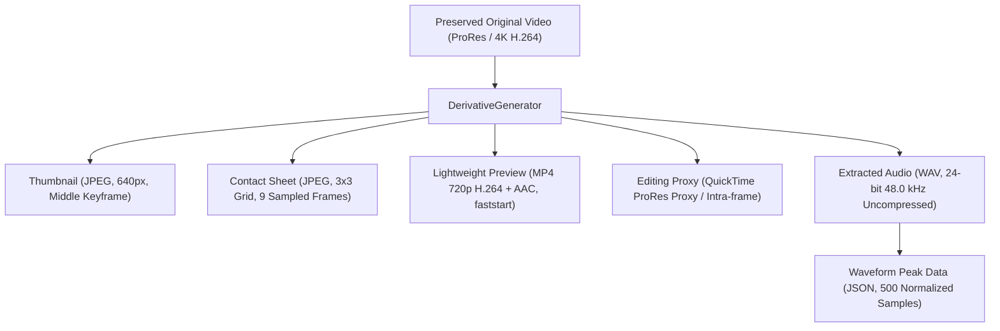

# Derivative Generation Specification
**Project:** Universal AI Video Production Studio  
**Phase:** Part 02 Specification  
**Version:** 1.0.0  
**Verification Date:** 2026-11-21  

---

## 1. Derivative Philosophy

Derivatives are disposable, reproducible proxy assets generated from preserved originals. They serve three critical functions:
1. **Low-Latency UI Playback:** Providing lightweight 720p H.264 streams and WebP thumbnails for web browsing and scrubber scrubbing without taxing CPU/network bandwidth.
2. **Timeline Editing Acceleration:** Generating intra-frame ProRes Proxies to enable real-time multi-track scrubbing and cutting in OpenTimelineIO.
3. **Specialized Downstream Intelligence:** Extracting pure 24-bit 48kHz WAV audio files and waveform peak vectors for speech recognition (`WhisperX`), vocal stem separation (`Demucs`), and UI audio visualizers.

**Golden Rules:**
- **Never overwrite original footage.**
- **Never treat a derivative as the original master.**
- **Record the exact encoding parameters used to generate each derivative.**



---

## 2. Specification of Video Derivatives

### 2.1 Thumbnail (`THUMBNAIL`)
- **Format:** JPEG (`image/jpeg`)
- **Dimensions:** Max 640px width (preserving native aspect ratio).
- **Sampling Position:** Calculated dynamically at 10% of total duration (or 0.1s for short clips) to avoid black opening slate frames.
- **FFmpeg Invocation:**
  ```bash
  ffmpeg -y -ss <seek_sec> -i <source> -vframes 1 -vf "scale=640:-1" -q:v 2 <dest>
  ```

### 2.2 Contact Sheet (`CONTACT_SHEET`)
- **Format:** JPEG (`image/jpeg`)
- **Dimensions:** 3x3 grid (9 frames), each tile scaled to 320x180 px.
- **Sampling Logic:** Divides total frame count by 9 to provide an immediate overview of scene lighting and pacing.
- **FFmpeg Invocation:**
  ```bash
  ffmpeg -y -i <source> -vf "select='not(mod(n\,<interval>))',scale=320:180,tile=3x3" -frames:v 1 -q:v 3 <dest>
  ```

### 2.3 Lightweight Streaming Preview (`LIGHTWEIGHT_PREVIEW`)
- **Format:** MP4 (`video/mp4`)
- **Video Codec:** H.264 (`h264_videotoolbox` on Apple Silicon; `libx264` fallback).
- **Audio Codec:** AAC-LC (128 kbps).
- **Resolution:** 720p vertical (`scale=-2:720`).
- **Flags:** `-movflags +faststart` (places moov atom at beginning of MP4 for instant browser buffering).

### 2.4 Extracted Audio Track (`EXTRACTED_AUDIO`)
- **Format:** Broadcast WAV (`audio/wav`)
- **Channels:** Matches source channels (Mono or Stereo).
- **Sample Rate:** Standardized to 48,000 Hz.
- **Bit Depth:** 24-bit PCM (`pcm_s24le`).
- **FFmpeg Invocation:**
  ```bash
  ffmpeg -y -i <source> -vn -acodec pcm_s24le -ar 48000 <dest>
  ```

### 2.5 Editing Proxy (`PROXY_VIDEO`)
- **Format:** QuickTime MOV (`video/quicktime`)
- **Video Codec:** Apple ProRes 422 Proxy (`prores_ks`, profile 0).
- **Resolution:** 720p vertical (`scale=-2:720`).
- **Audio Codec:** 16-bit PCM (`pcm_s16le`).
- **Purpose:** Frame-accurate, low-CPU decoding during multi-track NLE playback.

---

## 3. Specification of Audio Derivatives

### 3.1 Normalized Audio Preview (`AUDIO_PREVIEW`)
- **Format:** MP4 Audio (`audio/mp4` / `.m4a`)
- **Codec:** AAC (128 kbps)
- **Loudness Normalization:** Conformed to `-14.0 LUFS` using the EBU R128 `loudnorm` filter:
  ```bash
  ffmpeg -y -i <source> -filter_complex "loudnorm=I=-14:TP=-1.5:LRA=11" -c:a aac -b:a 128k <dest>
  ```

### 3.2 Waveform Peak Array (`AUDIO_WAVEFORM`)
- **Format:** JSON (`application/json`)
- **Payload:** 500 normalized floating-point values between `0.0` and `1.0`.
- **Extraction:** Generated via downsampled 8kHz mono PCM peak scanning. Loaded by frontend waveform visualizers in <5ms.

---

## 4. Specification of Image Derivatives

### 4.1 Image Thumbnail (`IMAGE_THUMBNAIL`)
- **Format:** WebP (`image/webp`)
- **Dimensions:** 320x320 px max bounding box.
- **Compression:** Quality 85, Lanczos resampling.

### 4.2 Web Preview (`IMAGE_PREVIEW`)
- **Format:** WebP (`image/webp`)
- **Dimensions:** 1920x1920 px max bounding box (scaled down only if original exceeds 1080p/2K).
- **Compression:** Quality 90. Preserves aspect ratio.
