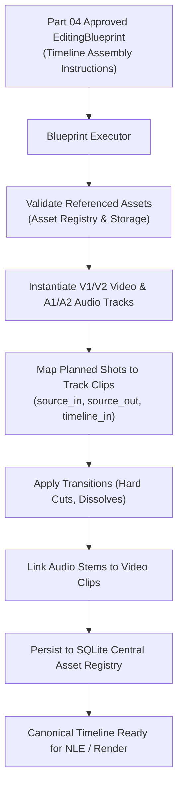

# Editing Blueprint Execution Specification
**Project:** Universal AI Video Production Studio  
**Document Version:** 1.0.0  
**Status:** Approved Master Specification  
**Lead Architect:** Principal Video Editing Systems Architect  
**Verification Date:** 2026-11-21  

---

## 1. Execution Objective & Flow

The **Editing Blueprint Executor** (`departments/08_video_editing/blueprint_executor.py`) bridges Part 04's creative planning engine with Part 05's physical non-linear editing engine.

It accepts an approved `EditingBlueprint` generated by Department 07 (`production_planning`), verifies source media assets, maps shots to canonical timeline tracks, configures transitions, and initializes the multi-track sequence ready for review and rendering.

---

## 2. Ingestion & Mapping Logic

### 2.1 Project & Timeline Initialization
- Creates an `EditingProject` matching the blueprint's `project_id`.
- Creates a `Timeline` with the blueprint's specified resolution (`1920x1080` standard) and frame rate (`24.0 fps` standard).
- Initializes default tracks:
  - `V1`: Primary Video Track
  - `V2`: Secondary Video Track / B-Roll
  - `A1`: Primary Audio / Dialogue Track
  - `A2`: Music & Ambience Track

### 2.2 Shot-to-Clip Translation
For each planned cut in the blueprint:
1. **Asset Lookup:** Queries the Central Asset Registry using the referenced `asset_id`. If unindexed or synthetic, assigns a valid placeholder clip to preserve editorial timing.
2. **Rational Time Assignment:**
   $$\text{duration} = \text{RationalTime}(\text{round}(\text{shot.duration\_seconds} \times 24), 24)$$
   $$\text{timeline\_in} = \text{current\_playhead\_position}$$
   $$\text{timeline\_out} = \text{timeline\_in} + \text{duration}$$
3. **Track Routing:**
   - A-Roll primary dialogue and action are routed to `V1`.
   - Cutaways, inserts, and visual overlays are routed to `V2`.
4. **Transition Insertion:**
   - When a transition (e.g. `CROSS_DISSOLVE`) is specified between shot $i$ and shot $i+1$, the executor instantiates a `Transition` record and offsets the playhead by the overlap duration.
5. **Playhead Advancement:**
   $$\text{playhead} = \text{timeline\_out}$$

---

## 3. Resilience & Coverage Gap Handling

If the blueprint notes a **Coverage Gap** (e.g. missing footage identified during Part 04 planning):
- The executor creates a visual placeholder clip with a `COLOR_BARS` or `SLATE` tag and attaches a `Marker` detailing the required asset description and duration.
- The editorial structure remains intact, allowing downstream artists or generative models to backfill the missing shot without disrupting the sequence.
