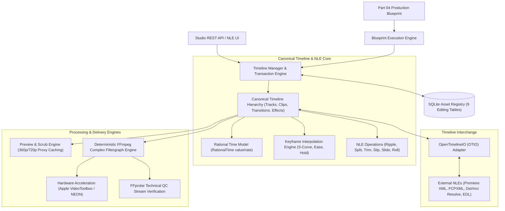

# Professional Non-Linear Video Editing Engine Architecture
**Project:** Universal AI Video Production Studio  
**Document Version:** 1.0.0  
**Department:** 08 Video Editing  
**Status:** Approved Master Architecture  
**Last Verified:** 2026-11-21  

---

## 1. Executive Summary & Design Principles

The **Professional Non-Linear Video Editing Engine** (Department 08) provides the core editorial assembly, trimming, multi-track layering, compositing, and rendering capabilities of the Universal AI Video Production Studio. It is built as a genuine, programmatically controllable non-linear editing (NLE) system rather than a simple clip-concatenation script or an ad-hoc FFmpeg wrapper.

### Core Design Tenets:
1. **Application-Owned Canonical Data Model:** The internal timeline representation is strictly independent of any single rendering engine. It models projects, timelines, tracks, clips, transitions, effects, and keyframes natively.
2. **Rational Time Arithmetic:** Time is represented as an exact rational number (`RationalTime(value, rate)`) to eliminate floating-point drift over multi-hour timelines.
3. **OpenTimelineIO (ASWF) Interchange:** Full bidirectional serialization to OpenTimelineIO, enabling project interchange with DaVinci Resolve, Adobe Premiere Pro, and Final Cut Pro.
4. **Deterministic Rendering:** Multi-track audio/video assembly is compiled into mathematically exact FFmpeg complex filtergraphs (`xfade`, `acrossfade`, `overlay`, `amix`, `volume`, `eq`).
5. **Non-Destructive Editorial Safety:** Original source assets are never modified. Ingested clips reference source media via sub-second in/out intervals.

---

## 2. Technology Research & Evaluation Matrix

To select the core media processing and rendering architecture, five candidate technologies were investigated:

| Dimension | FFmpeg / libavfilter | GStreamer / GES | MLT Framework | PyAV | OpenTimelineIO |
| :--- | :--- | :--- | :--- | :--- | :--- |
| **Multitrack Compositing** | Advanced complex filtergraphs (`overlay`, `xfade`) | GNonLin / GStreamer Editing Services | Excellent multitrack tractor model | Low-level decode/encode only | Editorial metadata schema (no rendering) |
| **Transitions & Effects** | 30+ `xfade` styles, `acrossfade`, `eq`, `scale` | Native transition elements | Rich Frei0r & Ladspa effect ecosystem | Requires manual numpy matrix math | Standard transition objects |
| **Hardware Acceleration** | Apple VideoToolbox, NVENC, VAAPI, NEON | VAAPI, NVCODEC, V4L2 | Wrapper around FFmpeg | FFmpeg hardware contexts | N/A (Schema only) |
| **License & Hygiene** | LGPL v2.1+ (Commercial safe) | LGPL v2.1+ | GPL v2+ (Copyleft risk for proprietary core) | BSD 3-Clause | Apache 2.0 (ASWF Permissive) |
| **Python Integration** | High-level subprocess CLI & JSON progress | `gi.repository.GES` (complex PyGObject) | Python bindings (maintenance lag) | C-Cython native bindings | Native C++ and Python bindings |
| **Architectural Verdict** | **Selected for Rendering** | Auxiliary streaming engine | Rejected (GPL copyleft risk) | **Selected for Ingestion/Inspection** | **Selected for Canonical Interchange** |

### Selected Hybrid Architecture:
- **Canonical Timeline Model:** Application-owned Python dataclasses backed by relational SQLite tables.
- **Interchange & Standards:** OpenTimelineIO (0.18.1) for lossless import/export to commercial NLEs.
- **Rendering & Conformance:** Deterministic FFmpeg (8.1.2) complex filtergraphs with Apple VideoToolbox hardware acceleration.
- **Fast Interactive Preview:** OpenCV & FFmpeg proxy frame cache (`PreviewEngine`).

---

## 3. Departmental Responsibilities

- **Department 08 (Video Editing):** Owns `TimelineManager`, `BlueprintExecutor`, `RenderEngine`, `PreviewEngine`, `AudioVideoSyncEngine`, and `VideoEditingService`.
- **Department 07 (Production Planning):** Supplies validated `EditingBlueprint` specifications.
- **Department 03 (Media Ingestion):** Supplies verified source media files and metadata.
- **Department 21 (Central Asset Registry):** Persists editing projects, timelines, tracks, clips, and render tickets.
