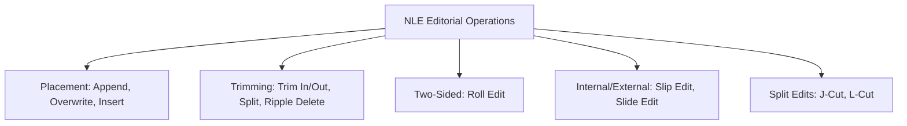

# Editing Operations Specification
**Project:** Universal AI Video Production Studio  
**Document Version:** 1.0.0  
**Status:** Approved Master Specification  
**Lead Architect:** Principal Video Editing Systems Architect  
**Verification Date:** 2026-11-21  

---

## 1. Non-Linear Editorial Operations Overview

The editing engine provides a complete suite of programmatic non-linear editing (NLE) operations implemented in `core/timeline/operations.py` and orchestrated via `TimelineManager`.

All operations operate on exact `RationalTime` instances and maintain timeline consistency.

---

## 2. Detailed Operation Specifications

### 2.1 Append Edit
Places a new clip immediately following the last clip on the target track.
- If the track is empty: `clip.timeline_in = RationalTime(0, rate)`.
- If track has clips: `clip.timeline_in = \max_{c \in \text{clips}}(c.\text{timeline\_out})`.
- `clip.timeline_out = clip.timeline_in + (clip.source_out - clip.source_in)`.

### 2.2 Overwrite Edit
Places a clip at a designated timeline position, overwriting and replacing any existing content on that track across the target time range.
- Existing clips fully enclosed by the new clip are removed.
- Existing clips partially overlapped at their tail have their `timeline_out` (and `source_out`) trimmed backward.
- Existing clips partially overlapped at their head have their `timeline_in` (and `source_in`) trimmed forward.
- Existing clips spanning across the entire new clip are split into two clips (head and tail) surrounding the new clip.

### 2.3 Insert Edit (Ripple Edit)
Inserts a clip at `target_time`, splitting any clip that exists at that timestamp, and rippling all subsequent clips forward by the duration of the inserted clip.
$$\Delta t = \text{new\_clip.duration}$$
$$\forall c \in \text{clips}: c.\text{timeline\_in} \ge target\_time \implies c.\text{timeline\_in} \mathrel{+}= \Delta t, c.\text{timeline\_out} \mathrel{+}= \Delta t$$

### 2.4 Split Clip (Razor Tool)
Divides a single clip at an interior timestamp $t_{\text{split}}$ into two contiguous clips:
- **Clip A (Left):**
  - `timeline_in = clip.timeline_in`
  - `timeline_out = t_split`
  - `source_in = clip.source_in`
  - `source_out = clip.source_in + (t_split - clip.timeline_in)`
- **Clip B (Right):**
  - `timeline_in = t_split`
  - `timeline_out = clip.timeline_out`
  - `source_in = clip.source_in + (t_split - clip.timeline_in)`
  - `source_out = clip.source_out`

### 2.5 Trim In-Point / Trim Out-Point
- **Trim In:** Adjusts `timeline_in` by $\Delta t$. Shifts `source_in` by the same $\Delta t$ to preserve sync with media footage.
- **Trim Out:** Adjusts `timeline_out` by $\Delta t$. Shifts `source_out` by the same $\Delta t$.
- Prevents inverted clips: Enforces `timeline_out > timeline_in` and `source_out > source_in`.

### 2.6 Roll Edit (Dual-Roller Trim)
Simultaneously trims the out-point of Clip A and in-point of Clip B at a common edit point, changing the cut boundary without changing the overall track duration or moving downstream clips.
$$A.\text{timeline\_out} \mathrel{+}= \Delta t, \quad A.\text{source\_out} \mathrel{+}= \Delta t$$
$$B.\text{timeline\_in} \mathrel{+}= \Delta t, \quad B.\text{source\_in} \mathrel{+}= \Delta t$$

### 2.7 Slip Edit
Changes what portion of the source media is seen inside a clip without moving its position on the timeline or altering its duration.
$$c.\text{source\_in} \mathrel{+}= \Delta t, \quad c.\text{source\_out} \mathrel{+}= \Delta t$$
$$c.\text{timeline\_in} \text{ and } c.\text{timeline\_out} \text{ remain unchanged.}$$

### 2.8 Slide Edit
Moves a clip along the timeline while simultaneously adjusting the adjacent clips to accommodate the move:
- The preceding clip's out-point is trimmed to meet the new in-point.
- The following clip's in-point is trimmed to meet the new out-point.
- The overall sequence duration remains identical.

### 2.9 Ripple Delete
Deletes a target clip and ripples all subsequent clips on that track backward by the duration of the deleted clip, closing the resulting gap:
$$\Delta t = c_{\text{target}}.\text{duration}$$
$$\forall c \in \text{clips}: c.\text{timeline\_in} > c_{\text{target}}.\text{timeline\_in} \implies c.\text{timeline\_in} \mathrel{-}= \Delta t, c.\text{timeline\_out} \mathrel{-}= \Delta t$$

### 2.10 J-Cut and L-Cut (Split Edits)
Asymmetrical audio/video cuts:
- **J-Cut:** Audio from the incoming shot starts before the video cut occurs ($A_{\text{in}} < V_{\text{in}}$).
- **L-Cut:** Video cuts to the incoming shot while audio from the preceding shot continues playing ($V_{\text{in}} < A_{\text{in}}$).
- Managed programmatically by `AudioVideoSyncEngine` coordinating linked clip pairs across `V1` and `A1`.
