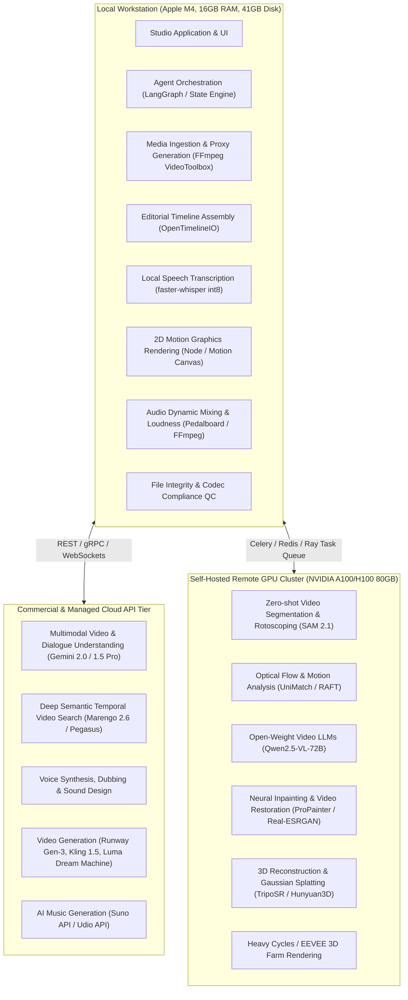

# Development Environment Audit Report
**Project:** Universal AI Video Production Studio  
**Audit Date:** 2026-11-21  
**Auditor:** Principal Software Architect & Infrastructure Lead  
**System Target:** Local Workstation & Production Hybrid Infrastructure  

---

## 1. Executive Summary

An exhaustive empirical audit of the primary host machine was conducted on 2026-11-21. The workstation is an **Apple MacBook Pro powered by an Apple M4 SoC (10 CPU cores) with 16 GB unified memory and 41 GB available disk space on macOS 27.2.1 (Darwin 27.2.0 arm64)**.

### Verdict on Compute Capability
- **Local Workstation Profile:** **Tier 1 (Edge Client / Fast Orchestrator / Lightweight Audio & Transcoding Node)**.
- **Feasible Local Workloads:** FFmpeg 8.1.2 media stream demuxing, probe, audio filtering, proxy transcode, timeline EDL/OTIO serialization, client UI, lightweight CPU/NEON audio speech-to-text (`faster-whisper`), rule-based shot detection (`PySceneDetect` native), and local agent orchestration.
- **Infeasible Local Workloads:** Dense multi-modal LLM fine-tuning, large video generative models (>14B diffusion models such as CogVideoX-5B, Wan2.1, HunyuanVideo, Flux.1-dev), dense multi-frame zero-shot video segmentation (SAM 2 on 4K multi-stream), and high-resolution 3D Gaussian Splatting / NeRF reconstruction.
- **Strategic Recommendation:** Adopt a **Hybrid Cloud / Decoupled Worker Topology**. The local machine serves as the editorial workstation, timeline controller, and proxy-preview engine. Heavy inference and render batch jobs are dispatched to cloud API providers (Gemini 2.0/1.5 Pro, TwelveLabs, ElevenLabs, Runway, Kling, Luma) or a dedicated self-hosted GPU worker pool (Linux x86_64 with NVIDIA A100/H100/L40S via RunPod, Lambda Labs, or AWS EC2).

---

## 2. Hardware Specifications

| Component | Audit Specification | Architectural Implication |
| :--- | :--- | :--- |
| **SoC / CPU** | Apple M4 (10 cores: 4 performance + 6 efficiency) | Excellent single-thread and vectorized SIMD/NEON performance for FFmpeg, Python runtime, and AST transforms. |
| **GPU / Acceleration** | Integrated Apple M4 10-core GPU (Metal 3 / Apple MPS / Accelerate framework) | Accelerated CoreML / MPS inference possible for quantized models (<4B). No native NVIDIA CUDA. |
| **System Memory** | 16,384 MB (16.0 GB) Unified Memory Architecture | Severe ceiling for large AI models. A 14B parameter model in FP16 requires ~28 GB VRAM. Maximum safe local model allocation is 6-8 GB without inducing catastrophic macOS memory swap. |
| **Storage Architecture** | Apple APFS on NVMe SSD | Fast sequential read/write (~3-5 GB/s), ideal for video proxy caching and timeline scrubbing. |
| **Available Disk Space** | **41.0 GB Free** (383 GB Used / 460 GB Total, 91% capacity) | **High Risk:** Storing multiple raw video master files (ProRes 422 HQ @ 220 Mbps = ~100 GB/hr) or downloading multi-gigabyte model weights locally will exhaust disk space immediately. Local disk must be strictly guarded for caches and proxies with aggressive LRU eviction. |

---

## 3. Installed Software & Tooling Audit

| Tool | Status | Version / Path | Readiness Assessment |
| :--- | :--- | :--- | :--- |
| **macOS** | Installed | 27.2.1 (Build 26B131), Kernel 27.2.0 arm64 | Fully supported POSIX environment. |
| **Python** | Installed | 3.13.7 (`/Library/Frameworks/Python.framework/Versions/3.13/bin/python3`) | Modern Python runtime. Need project-specific virtual environment (`.venv`) to isolate dependencies. |
| **Node.js** | Installed | v24.11.0 (`/usr/local/bin/node`) | High-performance JS engine ready for Remotion, Motion Canvas, and Studio UI. |
| **npm** | Installed | 11.6.1 (`/usr/local/bin/npm`) | Standard package manager. |
| **pnpm** | Installed | Installed (`/Users/badal11/Library/pnpm/bin/pnpm`) | Efficient hard-linked Node package manager, saves disk space. |
| **FFmpeg** | Installed | 8.1.2 (built with Apple clang 21.0.0, `/opt/homebrew/bin/ffmpeg`) | Production-grade media processing with Apple Silicon hardware acceleration (`h264_videotoolbox`, `hevc_videotoolbox`). |
| **FFprobe** | Installed | 8.1.2 (`/opt/homebrew/bin/ffprobe`) | Fast stream inspection, metadata extraction, keyframe indexing. |
| **Git** | Installed | `/usr/bin/git` (Apple Git) | Version control active; remote origin configured to GitHub. |
| **Homebrew** | Installed | 7.0.10 (`/opt/homebrew/bin/brew`) | Package manager ready for system dependencies (libsndfile, rubberband, etc.). |
| **Blender** | Not in PATH | Absent or unlinked in CLI | Required for 3D animation, Grease Pencil 2D, and headless rendering. Needs automated installation or path link. |
| **Docker** | Not Found | Not installed in PATH | Containerized worker testing requires remote runner or installation of OrbStack / Docker Desktop if needed. |
| **PyTorch / MLX** | Not in Global | Python 3.13 global environment does not have `torch` | PyTorch with MPS support or Apple MLX must be installed in a dedicated `.venv`. Note: PyTorch wheels for Python 3.13 on Apple Silicon need verified compatibility. |

---

## 4. Installed Python Ecosystem Highlights

A scan of the host Python environment revealed notable libraries already present:
- `faster-whisper` (v1.2.1) + `ctranslate2` (v4.8.3): Ready for optimized local speech transcription.
- `opencv-python` (v5.0.0.93): Ready for spatial frame transforms, feature extraction, and computer vision primitives.
- `fastapi` (v0.141.1) + `httpx` (v0.28.1): Ready for asynchronous REST / OpenAPI microservices.
- `pydantic` (v2.13.5) + `pydantic_core` (v2.46.5): Ready for strict typed data modeling and JSON schema validation.
- `av` (PyAV v19.0.2): Direct Python C-binding to FFmpeg libraries for frame-accurate seeking and decoding.

---

## 5. Local vs. Cloud Execution Matrix

Based on the verified 16 GB RAM, 41 GB disk, and Apple M4 GPU, the following operational division of labor is strictly mandated:

| Pipeline Task | Local Workstation Execution | Cloud API Provider | Self-Hosted Remote GPU | Rationale |
| :--- | :---: | :---: | :---: | :--- |
| **Media Probing & Demuxing** | **YES** | NO | NO | FFprobe 8.1.2 is instant (<100ms) and zero-cost locally. |
| **Proxy Generation (ProRes / H.264)** | **YES** | NO | Optional | Apple M4 `h264_videotoolbox` encodes 4K video at >120 fps hardware speed. |
| **Deep Video Understanding (Hours)** | NO | **YES** (Gemini 1.5/2.0 Pro) | Secondary | 2M token context window processes 2 hours of video with audio without local VRAM. |
| **Temporal Semantic Search** | NO | **YES** (TwelveLabs) | Secondary | TwelveLabs Pegasus/Marengo indexes motion, objects, and speech natively. |
| **Speech-to-Text (Draft)** | **YES** (faster-whisper) | Optional | Optional | `faster-whisper` on Apple M4 runs at ~15x realtime with int8 quantization. |
| **Speech Diarization & Studio Align** | Optional | Optional | **YES** (PyAnnote 3.1) | PyAnnote requires dedicated PyTorch tensor compute for large audio files. |
| **Voice Cloning & TTS** | NO | **YES** (ElevenLabs / Cartesia) | Optional | State of the art prosody, emotion, and zero-shot voice cloning. |
| **Rotoscoping & Video Segmentation** | NO | NO | **YES** (SAM 2.1 Video) | SAM 2.1 video memory bank requires 16-24 GB VRAM for multi-object tracking. |
| **Text-to-Video & Image-to-Video** | NO | **YES** (Kling / Runway / Luma) | **YES** (Wan2.1 / CogVideoX) | Diffusion models require 40GB+ VRAM and substantial GPU time. |
| **2D Motion Graphics Rendering** | **YES** (Motion Canvas / Remotion) | NO | Optional | Headless Chrome / Node.js executes rapidly on 10-core M4. |
| **3D Character Rigging & Animation** | **YES** (Blender headless draft) | NO | **YES** (Cycles Final Render) | Drafts and geometry creation are local; heavy multi-bounce raytracing is remote. |
| **Multitrack Audio Mixing & Loudness** | **YES** (Pedalboard / FFmpeg) | NO | NO | Audio DSP has low memory footprint and is CPU-bound; M4 handles 64 tracks effortlessly. |
| **Master Delivery Encoding** | **YES** (FFmpeg master render) | NO | Secondary | Final editorial stitch of rendered passes via FFmpeg is fast and exact. |

---

## 6. Storage & Disk Space Guardrails

With only **41 GB available disk space**, strict system storage guardrails are enforced:
1. **Never download large model weights (>2 GB) to local disk**. Model checkpoints must be accessed via hosted endpoints or executed on remote compute nodes.
2. **Aggressive Cache Eviction:** Local intermediate frames, extracted WAVs, and temporary optical flow arrays must be stored in `temp/` and automatically cleaned post-pipeline run.
3. **Proxy-First Workflow:** High-bitrate master footage (camera RAW, 4K ProRes 4444) remains on external network storage (S3/GCS or local NAS). The local studio generates lightweight 720p/1080p ProRes Proxy or H.264 intra-frame files for timeline editing and visual inspection.
4. **Git Repository Hygiene:** Strict `.gitignore` excludes all media binaries, weights, logs, cache, and build directories.
