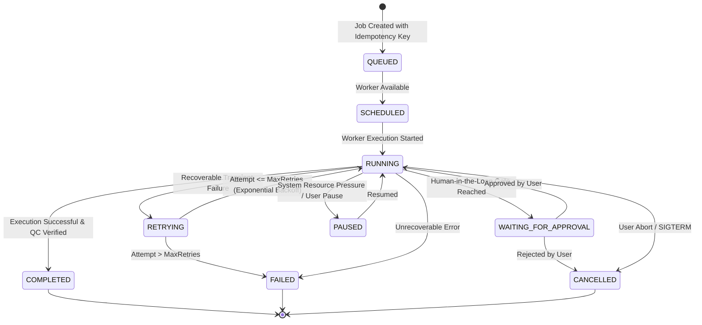

# Event & Asynchronous Job Execution Contracts
**Project:** Universal AI Video Production Studio  
**Document Version:** 1.0.0  
**Status:** Approved Operational Specification  

---

## 1. Asynchronous Job State Machine

Every background operation in the studio (media ingestion, proxy transcoding, stem separation, generative synthesis, motion canvas rendering, video color grading, and final delivery export) is governed by a strict finite state machine:



---

## 2. Canonical Job Ticket Schema

```python
class JobStatus(str, Enum):
    QUEUED = "QUEUED"
    SCHEDULED = "SCHEDULED"
    RUNNING = "RUNNING"
    WAITING_FOR_APPROVAL = "WAITING_FOR_APPROVAL"
    RETRYING = "RETRYING"
    COMPLETED = "COMPLETED"
    FAILED = "FAILED"
    CANCELLED = "CANCELLED"
    PAUSED = "PAUSED"

class JobTicket(BaseModel):
    job_id: UUID
    project_id: UUID
    department: str
    task_type: str  # INGESTION_PROXY, SPEECH_TRANSCRIPTION, GENERATE_VIDEO, RENDER_MASTER, QC_AUDIT
    idempotency_key: str  # SHA-256(project_id + task_type + inputs_hash)
    status: JobStatus = JobStatus.QUEUED
    progress_percent: float = 0.0
    attempt_count: int = 0
    max_retries: int = 3
    input_references: Dict[str, Any]
    output_references: Dict[str, Any] = Field(default_factory=dict)
    error_details: Optional[str] = None
    created_at: str
    updated_at: str
    completed_at: Optional[str] = None
```

---

## 3. Idempotency Guarantees & Duplicate Prevention

1. **Cryptographic Idempotency Keys:** Every job ticket calculates an `idempotency_key = sha256(f"{project_id}:{task_type}:{canonical_inputs_json}")`.
2. **Atomic Ingestion Check:** When a worker or user submits a job with an identical idempotency key that is currently `RUNNING` or `COMPLETED`, the queue returns the existing job ID rather than spawning a duplicate process.
3. **Partial Output Cleanup:** If a transcode or render job fails or is cancelled mid-execution, the `RecoveryManager` immediately deletes partial output files (`.part`, temporary WAV/MP4 files) to prevent corrupted fragments from polluting project storage.

