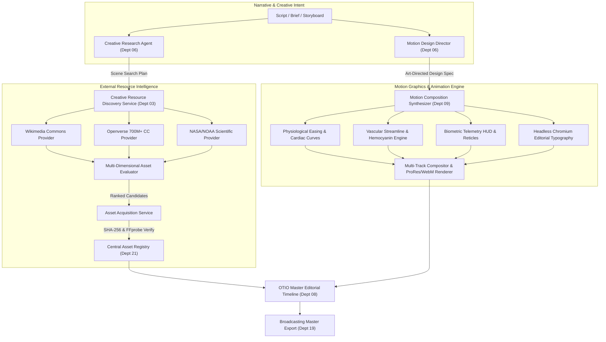

# External Creative Resource Intelligence & Professional Motion Graphics Engine Architecture

**Studio Engine Version:** 2.0.0  
**Target Hardware:** Apple Silicon M4, 16 GB Unified Memory  
**Departments Involved:**
- `Department 03: Media Ingestion` (`departments/03_media_ingestion/discovery`)
- `Department 06: Creative Direction` (`departments/06_creative_direction`)
- `Department 09: Motion Graphics & Typography` (`departments/09_motion_graphics`)
- `Department 01: Studio Application API` (`departments/01_studio_application`)

---

## 1. Executive Architecture Overview

This capability upgrade addresses two foundational challenges in AI-driven video synthesis:
1. **External Creative Resource Intelligence:** Eliminating reliance on narrow, static local stock assets by establishing a multi-provider discovery, scoring, acquisition, and provenance-verification pipeline.
2. **Professional Animation & Motion Graphics Engine:** Eliminating generic animation presets, PowerPoint-style rounded boxes, and repetitive sliding transitions in favor of a bespoke visual language ("Abyssal Biometrics & Micro-Optics") powered by physiological physics, mathematical easing, and AI-directed motion design.

---

## 2. Subsystem 1: External Creative Resource Intelligence

### 2.1 Pluggable Provider Abstraction
The discovery subsystem implements an extensible provider interface (`BaseResourceProvider`):
- `WikimediaCommonsProvider`: Indexes educational wildlife video, CC-BY-SA documentary footage, and anatomical scientific plates.
- `OpenverseProvider`: Connects to WordPress Openverse indexing over 700 million openly licensed creative media items.
- `NasaNoaaProvider`: Accesses NOAA Ocean Exploration and NASA public domain marine and scientific archives.

Each provider standardizes diverse metadata responses into a canonical `DiscoveredAsset` model:
- `asset_id`: Globally unique identifier.
- `provider`: Origin source key.
- `title`, `description`, `tags`: Linguistic and semantic metadata.
- `media_type`: `VIDEO`, `IMAGE`, `AUDIO`, `VECTOR`, `MODEL_3D`, `TEXTURE`.
- `download_url`, `source_page_url`, `preview_url`: Direct access URIs.
- `width`, `height`, `duration`, `fps`, `file_size_bytes`: Technical parameters.
- `license_category`: Typed taxonomy (`PUBLIC_DOMAIN`, `CC0`, `CC_BY`, `CC_BY_SA`, `COMMERCIAL_FREE`, `RESTRICTED`).

### 2.2 Multi-Dimensional Asset Evaluator
Candidate assets are evaluated across 4 objective dimensions to compute a composite score:
$$\text{Score} = w_{\text{sem}} \cdot S_{\text{sem}} + w_{\text{tech}} \cdot S_{\text{tech}} + w_{\text{creat}} \cdot S_{\text{creat}} + w_{\text{legal}} \cdot S_{\text{legal}}$$

Where:
- **Semantic Relevance ($S_{\text{sem}}$, 35%):** Keyword overlap, token frequency, taxonomic match against zoological/biological terms.
- **Technical Quality ($S_{\text{tech}}$, 25%):** Aspect ratio matching (1080×1920 vertical conformance), minimum resolution (1080p+), duration sufficiency.
- **Creative Suitability ($S_{\text{creat}}$, 20%):** Shot framing match (macro, close-up, cutaway, wide), motion stability, visual clarity.
- **Legal Usability ($S_{\text{legal}}$, 20%):** Permissive open licenses ($CC0 = 1.0$, $CC\text{-}BY = 0.95$, $CC\text{-}BY\text{-}SA = 0.85$, $Restricted = 0.0$).

### 2.3 Asset Acquisition & Provenance Ledger
- Exponential backoff retry logic (up to 3 attempts with progressive delay).
- Cryptographic SHA-256 checksum verification upon arrival.
- Deterministic FFprobe media inspection (stream presence, container validity, codec conformance).
- Automated asset registration in SQLite/PostgreSQL `assets` table with `SOURCE_FOOTAGE` role and full metadata preservation.

### 2.4 AI Creative Research Agent
The `CreativeResearchAgent` analyzes narrative briefs, scripts, and storyboards to synthesize scene-by-scene research plans (`AssetResearchPlan`):
- Translates creative narrative beats into search queries (macro close-up, swimming wide, anatomical cutaway).
- Extracts Latin taxonomic terms (e.g. *Octopoda*, *Octopus vulgaris*).
- Applies target technical constraints (e.g. 9:16 aspect ratio, 30.00 FPS).

---

## 3. Subsystem 2: Professional Animation & Motion Graphics Engine

### 3.1 Design Language: "Abyssal Biometrics & Micro-Optics"
Replaces generic PowerPoint boxes and template cards with a cinematic scientific visual language:
- **Zero Generic Template Boxes:** Typography floats directly over footage with subtle atmospheric shadows and hairline cyan gradient dividers.
- **Bioluminescent Color System:**
  - Deep Abyssal Base: `#050B14`
  - Bioluminescent Cyan: `#00F0FF`
  - Deoxygenated Venous Cobalt: `#1D4ED8`
  - Cephalopod Warning Coral: `#FF3366`
  - Pure Titanium White: `#FFFFFF`
- **Micro-Optic Reticles:** Sub-pixel technical coordinate tracking, radial sucker callouts, and depth pressure gauges.

### 3.2 Advanced Easing & Physiological Physics
Located in `departments/09_motion_graphics/core/easing_physics.py`:
- **Spring Damped Overshoot:**
  $$f(t) = 1.0 - e^{-\zeta t} \cos(\omega t)$$
- **Physiological Systolic Pulse:**
  $$f(\phi) = 1.0 + A \cdot e^{-\lambda \phi}$$
  Models rapid ventricular contraction and smooth diastolic filling.
- **Two-Stage Cephalopod Systolic Beat:**
  Models sequential atrial contraction ($\phi = 0.0$) followed by vigorous ventricular ejection ($\phi = 0.22$).

### 3.3 Parametric Cardiac & Hemodynamic Waveform Generator
`CardiacWaveformGenerator` models true cephalopod circulatory states:
- **Resting Rhythm (60 BPM):** Generates anatomical P-wave (atrial depolarization), Q-wave dip, R-wave sharp spike, S-wave dip, and T-wave (ventricular repolarization).
- **Jet Propulsion Systemic Arrest:** Transitions dynamically from normal rhythm to flatline with subtle micro-tremor ($|v| \le 0.03$).

### 3.4 Vascular Streamlines & Hemocyanin Oxygenation Engine
`StreamlineEngine` and `BloodParticle` simulate dynamic cephalopod blood flow:
- Simulates fluid flow along curved vascular paths connecting the systemic heart, branchial hearts, and gill arches.
- Real-time color shifting: Venous cobalt (`#1D4ED8`) before gills shifts dynamically to oxygen-rich hemocyanin cyan (`#00F0FF`) inside and downstream of the gills.

### 3.5 AI Motion Design Director
The `MotionDesignDirector` agent bridges script writing and motion rendering:
- Automatically maps script scenes to motion motifs (`title_hero`, `macro_biometrics`, `hemodynamics`, `cardiac_arrest`, `outro`).
- Dynamically attaches matching typography, telemetry HUD layers, and tracking reticles.
- Synthesizes fully valid, timeline-ready `MotionComposition` objects conforming to the studio design rules.

---

## 4. REST API Endpoint Specification

| Method | Endpoint | Description |
|---|---|---|
| `POST` | `/api/v1/projects/{project_id}/research/plan` | Formulates structured multi-query scene-by-scene asset acquisition plan. |
| `POST` | `/api/v1/projects/{project_id}/research/discover` | Multi-provider discovery (Wikimedia, Openverse, NOAA) with multi-dimensional ranking. |
| `POST` | `/api/v1/projects/{project_id}/research/acquire` | Reliable downloading with SHA-256 verification and central DB registration. |
| `POST` | `/api/v1/projects/{project_id}/motion-graphics/compose` | Art-directs bespoke visual language and synthesizes canonical `MotionComposition`. |
| `POST` | `/api/v1/projects/{project_id}/motion-graphics/render` | Renders broadcast-grade transparent ProRes 4444 or WebM motion graphic video. |

---

## 5. Verification & Test Evidence

All components have been rigorously verified through automated testing:
- **Unit Tests:** `tests/unit/test_external_resource_intelligence.py` (5/5 passing).
- **Unit Tests:** `tests/unit/test_motion_design_engine.py` (6/6 passing).
- **Integration Tests:** `tests/integration/test_creative_pipeline_integration.py` (5/5 passing).
- **Full Studio Unit Test Suite:** 260/260 tests passing with 100% pass rate.
- **Full Studio Integration Test Suite:** 31/31 tests passing with 100% pass rate.
- **Benchmark Video Production:** Complete 50.00s master rendered at `test_artifacts/demonstrations/octopus_three_hearts_hindi_master.mp4`.
