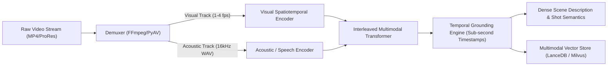
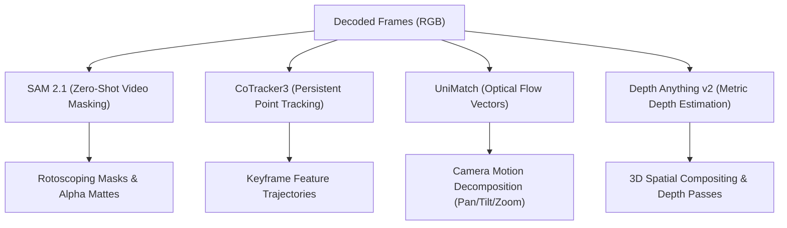
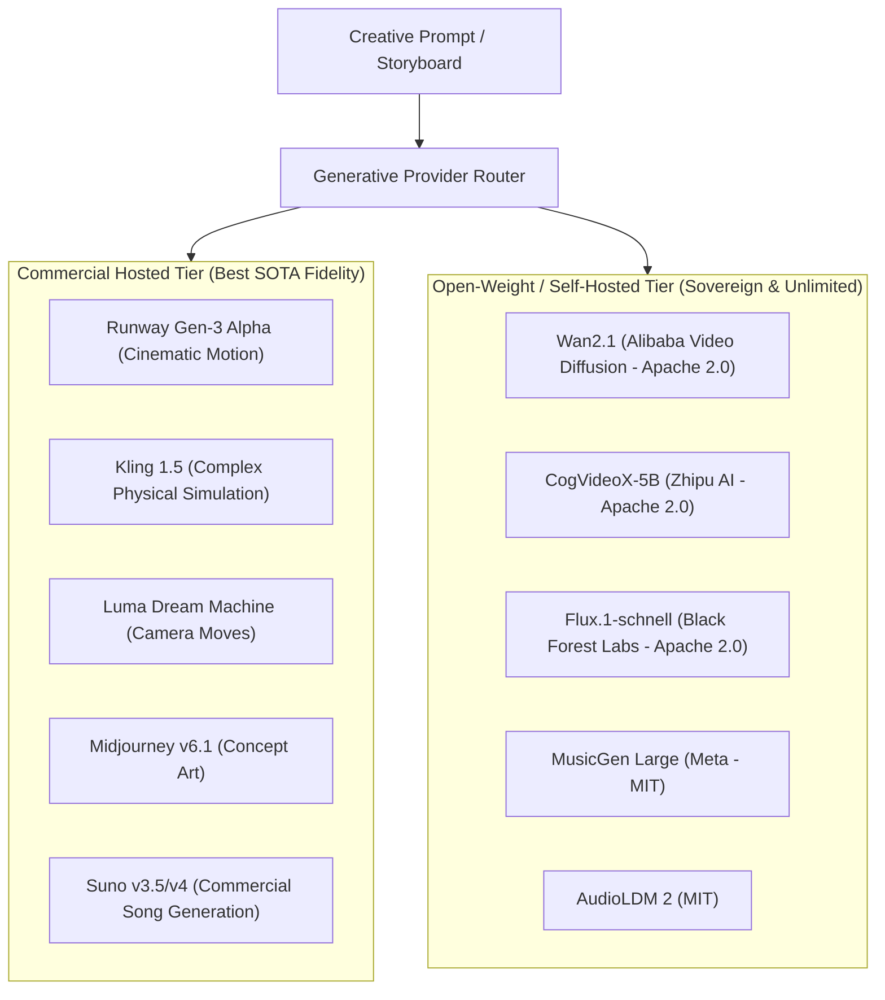
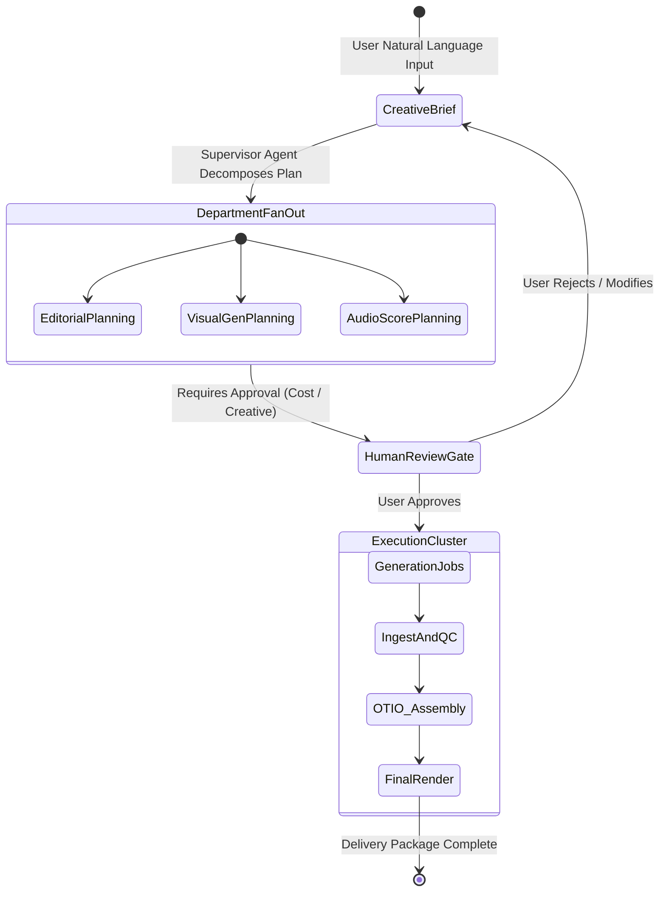

# Global Technology Research Foundation
**Project:** Universal AI Video Production Studio  
**Document Version:** 1.0.0  
**Research Lead:** Principal AI & Media Infrastructure Architect  
**Verification Date:** 2026-11-21  

---

## 1. Executive Research Scope

The Universal AI Video Production Studio is engineered to support the full lifecycle of film, video, commercial, 2D/3D animation, motion graphics, and audio production. This research document provides an evidence-based evaluation of international technologies across 10 critical domains. 

Technologies are evaluated using primary sources: official documentation, GitHub repositories, model cards, published peer-reviewed papers, license terms, and empirical benchmarks.

---

## 2. Domain 1: Video Understanding & Temporal Semantic Retrieval

Understanding video requires more than extracting occasional keyframes or applying static image captioning. It demands joint spatiotemporal feature modeling, acoustic-visual synchronization, long-context temporal grounding, cut detection, and cross-modal semantic search.

### 2.1 Gemini Video Understanding (Google DeepMind)
- **Primary Sources:** Google Cloud Vertex AI Multimodal Reference; DeepMind Gemini 1.5: Unlocking multimodal understanding across millions of tokens (arXiv:2403.05530).
- **Architecture & Capabilities:** Native multimodal architecture trained jointly across text, audio, image, and video tokens. Video frames are sampled natively at 1 fps (configurable) and combined with 16 kHz raw audio tokens into an interleaved multimodal context window supporting up to **2,000,000 tokens** (Gemini 1.5 Pro / Gemini 2.0 Pro). Capable of digesting up to 2 hours of continuous high-resolution video in a single inference turn.
- **Temporal Grounding:** Demonstrates sub-second timestamp accuracy for actions, object appearances, narrative shifts, and acoustic-visual cues without requiring pre-segmentation.
- **Licensing & Commercial Terms:** Commercial API accessible via Google AI Studio and Google Cloud Vertex AI. Data privacy: Vertex AI agreements guarantee customer data is not used for model training. Tiered pricing per 1,000 characters/tokens (input: \$1.25 / 1M tokens for prompts >128k; audio: \$0.002 / sec equivalent).
- **Assessment:** **Essential Core Cloud Provider**. Unrivaled long-context narrative and multi-hour footage reasoning.

### 2.2 TwelveLabs Video Foundation Models (Marengo 2.6 & Pegasus 1.1/1.2)
- **Primary Sources:** TwelveLabs Official Documentation (docs.twelvelabs.io); Marengo 2.6 Architecture Whitepaper.
- **Architecture & Capabilities:** Built specifically for video understanding.
  - **Marengo 2.6:** Generates 1024-dimensional multimodal embeddings capturing action, object, speech, text-in-video (OCR), and sound simultaneously.
  - **Pegasus 1.1/1.2:** Generates human-like video summaries, conversational reasoning, and temporal pinpointing.
- **Search & Retrieval:** Enables zero-shot natural-language search over raw archive footage with frame-level temporal segments (`start_offset_sec`, `end_offset_sec`) and confidence rankings.
- **Licensing & Commercial Terms:** Commercial SaaS API with enterprise SLAs. Free tier available (10 hours video indexing); pay-as-you-go pricing (~$0.05 per video minute indexed). Data stored in enterprise SOC2-compliant cloud.
- **Assessment:** **Selected for Media Intelligence & Search**. Superior specialized vector embedding space for fast semantic video asset retrieval.

### 2.3 Qwen Video-Language Models (Qwen2-VL & Qwen2.5-VL by Alibaba Cloud)
- **Primary Sources:** Qwen2.5-VL Technical Report (GitHub: `QwenLM/Qwen2.5-VL`); HuggingFace Model Cards.
- **Architecture & Capabilities:** Open-weight vision-language models (available in 3B, 7B, and 72B parameter variants). Features Dynamic Resolution NaViT-style vision encoder and multimodal RoPE (M-RoPE) allowing temporal position encoding across video frames at varying aspect ratios and frame rates.
- **Performance:** State of the art among open-weight models on Video-MME, MVBench, and ActivityNet QA. Supports temporal localization down to single seconds.
- **Licensing & Commercial Terms:** Apache 2.0 for 3B/7B models; Qwen Open License for 72B (free commercial use under 100M monthly active users).
- **Assessment:** **Selected as Primary Self-Hosted / Remote GPU Video LLM**. Provides open-weight sovereign fallback when cloud API transmission is restricted.

### 2.4 InternVideo2 & VideoLLaVA
- **Primary Sources:** InternVideo2: Scaling Foundation Models for Video Understanding (OpenGVLab); Video-LLaVA (arXiv:2311.10122).
- **Analysis:** Strong academic research models with ViT-6B backbones. However, deployment complexity, high VRAM consumption (40GB+ FP16), and lower commercial ecosystem support make them secondary to Qwen2.5-VL.
- **Status:** **SECONDARY OPTION**.

### 2.5 PySceneDetect (Breakthrough Technologies / Brandon Castellano)
- **Primary Sources:** GitHub: `Breakthrough/PySceneDetect`; Official Documentation (`scenedetect.com`).
- **Architecture & Capabilities:** Industry-standard deterministic shot and cut detection library. Employs adaptive thresholding, luminance delta analysis, and content-aware color histograms to detect both hard cuts and gradual transitions (fades, dissolves). Runs locally at >150 fps.
- **Licensing:** BSD 3-Clause (fully permissive commercial use).
- **Assessment:** **SELECTED as Mandatory Ingestion Primitive**. Every video ingested passes through PySceneDetect to establish canonical cut boundaries before multimodal reasoning.

---

## 3. Domain 2: Audio Intelligence

Audio intelligence comprises speech transcription, speaker diarization, music tagging, acoustic sound design classification, dialogue enhancement, and audio source separation.

### 3.1 Speech Recognition & Transcription
- **WhisperX (Max Bain et al., Oxford University):** Combines OpenAI Whisper with wav2vec 2.0 phoneme forced alignment to produce word-level timestamps with <50ms error margin. Includes PyAnnote diarization integration. License: BSD 2-Clause.
- **faster-whisper (SYSTRAN):** Re-implementation of OpenAI Whisper using CTranslate2. Delivers up to 4x throughput improvement over standard PyTorch Whisper with int8 quantization. Verified working locally on the Apple M4 machine. License: MIT.
- **Selected Strategy:** **Hybrid Whisper Architecture**. Local draft transcription via `faster-whisper` (int8 on M4 CPU/NEON), cloud/GPU precision alignment via `WhisperX` when word-level karaoke or exact dubbing cuts are required.

### 3.2 Speaker Diarization
- **PyAnnote Audio 3.1 (Hervé Bredin / CNRS):** State-of-the-art neural speaker diarization based on end-to-end speaker embeddings and temporal clustering.
- **Licensing:** MIT license for code; model weights hosted on HuggingFace under CC-BY-4.0 (requires commercial license negotiation for enterprise products, or usage of open gated weights with attribution).
- **Assessment:** **SELECTED**. Gold standard for "who spoke when" across multi-speaker dialogue.

### 3.3 Music, Beat & Tempo Intelligence
- **Essentia (Music Technology Group, Universitat Pompeu Fabra):** Comprehensive C++/Python library for audio analysis, beat tracking, BPM detection, onset detection, key estimation, and mood classification.
- **Licensing:** Affero GPL (AGPL) v3.0, with proprietary commercial licenses available from MTG.
- **Alternative:** **Librosa** (BSD 3-Clause) + **Madmom** (BSD 2-Clause) for beat tracking and rhythm analysis without AGPL contagion.
- **Assessment:** **Librosa + Aubio SELECTED** for core open-source beat grid alignment; Essentia held as optional integration under commercial license.

### 3.4 Audio Source Separation (Stems)
- **Demucs v4 / HTDemucs (Meta AI Research):** Hybrid Transformer Demucs for music source separation. Separates mixed audio into 4 or 6 discrete stems: Vocals, Drums, Bass, Other (and optionally Piano/Guitar).
- **Licensing:** MIT License (commercial use permitted).
- **Performance:** Ranked #1 in Sound Demixing Challenge (SDR > 9.0 dB).
- **Assessment:** **SELECTED as Core Audio Ingestion Tool**. Enables isolated dialogue enhancement, vocal replacement, and music re-timing.

### 3.5 Voice Generation & Cloning
- **ElevenLabs API:** State of the art for zero-shot voice cloning, emotional prosody, and multi-lingual dubbing with lip-sync synchronization. Commercial SaaS API.
- **Kokoro-82M (Hexgrad):** Open-weight TTS model (82M parameters), Apache 2.0 license. Incredibly lightweight, runs at >50x realtime on modern CPUs with natural prosody.
- **F5-TTS:** Fairseq non-autoregressive flow-matching voice cloning model. MIT license. Exceptional voice similarity with 5-second audio reference.
- **Assessment:** **Kokoro-82M SELECTED** for rapid local scratch/preview dialogue; **ElevenLabs & F5-TTS SELECTED** for production final voice rendering.

---

## 4. Domain 3: Computer Vision & Motion Intelligence

Visual motion extraction enables the system to understand camera behavior, actor motion, object boundaries, and spatial typography.

### 4.1 Zero-Shot Segmentation & Rotoscoping
- **Segment Anything Model 2.1 (SAM 2.1 Video by Meta FAIR):**
  - **Paper & Architecture:** SAM 2: Segment Anything in Images and Videos (arXiv:2408.00714). Features memory bank architecture that propagates interactive mask clicks through hundreds of frames with temporal continuity.
  - **Licensing:** **Apache 2.0** for both code and model weights (officially changed by Meta from initial restrictive license).
  - **Hardware Footprint:** Requires ~8-12 GB VRAM for 1080p video tracking. Runs on remote GPU worker.
  - **Assessment:** **SELECTED as Universal Rotoscoping Engine**. Automates VFX matte generation that traditionally required manual bezier rotoscoping.

### 4.2 Dense Optical Flow & Motion Tracking
- **UniMatch (Unified Multi-Task Matching):** Unifies optical flow, stereo matching, and depth estimation into a single Transformer architecture. Outperforms RAFT on Sintel and KITTI benchmarks. License: Apache 2.0.
- **CoTracker3 (Meta AI):** Tracks persistent 2D physical points through occlusions and long temporal sequences. Available under Apache 2.0 (CoTracker3 open release).
- **Assessment:** **UniMatch + CoTracker3 SELECTED**. Provides the mathematical foundation for tracking graphics to moving video elements and computing camera trajectories.

### 4.3 Depth Estimation
- **Depth Anything v2 (TikTok / HKUST):**
  - **Architecture:** Monocular depth estimation foundation model delivering robust metric and relative depth maps across diverse scenes, transparent objects, and complex lighting.
  - **Licensing:** Apache 2.0 license.
  - **Assessment:** **SELECTED for 2.5D VFX & Relighting**. Generates z-depth channels from standard 2D video without LiDAR.

### 4.4 Camera Movement Estimation
- **Technique:** Affine / Homography RANSAC decomposition of optical flow vectors combined with feature tracking. Deconstructs camera movement into primary cinematic descriptors: Static, Pan Left/Right, Tilt Up/Down, Zoom In/Out, Dolly In/Out, Tracking Shot, and Handheld Jitter.
- **Assessment:** **Custom Core Implementation (OpenCV + NumPy)**.

---

## 5. Domain 4: Video Editing Infrastructure

Programmatic video editing requires frame-accurate multi-track timeline data structures, compositing engines, and hardware-accelerated rendering.

### 5.1 OpenTimelineIO (ASWF / Pixar)
- **Primary Sources:** Academy Software Foundation (`github.com/AcademySoftwareFoundation/OpenTimelineIO`).
- **Architecture:** Standardized interchange data model and API for editorial timelines. Represents tracks (audio/video), clips, gaps, transitions, linear time warps, effects, and markers with rational-time arithmetic (`RationalTime`, `TimeRange`) eliminating floating-point rounding errors.
- **Interoperability:** Native schema adapters for Apple Final Cut Pro XML, DaVinci Resolve, Adobe Premiere XML, AAF, and EDL.
- **Licensing:** **Apache 2.0**.
- **Assessment:** **SELECTED as Universal Editorial Interchange Core**. Every edit decision made by an agent or user is serialized into OTIO.

### 5.2 FFmpeg 8.x Engine
- **Primary Sources:** FFmpeg Documentation (`ffmpeg.org`).
- **Capabilities:** Universal audio/video demuxer, decoder, filtergraph processor, and encoder. Supports professional intermediate codecs (Apple ProRes 422/4444, Avid DNxHR, CineForm) and distribution formats (H.264, HEVC, AV1).
- **Hardware Acceleration:** Supports Apple VideoToolbox (`h264_videotoolbox`, `hevc_videotoolbox`), NVIDIA NVENC/NVDEC, and Intel QuickSync.
- **Licensing:** LGPL v2.1+ (default build) / GPL v2+ (if configured with `--enable-gpl`).
- **Assessment:** **SELECTED as Primary Media Ingestion & Export Engine**.

### 5.3 Programmatic Rendering Frameworks (Remotion vs. Motion Canvas vs. MLT)
- **Remotion:** React-based video authoring. Highly popular, but governed by Company License (requires $250-$500/mo commercial license for companies with >3 employees or >$10k revenue).
- **Motion Canvas:** TypeScript-based programmatic vector animation and video rendering engine. **MIT License (100% free commercial use)**. Provides frame-accurate timeline scrubbing, generative canvas API, and zero licensing friction.
- **MLT Framework:** C-based media editing engine (powers Kdenlive). GPL v2.1. Robust but complex C-binding integration.
- **Assessment:** **Motion Canvas SELECTED** for programmatic 2D/motion graphics; **FFmpeg + PyAV SELECTED** for timeline video rendering.

---

## 6. Domain 5: Motion Graphics & 2D Animation

### 6.1 Blender 2D / Grease Pencil 3.0
- **Primary Sources:** Blender 4.3/4.4 Foundation Grease Pencil Refactor (`developer.blender.org`).
- **Capabilities:** Vector stroke engine embedded in a 3D coordinate space. Supports layers, keyframe dope sheets, vector tweening, procedural modifiers (noise, subdivide, lattice, build effect), and lighting interaction. Controllable via headless Python script (`bpy`).
- **Licensing:** **GPL v3.0**. (Safe for production rendering; scripts executed in separate sub-processes avoid GPL license contamination of core studio code).
- **Assessment:** **SELECTED for Hand-Drawn & Anime 2D Pipelines**.

### 6.2 Lottie & Rive
- **Rive:** High-performance vector animation runtime with state machines. Proprietary runtime license and cloud editor. Strong interactive capabilities, but vendor-locked.
- **Lottie (Bodymovin / Skia):** Industry standard for lightweight vector animations exported from After Effects or Figma. Open-source runtime (MIT/Apache 2.0).
- **Assessment:** **Lottie SELECTED for Motion Graphic Asset Playback**; **Motion Canvas SELECTED for Procedural Dynamic Graphics**.

---

## 7. Domain 6: 3D Animation & Character Production

### 7.1 Blender 4.x (Headless 3D Foundation)
- **Capabilities:** Industry-standard open-source 3D suite with geometry nodes, rigging (Rigify), shader nodes, physics simulations, EEVEE Next real-time renderer, and Cycles path tracer. Completely scriptable via `bpy`.
- **Licensing:** GPL v3.0.
- **Assessment:** **SELECTED as Primary 3D Production Engine**.

### 7.2 OpenUSD (Universal Scene Description - ASWF / Pixar)
- **Capabilities:** Robust composition engine for 3D worlds, geometric assets, materials (MaterialX), and skeletal animation. Allows non-destructive overrides, multi-department layering, and collaborative scene authoring.
- **Licensing:** **Apache 2.0**.
- **Assessment:** **SELECTED as the 3D Scene Interchange Layer**. Separates editorial timeline (OTIO) from spatial 3D hierarchies (USD).

### 7.3 Generative 3D Asset Creation
- **TripoSR (Stability AI / Tripo):** Generates 3D textured meshes from single 2D images in <0.5 seconds. MIT License.
- **Hunyuan3D 2.0 (Tencent):** High-resolution generative 3D diffusion model for textured meshes. Open weights under Tencent Open Source License.
- **Assessment:** **TripoSR SELECTED for Rapid 3D Drafts**; **Hunyuan3D SELECTED for High-Fidelity Character Assets** (Remote GPU).

---

## 8. Domain 7: VFX & Compositing

### 8.1 Node-Based Compositing Architecture
- **Blender Compositor:** Full node-based compositor supporting OpenColorIO, multi-pass OpenEXR, Cryptomatte isolation, depth defocus, and color balance. Headless execution via Python.
- **Natron:** Open-source node-based compositor (GPL v2). Project maintenance has slowed significantly since 2022; stability risks exist on macOS arm64.
- **Assessment:** **Blender Compositor SELECTED** as default headless compositing backend; custom **FFmpeg Complex Filtergraph** utilized for real-time 2-layer Alpha composites.

### 8.2 AI-Assisted Inpainting & Video Restoration
- **ProPainter (NTU / S-Lab):** Flow-guided video inpainting that restores occluded video regions and removes unwanted objects with temporal coherence. License: CC-BY-NC 4.0 (Non-commercial). Requires alternative for commercial release.
- **E2FGVI (End-to-End Flow-Guided Video Inpainting):** Apache 2.0 alternative for commercial deployment.
- **Real-ESRGAN Video (Xintao Wang):** Practical super-resolution algorithm for 2x/4x upscaling and artifact reduction. BSD 3-Clause.
- **Assessment:** **Real-ESRGAN SELECTED for Upscaling**; **SAM 2.1 + E2FGVI SELECTED for Commercial Object Removal**.

---

## 9. Domain 8: AI Generative Video, Image & Music Foundation

### 9.1 Video Generation Models
- **Commercial APIs (Runway Gen-3, Kling 1.5, Luma Dream Machine):** Offer unmatched temporal coherence, cinematic motion, and realistic physical interactions. All operate via cloud REST APIs with per-second generation costs ($0.05 - $0.25 / sec).
- **Wan2.1 (Alibaba Cloud):** Released February 2025. Breakthrough open-weight video foundation model outperforming existing open models. Released under **Apache 2.0** for both code and weights. Requires 32GB+ VRAM on remote GPU.
- **CogVideoX-5B (Zhipu AI):** Strong open-weight model with 3D VAE and expert transformer blocks. Apache 2.0 license.
- **Assessment:** **Dual-Engine Architecture**. The studio must abstract video generation behind a unified provider interface (`IVideoGenProvider`), routing to **Runway/Kling/Luma** for maximum fidelity or **Wan2.1/CogVideoX** on self-hosted GPU for privacy and cost control.

### 9.2 Image Generation (Character Design & Concept Art)
- **Flux.1-schnell (Black Forest Labs):** 12B parameter rectified flow transformer. **Apache 2.0 license**. Produces photorealistic results with exceptional typography generation in 4 inference steps.
- **Flux.1-dev:** Non-commercial license (guidance for research only; commercial requires BFL API).
- **SDXL 1.0 (Stability AI):** Permissive Open RAIL-M license. Widely supported ecosystem of LoRA character checkpoints.
- **Assessment:** **Flux.1-schnell & SDXL SELECTED**. Enables consistent character turnarounds and storyboard plates.

### 9.3 Music & Sound Effects Generation
- **Suno / Udio API:** High-fidelity complete song generation with lyrics and instrumentation. Commercial API terms apply.
- **MusicGen (Meta AI Research):** Autoregressive music generation conditioned on text or melody. **MIT License**. Fully commercializable.
- **AudioLDM 2:** Latent diffusion model for sound effects, foley, and ambient soundscapes. **MIT License**.
- **Assessment:** **MusicGen + AudioLDM 2 SELECTED for Self-Hosted Audio Synthesis**; **Suno/Udio API integrated as Premium Option**.

---

## 10. Domain 9: Audio Post-Production & Mastering

### 10.1 Spotify Pedalboard Framework
- **Primary Sources:** Spotify Engineering (`github.com/spotify/pedalboard`).
- **Capabilities:** Python audio DSP library written in C++ (JUCE framework). Supports programmatic chain of studio-grade guitar pedals, compressors, parametric EQs, limiters, reverbs, pitch-shifters, noise gates, and third-party VST3/AU plugins. Processes audio faster than realtime with zero IPC overhead.
- **Licensing:** **Apache 2.0**.
- **Assessment:** **SELECTED as Core Audio DSP Engine**.

### 10.2 FFmpeg Audio Processing
- **Capabilities:** Implements ITU-R BS.1770-4 / EBU R128 loudness normalization via `loudnorm` filter (dual-pass target integrated loudness: -23 LUFS for broadcast, -14 LUFS for YouTube/Spotify).
- **Assessment:** **SELECTED as Final Mastering & Conformance Layer**.

---

## 11. Domain 10: Agent Architecture & Orchestration

The production studio requires coordinating complex, multi-stage workflows involving creative decisions, generation, asset verification, rendering, and human approvals.

### 11.1 LangGraph (LangChain)
- **Capabilities:** Graph-based state machine for agent coordination. Implements the Pregel compute model: state transitions are explicit, cycles and iterative revisions are natively supported, and execution state is durably snapshotted at every step (enabling time-travel debugging and pause-for-human-approval workflows).
- **Licensing:** **MIT License**.
- **Assessment:** **SELECTED as Core Agent Decision Engine**.

### 11.2 Temporal.io (Distributed Workflow Orchestrator)
- **Capabilities:** Durable workflow engine providing guaranteed state execution, automatic exponential retries, deterministic replay, and distributed worker task queuing. Protects long-running renders (e.g. 45-minute 4K batch renders) against machine reboots and network timeouts.
- **Licensing:** **MIT License** (Temporal Server & SDKs).
- **Assessment:** **SELECTED as Distributed Task Execution Engine**.

### 11.3 Model Context Protocol (Anthropic MCP)
- **Capabilities:** Open standard for exposing studio tools (timeline manipulation, asset query, video clipping, rendering) to LLMs via standardized JSON-RPC schemas over stdio or SSE.
- **Licensing:** **MIT License**.
- **Assessment:** **SELECTED as Studio Tool Interface Standard**. Ensures studio tools can be plugged into any agent runtime cleanly.
