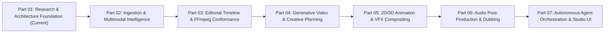

# Studio Implementation Roadmap & Phased Execution Plan
**Project:** Universal AI Video Production Studio  
**Document Version:** 1.0.0  
**Status:** Approved Master Roadmap  
**Lead Architect:** Principal Software Architect & Technical Lead  
**Verification Date:** 2026-11-21  

---

## 1. Executive Roadmap Overview

Building a professional AI Video Production Studio requires an uncompromising, staged engineering methodology. Each phase delivers fully tested, verifiable modules before subsequent higher-order creative pipelines are connected.

---

## 2. Phase Breakdown & Department Milestones

### Phase 1 (Part 01): Global Research & Architectural Foundation [COMPLETED]
- **Focus:** Ground-truth hardware and software audit, international technology research, comparative matrix, 22-department architecture specification, data schemas, and repository foundation.
- **Deliverables:**
  - Complete 14 foundational architecture documents.
  - Common data schemas (Project, Asset Manifest, Multimodal Observation, Timeline, Job Ticket).
  - Production directory structure and department interfaces.
  - Audit of Apple M4 local workstation capabilities and cloud tiering boundaries.
- **Verification Gate:** Architecture quality review passed; all ADRs approved.

### Phase 2 (Part 02): Ingestion, Conformance & Asset Management [COMPLETED]
- **Focus Departments:**
  - Department 03: Media Ingestion & Conformance
  - Department 21: Storage & Asset Management
  - Department 01: Studio Application (API Gateway)
- **Key Deliverables Completed:**
  - Media content validation inspecting 31 magic signatures; spoofed extension rejection.
  - Streaming SHA-256 cryptographic checksum calculation and duplicate deduplication.
  - Non-destructive original preservation in project-partitioned storage (`assets/{project_id}/originals/`).
  - Stream inspection and metadata extraction via FFprobe and Pillow (24 dimensions).
  - Asynchronous derivative generation: thumbnails, contact sheets, 720p web previews, ProRes proxies, 24-bit 48kHz WAV audio extraction, and waveform peak vectors.
  - Asynchronous job worker queue with crash recovery and 3x retry exponential backoff.
  - Persistent SQLite Central Asset Registry with 6 relational tables.
  - Complete REST API with 11 endpoints.
- **Verification Gate:** 12 automated unit and integration tests passing with 100% success rate.

### Phase 3 (Part 03): Multimodal Video, Audio & Reference Understanding Engine [COMPLETED]
- **Focus Departments:**
  - Department 04: Media Intelligence
  - Department 05: Multimodal Providers
  - Department 01: Studio Application (API Gateway)
- **Key Deliverables Completed:**
  - Dual-engine deterministic cut detection via PySceneDetect `AdaptiveDetector` with OpenCV HSV color-histogram correlation fallback.
  - Farneback dense optical flow vector field decomposition classifying `STATIC`, `PAN_LEFT/RIGHT`, `TILT_UP/DOWN`, `ZOOM_IN/OUT`, `TRACKING`, and `HANDHELD_JITTER`.
  - faster-whisper CTranslate2 `int8` multilingual speech recognition on Apple M4 CPU with word-level timestamps and acoustic speaker turn heuristics.
  - SciPy digital signal processing extracting tempo (BPM), beat grid timestamps, short-time RMS energy profiling, and silence boundaries.
  - Computer vision tracking across video frames with OpenCV HOG and adaptive MOG2 motion saliency fallback.
  - Morphological gradient text line detection and spatial categorization into `TITLE`, `SUBTITLE`, `LOWER_THIRD`, and `GENERAL`.
  - Reference video style deconstruction: Average Shot Length (ASL), Cuts Per Minute (CPM), pacing classification, and K-Means 5-color dominant palette.
  - Multi-video comparison calculating pacing match scores, visual lighting similarity, camera motion alignment, and actionable editorial recommendations.
  - Hybrid multi-modal semantic search across transcripts, on-screen OCR, detected objects, and camera movements.
  - Unified multimodal provider router supporting Google Gemini 2.0 Flash / 1.5 Pro, TwelveLabs Marengo/Pegasus, and Local Machine On-Device processing.
  - 11 new REST API endpoints registered and verified.
- **Verification Gate:** 12 automated unit and integration tests passing in 2.610s (28 cumulative studio tests passing in 4.667s).

### Phase 4 (Part 04): AI Director, Creative Reasoning & Production Planning Engine [COMPLETED]
- **Focus Departments:**
  - Department 06: Creative Direction
  - Department 07: Production Planning
  - Department 12: Character Production
  - Department 01: Studio Application (API Gateway)
- **Key Deliverables Completed:**
  - Canonical planning data models and 25 core classes/enums (`core/planning/planning_models.py`).
  - Relational database schema with 11 specialized planning tables in SQLite (`core/assets/database.py`).
  - Structured brief parsing with assumption logging and clarification question generation (`departments/06_creative_direction/brief_interpreter.py`).
  - Multi-concept generation producing at least 3 materially distinct creative concepts with complexity ratings (`departments/06_creative_direction/concept_generator.py`).
  - Screenplay generation and algorithmic speech duration estimation based on 140 WPM baseline plus punctuation pause buffering (`departments/06_creative_direction/script_engine.py`).
  - Cinematography shot planning specifying focal lengths (18mm-100mm), camera angles, motions, and lighting (`departments/06_creative_direction/shot_planner.py`).
  - Storyboard frame generation with prompt specifications and composition guidelines (`departments/06_creative_direction/storyboard_planner.py`).
  - Reference style transfer integrating Part 03's `ReferenceProfile` while enforcing IP hygiene and trademark guardrails (`departments/06_creative_direction/style_interpreter.py`).
  - World, character, and environment registry with automated shot continuity auditing (`departments/12_character_production/continuity_service.py`).
  - Mode B editing blueprinting mapping source footage boundaries to target timeline sequence and flagging coverage gaps (`departments/07_production_planning/edit_planner.py`).
  - Production breakdown compiling shots into a departmental dependency DAG with compute cost estimates (`departments/07_production_planning/production_breakdown.py`).
  - Hardware feasibility checking on Apple Silicon M4 with remote GPU routing and cost uncertainty intervals (`departments/07_production_planning/feasibility_evaluator.py`).
  - Master production blueprint manager enforcing human director approval gates (`departments/07_production_planning/blueprint_manager.py`).
  - 15 new REST API endpoints registered and validated in `departments/01_studio_application/api.py`.
- **Verification Gate:** 11 automated unit and integration tests passing in 0.354s (39 cumulative studio tests passing in 4.904s).

### Phase 5 (Part 05): 2D/3D Animation, Motion Graphics & VFX Compositing
- **Focus Departments:**
  - Department 09: Motion Graphics (Motion Canvas)
  - Department 10: 2D Animation (Blender Grease Pencil)
  - Department 11: 3D Animation (Blender Headless / OpenUSD)
  - Department 13: VFX & Compositing (SAM 2.1 / OpenColorIO)
  - Department 16: Color & Restoration
- **Key Deliverables:**
  - Automated 2D motion graphics generation in Motion Canvas (titles, lower-thirds, data graphics).
  - Headless Blender scripts for automated camera animation and Cycles/EEVEE rendering.
  - Zero-shot video rotoscoping pipeline using SAM 2.1 Video Predictor.
  - OpenColorIO ACEScg color pipeline and Real-ESRGAN super-resolution upscaler.
- **Verification Gate:** Transparent alpha-channel title composite overlaid onto a camera-tracked 3D scene with ACEScg color conformance.

### Phase 6 (Part 06): Professional Audio Post-Production & Finishing
- **Focus Departments:**
  - Department 14: Audio Production (Spotify Pedalboard)
  - Department 17: Subtitles & Dubbing (WhisperX / ElevenLabs / Kokoro)
  - Department 18: Quality Control (Automated QC)
- **Key Deliverables:**
  - Programmatic multi-track audio DSP: dynamic EQ, compression, spatial reverb, and stem isolation via Demucs.
  - EBU R128 broadcast loudness normalization (-14 LUFS / -23 LUFS).
  - Automated multi-language subtitle generation (.srt, .vtt, styled .ass) and voice cloning dubbing.
  - Automated QC inspection: detection of black frames, freeze frames, and audio clipping.
- **Verification Gate:** Full 64-track audio mix meeting EBU R128 broadcast loudness standards with automated PASS verification from the QC engine.

### Phase 7 (Part 07): Autonomous Agent Orchestration & Studio Application
- **Focus Departments:**
  - Department 01: Studio Application (UI & Streaming Viewport)
  - Department 20: Agent Orchestration (LangGraph + Temporal.io)
- **Key Deliverables:**
  - LangGraph hierarchical supervisor-specialist decision engine.
  - Temporal.io durable workflow execution protecting long-running render jobs.
  - Model Context Protocol (MCP) server exposing all studio tools to agents.
  - Web-based Studio UI with real-time video scrubbing, chat director prompt, and Human-in-the-Loop review gates.
- **Verification Gate:** End-to-end autonomous creation: natural language user prompt -> script -> generation -> assembly -> audio mix -> QC -> delivery package with user approval checkpoints.
