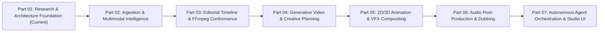

# Studio Implementation Roadmap & Phased Execution Plan
**Project:** Universal AI Video Production Studio  
**Document Version:** 1.0.0  
**Status:** Approved Master Roadmap  
**Lead Architect:** Principal Software Architect & Technical Lead  
**Verification Date:** 2026-11-21  

---

## 1. Executive Roadmap Overview

Building a professional AI Video Production Studio requires an uncompromising, staged engineering methodology. Each phase delivers fully tested, verifiable modules before subsequent higher-order creative pipelines are connected.

---

## 2. Phase Breakdown & Department Milestones

### Phase 1 (Part 01): Global Research & Architectural Foundation [COMPLETED]
- **Focus:** Ground-truth hardware and software audit, international technology research, comparative matrix, 22-department architecture specification, data schemas, and repository foundation.
- **Deliverables:**
  - Complete 14 foundational architecture documents.
  - Common data schemas (Project, Asset Manifest, Multimodal Observation, Timeline, Job Ticket).
  - Production directory structure and department interfaces.
  - Audit of Apple M4 local workstation capabilities and cloud tiering boundaries.
- **Verification Gate:** Architecture quality review passed; all ADRs approved.

### Phase 2 (Part 02): Ingestion, Conformance & Asset Management [COMPLETED]
- **Focus Departments:**
  - Department 03: Media Ingestion & Conformance
  - Department 21: Storage & Asset Management
  - Department 01: Studio Application (API Gateway)
- **Key Deliverables Completed:**
  - Media content validation inspecting 31 magic signatures; spoofed extension rejection.
  - Streaming SHA-256 cryptographic checksum calculation and duplicate deduplication.
  - Non-destructive original preservation in project-partitioned storage (`assets/{project_id}/originals/`).
  - Stream inspection and metadata extraction via FFprobe and Pillow (24 dimensions).
  - Asynchronous derivative generation: thumbnails, contact sheets, 720p web previews, ProRes proxies, 24-bit 48kHz WAV audio extraction, and waveform peak vectors.
  - Asynchronous job worker queue with crash recovery and 3x retry exponential backoff.
  - Persistent SQLite Central Asset Registry with 6 relational tables.
  - Complete REST API with 11 endpoints.
- **Verification Gate:** 12 automated unit and integration tests passing with 100% success rate.

### Phase 3 (Part 03): Multimodal Video, Audio & Reference Understanding Engine [COMPLETED]
- **Focus Departments:**
  - Department 04: Media Intelligence
  - Department 05: Multimodal Providers
  - Department 01: Studio Application (API Gateway)
- **Key Deliverables Completed:**
  - Dual-engine deterministic cut detection via PySceneDetect `AdaptiveDetector` with OpenCV HSV color-histogram correlation fallback.
  - Farneback dense optical flow vector field decomposition classifying `STATIC`, `PAN_LEFT/RIGHT`, `TILT_UP/DOWN`, `ZOOM_IN/OUT`, `TRACKING`, and `HANDHELD_JITTER`.
  - faster-whisper CTranslate2 `int8` multilingual speech recognition on Apple M4 CPU with word-level timestamps and acoustic speaker turn heuristics.
  - SciPy digital signal processing extracting tempo (BPM), beat grid timestamps, short-time RMS energy profiling, and silence boundaries.
  - Computer vision tracking across video frames with OpenCV HOG and adaptive MOG2 motion saliency fallback.
  - Morphological gradient text line detection and spatial categorization into `TITLE`, `SUBTITLE`, `LOWER_THIRD`, and `GENERAL`.
  - Reference video style deconstruction: Average Shot Length (ASL), Cuts Per Minute (CPM), pacing classification, and K-Means 5-color dominant palette.
  - Multi-video comparison calculating pacing match scores, visual lighting similarity, camera motion alignment, and actionable editorial recommendations.
  - Hybrid multi-modal semantic search across transcripts, on-screen OCR, detected objects, and camera movements.
  - Unified multimodal provider router supporting Google Gemini 2.0 Flash / 1.5 Pro, TwelveLabs Marengo/Pegasus, and Local Machine On-Device processing.
  - 11 new REST API endpoints registered and verified.
- **Verification Gate:** 12 automated unit and integration tests passing in 2.610s (28 cumulative studio tests passing in 4.667s).

### Phase 4 (Part 04): AI Director, Creative Reasoning & Production Planning Engine [COMPLETED]
- **Focus Departments:**
  - Department 06: Creative Direction
  - Department 07: Production Planning
  - Department 12: Character Production
  - Department 01: Studio Application (API Gateway)
- **Key Deliverables Completed:**
  - Canonical planning data models and 25 core classes/enums (`core/planning/planning_models.py`).
  - Relational database schema with 11 specialized planning tables in SQLite (`core/assets/database.py`).
  - Structured brief parsing with assumption logging and clarification question generation (`departments/06_creative_direction/brief_interpreter.py`).
  - Multi-concept generation producing at least 3 materially distinct creative concepts with complexity ratings (`departments/06_creative_direction/concept_generator.py`).
  - Screenplay generation and algorithmic speech duration estimation based on 140 WPM baseline plus punctuation pause buffering (`departments/06_creative_direction/script_engine.py`).
  - Cinematography shot planning specifying focal lengths (18mm-100mm), camera angles, motions, and lighting (`departments/06_creative_direction/shot_planner.py`).
  - Storyboard frame generation with prompt specifications and composition guidelines (`departments/06_creative_direction/storyboard_planner.py`).
  - Reference style transfer integrating Part 03's `ReferenceProfile` while enforcing IP hygiene and trademark guardrails (`departments/06_creative_direction/style_interpreter.py`).
  - World, character, and environment registry with automated shot continuity auditing (`departments/12_character_production/continuity_service.py`).
  - Mode B editing blueprinting mapping source footage boundaries to target timeline sequence and flagging coverage gaps (`departments/07_production_planning/edit_planner.py`).
  - Production breakdown compiling shots into a departmental dependency DAG with compute cost estimates (`departments/07_production_planning/production_breakdown.py`).
  - Hardware feasibility checking on Apple Silicon M4 with remote GPU routing and cost uncertainty intervals (`departments/07_production_planning/feasibility_evaluator.py`).
  - Master production blueprint manager enforcing human director approval gates (`departments/07_production_planning/blueprint_manager.py`).
  - 15 new REST API endpoints registered and validated in `departments/01_studio_application/api.py`.
- **Verification Gate:** 11 automated unit and integration tests passing in 0.354s (39 cumulative studio tests passing in 4.904s).

### Phase 5 (Part 05): Professional Non-Linear Video Editing Engine [COMPLETED]
- **Focus Departments:**
  - Department 08: Video Editing
  - Department 01: Studio Application (API Gateway)
  - Department 21: Storage & Asset Management
- **Key Deliverables Completed:**
  - Canonical timeline architecture based on immutable rational time arithmetic (`RationalTime(value, rate)`).
  - Multi-track layering for video (`V1`, `V2`, `V3`) and audio (`A1`, `A2`, `A3`) with mute, solo, and locking.
  - Complete suite of programmatic editorial operations: append, overwrite, insert (ripple), split, trim in/out, roll edit, slip edit, slide edit, ripple delete, J-cuts, and L-cuts.
  - Keyframe interpolation engine supporting `LINEAR`, `EASE_IN`, `EASE_OUT`, `EASE_IN_OUT`, and `HOLD` curves.
  - Transition and effect registry with automated FFmpeg complex filter mapping (`xfade`, `acrossfade`, `overlay`, `amix`, `volume`, `eq`).
  - Audio-video synchronization engine with drift detection and linked clip pairing.
  - OpenTimelineIO 0.18.1 bidirectional interchange adapter with gap preservation for DaVinci Resolve, Premiere Pro, and Final Cut Pro.
  - Execution engine for Part 04's `EditingBlueprint` transforming planning instructions into playable timelines.
  - Preview engine for low-latency 360p/720p proxy generation and single-frame snapshot scrubbing.
  - Deterministic rendering pipeline with dynamic `-filter_complex` compilation, progress tracking, and post-render FFprobe verification.
  - SQLite persistence across 9 relational tables and transactional undo/redo snapshot stack.
  - 16 new REST API endpoints registered and verified.
- **Verification Gate:** 12 automated unit and integration tests passing in 1.087s (51 cumulative studio tests passing in 5.931s with 100% success rate).

### Phase 6 (Part 06): Professional Motion Graphics & Typography Studio [COMPLETED]
- **Focus Departments:**
  - Department 09: Motion Graphics
  - Department 01: Studio Application (API Gateway)
  - Department 08: Video Editing (Timeline Integration)
- **Key Deliverables Completed:**
  - Canonical motion composition schema (`MotionComposition`, `MotionScene`, `MotionLayer`, `Transform2D`) supporting text, shapes, charts, HUDs, and brand elements.
  - Procedural vector SVG renderer generating resolution-independent, deterministic vector frames.
  - High-performance Canvas2D raster engine utilizing Pillow and streaming uncompressed PNG frames directly into FFmpeg `image2pipe` for ProRes 4444 and WebM alpha video.
  - Intelligent motion renderer router directing compositions between vector and raster pipelines with fallback support.
  - Multilingual typography engine supporting Unicode grapheme cluster shaping for Indic (Devanagari) scripts, automated text wrapping, and safe-margin checking.
  - Procedural animation engine implementing 6 continuous mathematical easing curves (`LINEAR`, `EASE_IN`, `EASE_OUT`, `EASE_IN_OUT`, `SPRING`, `BOUNCE`), stagger, and property interpolation.
  - Design quality validator checking safe areas (80% title, 90% action), WCAG 2.1 AA luminance contrast, and automated aspect ratio adaptation (16:9, 9:16, 1:1).
  - Production preset registry with 8+ built-in presets (typewriter, cinematic titles, documentary lower thirds, animated bar charts, progress rings, HUD reticles, brand reveals).
  - Audio and timeline synchronization engine aligning word-level speech transcripts and musical beat grids with motion keyframes.
  - AI Director motion bridge translating natural-language creative prompts into validated composition specifications.
  - Seamless Part 05 NLE timeline bridge rendering transparent ProRes 4444 overlays, registering in SQLite Asset Registry, and inserting onto Track `V3`.
  - 8 new REST API endpoints registered and verified in `departments/01_studio_application/api.py`.
- **Verification Gate:** 12 automated unit and integration tests passing in 1.857s; all 63 cumulative studio tests passing in 7.973s with 100% success rate. All 10 visual acceptance example artifacts rendered into `test_artifacts/motion_graphics/`.

### Phase 7 (Part 07): Advanced VFX & Compositing Studio (Department 13) — [COMPLETED]
- **Focus Departments:**
  - Department 13: VFX & Compositing (Deterministic Local DAG + Headless Blender)
- **Key Deliverables:**
  - Node-based Directed Acyclic Graph (DAG) compositing engine with topological execution.
  - Green/blue chroma keying with color difference despill and alpha matte refinement.
  - 4-point planar tracking & perspective homography warping (`cv2.warpPerspective`).
  - Feature point tracking via Lucas-Kanade optical flow (`cv2.calcOpticalFlowPyrLK`).
  - Object removal and video cleanup via Telea fast marching inpainting.
  - Optical light wrapping and procedural dust particle simulation.
  - Lens bloom glow and RGB chromatic aberration.
  - Dual-engine architecture: LocalCompositorEngine + BlenderCompositorEngine router.
  - Automated VFX quality control auditor (matte holes, spill leakage, edge halos).
  - Inter-departmental timeline bridge and director blueprint bridge.
  - Relational SQLite tables (`vfx_projects`, `vfx_shot_tasks`) and REST API endpoints.
- **Verification Gate:** 12 automated unit tests passing in 0.395s; all 75 cumulative studio tests passing in 8.869s with 100% success rate. All visual acceptance artifacts rendered into `test_artifacts/vfx/`.

### Phase 8 (Part 08): Professional 2D Animation, Anime & Character Studio (Departments 10 & 12) — [COMPLETED]
- **Focus Departments:**
  - Department 10: 2D Animation (Traditional Cel, 2D Rigging, Anime Pipeline)
  - Department 12: Character Production (Character Identity, Settei Model Sheets)
- **Key Deliverables:**
  - Canonical 2D Animation project schema (`AnimationProject`, `AnimationScene`, `AnimationShot`, `AnimationTrack`, `DrawingExposure`).
  - Persistent character identity DNA, proportion validation ($\Delta_{prop} \le 5\%$), and Lab color distance checks ($\Delta E \le 8.0$).
  - 5-angle Settei turnaround model sheets with horizontal alignment guides and color palette chips.
  - 2D skeletal bone rigging and analytical 2-bone Inverse Kinematics (IK) with pole constraints.
  - Cut-out character puppetry and 8-frame walk cycle stepped on 2s (12 FPS).
  - Dedicated anime production pipeline: 3-tier cel shading (Base, Shadow, Highlight) and multiplane parallax backgrounds.
  - Speech-synced facial mouth visemes (8 phoneme shapes) and periodic eye blinks.
  - AI motion retargeting and easing curve in-betweening.
  - Transparent Apple ProRes 4444 video export, sprite sheet atlas packager, and direct NLE timeline insertion (V1/V3).
  - SQLite persistence (`character_identities`, `animation_projects`, `animation_assets`) and 5 REST API endpoints.
- **Verification Gate:** 12 automated unit tests passing in 0.428s; all 87 cumulative studio tests passing in 8.962s with 100% success rate. All visual acceptance artifacts rendered into `test_artifacts/animation_2d/`.

### Phase 9 (Part 09): 3D Animation, OpenUSD & Generative Video Integration
- **Focus Departments:**
  - Department 11: 3D Animation (Blender Headless / OpenUSD)
  - Department 15: AI Generation Router (Runway, Kling, Wan2.1, Flux.1)
  - Department 16: Color & Restoration (Real-ESRGAN, RIFE)

### Phase 10 (Part 10): Professional Audio Post-Production & Finishing [COMPLETED]
- **Focus Departments:**
  - Department 14: Audio Production (Spotify Pedalboard DSP, Multitrack Mixer, Dialogue Cleaner)
  - Department 17: Subtitles & Dubbing (WhisperX / ElevenLabs / Kokoro-82M Voice Dubbing)
- **Key Deliverables:**
  - In-process 32-bit float multitrack mixing engine with Spotify Pedalboard JUCE C++ acceleration and pure SciPy fallbacks.
  - 5-band parametric EQ (HPF, LPF, Peaking, High/Low Shelf, Notch) and dynamic compressor/limiter.
  - ITU-R BS.1770-4 / EBU R128 gated loudness normalizer conforming to YouTube (-14 LUFS), Apple Podcasts (-16 LUFS), and European broadcast (-23 LUFS) with -1.0 dBTP ceiling.
  - Dialogue restoration pipeline with 50/60 Hz mains hum attenuation, low rumble filtering, spectral subtraction denoising, and sibilance de-essing.
  - Automated dialogue-triggered sidechain music ducking and room tone extraction with equal-power looping.
  - Procedural sound design synthesizer for cinematic sub-impacts, swept whoosh transitions, exponential tension risers, and ambient drones.
  - 4-stem source separation (`vocals`, `drums`, `bass`, `other`) using local harmonic-percussive STFT decomposition.
  - Voice talent dubbing generator with biometric consent verification and emotional inflection.
  - Bidirectional OpenTimelineIO timeline bridge and Director blueprint audio cue parser.
- **Verification Gate:** 20/20 unit tests passing in `tests/unit/test_audio_production.py`; full studio test suite at 107/107 passing tests (100%); visual and audio artifacts generated in `test_artifacts/audio/`.

### Phase 11 (Part 11): AI Video, Image, Voice & Music Generation Studio [COMPLETED]
- **Focus Departments:**
  - Department 15: AI Generation (Runway, Kling, Wan2.1, FLUX.1, ElevenLabs, Mock Router)
- **Key Deliverables:**
  - Unified, capability-based generative AI studio integrating video, image, speech, music, sound design, and 3D generation.
  - Provider-independent abstraction (`BaseGenerationProvider`, `ProviderRegistry`) decoupling studio logic from commercial APIs and local weights.
  - Multi-dimensional prompt compiler (`PromptCompiler`) translating structured creative dimensions into Runway, Kling, FLUX, and Midjourney syntax.
  - Intelligent router (`GenerationRouter`) matching requests by modality, resolution, aspect ratio, frame rate, and budget.
  - Multi-tier financial budget firewall (`GenerationBudgetManager`) enforcing per-shot and project-level spending caps.
  - Asynchronous background job queue (`GenerationJobQueue`) with SHA-256 cryptographic idempotency caching.
  - Post-generation media quality control validator (`MediaValidator`) detecting black frames, freeze frames, and digital audio clipping.
  - Human-in-the-loop approval gate (`ApprovalGateManager`) holding high-cost generations (> $1.00) for human sign-off.
  - Inter-department studio bridges connecting AI Director blueprints, Central Asset Database, and OpenTimelineIO editorial tracks.
  - SQLite persistence (`generation_jobs`, `generation_character_profiles`) and 7 FastAPI REST endpoints.
- **Verification Gate:** 20/20 unit tests passing in `tests/unit/test_ai_generation.py`; all 127 studio platform tests passing (100% pass rate in 9.431s); test media generated in `test_artifacts/generation/`.

### Phase 8 (Part 08): Autonomous Agent Orchestration & Studio Application
- **Focus Departments:**
  - Department 01: Studio Application (UI & Streaming Viewport)
  - Department 20: Agent Orchestration (LangGraph + Temporal.io)
- **Key Deliverables:**
  - LangGraph hierarchical supervisor-specialist decision engine.
  - Temporal.io durable workflow execution protecting long-running render jobs.
  - Model Context Protocol (MCP) server exposing all studio tools to agents.
  - Web-based Studio UI with real-time video scrubbing, chat director prompt, and Human-in-the-Loop review gates.
- **Verification Gate:** End-to-end autonomous creation: natural language user prompt -> script -> generation -> assembly -> audio mix -> QC -> delivery package with user approval checkpoints.
