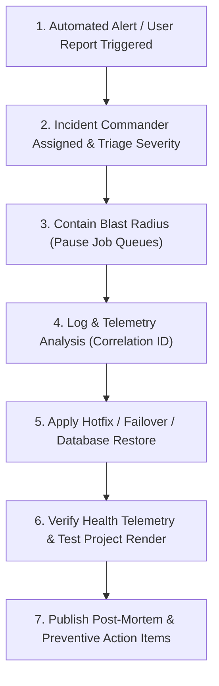

# Incident Response & On-Call Playbook
**Project:** Universal AI Video Production Studio  
**Document Version:** 1.0.0  
**Severity Levels:** SEV-1 (Critical Outage), SEV-2 (Degraded Production), SEV-3 (Minor Defect)  

---

## 1. Incident Severity Definitions

| Severity | Definition | Response SLA | Escalation Target |
| :--- | :--- | :--- | :--- |
| **SEV-1 (Critical)** | Entire studio application down; database corrupted; video rendering completely offline. | <15 Minutes | Lead Platform Architect & Lead Pipeline Engineer |
| **SEV-2 (Major)** | Core department failure (e.g. Ingestion stuck; Whisper transcription failing; AI router 500s). | <1 Hour | Department Module Lead |
| **SEV-3 (Minor)** | Cosmetic UI glitch; minor subtitle styling discrepancy; non-blocking performance degradation. | <24 Hours | Product Engineering Team |

---

## 2. SEV-1 Incident Response Workflow

---

## 3. Incident Scenarios & Immediate Playbooks

### Playbook A: Storage Exhaustion Incident
- **Alert:** `DiskSpaceCritical` (Free disk space < 5.0 GB).
- **Immediate Actions:**
  1. Automated safety kicks in: background queues pause new render submissions.
  2. Run orphan cleanup: `python3 scripts/backup_restore.py orphans`.
  3. Purge temp scratch directory: `rm -rf temp/*`.
  4. Verify free disk returns above 15 GB before resuming worker queues.

### Playbook B: Massive Render Job Failure Cascade
- **Alert:** `studio_job_failures_total` spikes > 10 in 2 minutes.
- **Immediate Actions:**
  1. Inspect error category in logs: `grep -i "error" logs/studio.jsonl | tail -n 20`.
  2. If hardware codec crashed, force CPU fallback mode by setting `HARDWARE_ACCELERATION=cpu` in `.env`.
  3. Restart studio application.
