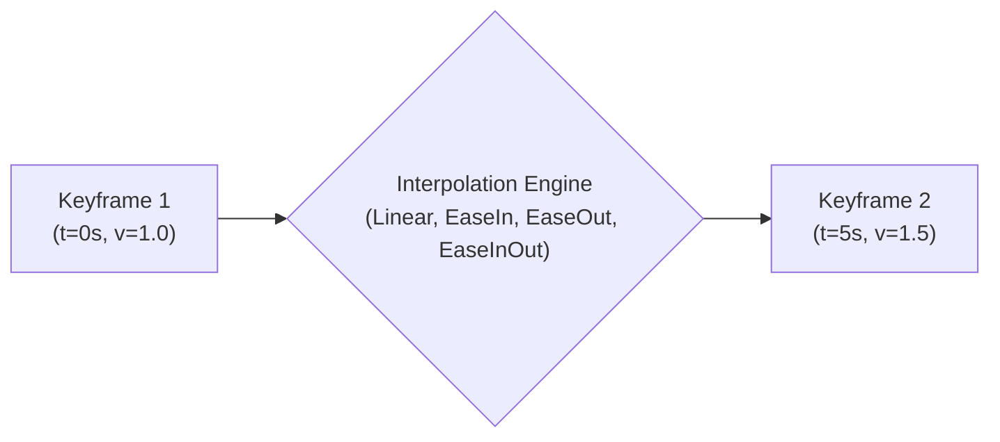

# Keyframe System & Interpolation Engine
**Project:** Universal AI Video Production Studio  
**Document Version:** 1.0.0  
**Status:** Approved Master Specification  
**Lead Architect:** Principal Video Editing Systems Architect  
**Verification Date:** 2026-11-21  

---

## 1. Keyframe Architecture

The Keyframe Engine (`core/timeline/keyframe_engine.py`) provides continuous mathematical parameter curves over time. Any numeric property of an `Effect` (opacity, scale, pan, volume, blur radius) can be modulated over time by defining two or more keyframes.



### Keyframe Definition
```python
@dataclass
class Keyframe:
    keyframe_id: str
    offset_time: RationalTime
    parameter_name: str
    value: float
    interpolation: InterpolationMode = InterpolationMode.LINEAR
```
- `offset_time`: Relative rational timestamp from the start of the clip (`0.0` is the first frame of the clip).
- `parameter_name`: The specific attribute being modulated (e.g. `"opacity"`, `"scale"`, `"volume"`).
- `value`: Target floating-point value at `offset_time`.
- `interpolation`: Mathematical easing mode connecting this keyframe to the subsequent keyframe.

---

## 2. Interpolation Modes & Mathematical Formulations

Given two adjacent keyframes $K_1 = (t_1, v_1)$ and $K_2 = (t_2, v_2)$ where $t_1 \le t \le t_2$:
The normalized time progress is:
$$\tau = \frac{t - t_1}{t_2 - t_1}, \quad \tau \in [0.0, 1.0]$$

### 2.1 HOLD (Step Function)
Value remains constant at $v_1$ until $t_2$:
$$v(t) = \begin{cases} v_1 & \tau < 1.0 \\ v_2 & \tau \ge 1.0 \end{cases}$$

### 2.2 LINEAR (Direct Vector Lerp)
Constant rate of change between keyframes:
$$v(t) = v_1 + \tau \cdot (v_2 - v_1)$$

### 2.3 EASE_IN (Quadratic Acceleration)
Slow start, accelerating towards destination:
$$f(\tau) = \tau^2$$
$$v(t) = v_1 + f(\tau) \cdot (v_2 - v_1)$$

### 2.4 EASE_OUT (Quadratic Deceleration)
Fast start, decelerating towards destination:
$$f(\tau) = 1.0 - (1.0 - \tau)^2$$
$$v(t) = v_1 + f(\tau) \cdot (v_2 - v_1)$$

### 2.5 EASE_IN_OUT (Smooth S-Curve Hermite / Cubic)
Slow acceleration followed by slow deceleration (C1 continuous):
$$f(\tau) = 3\tau^2 - 2\tau^3 \quad \text{(Smoothstep)}$$
$$v(t) = v_1 + f(\tau) \cdot (v_2 - v_1)$$

---

## 3. Boundary & Extrapolation Behavior

When evaluating a parameter at timestamp $t$:
1. If $t \le t_1$ (before the first keyframe): $v(t) = v_1$ (clamped to initial value).
2. If $t \ge t_n$ (after the last keyframe): $v(t) = v_n$ (clamped to final value).
3. If no keyframes exist for the parameter: returns the default effect parameter value.
