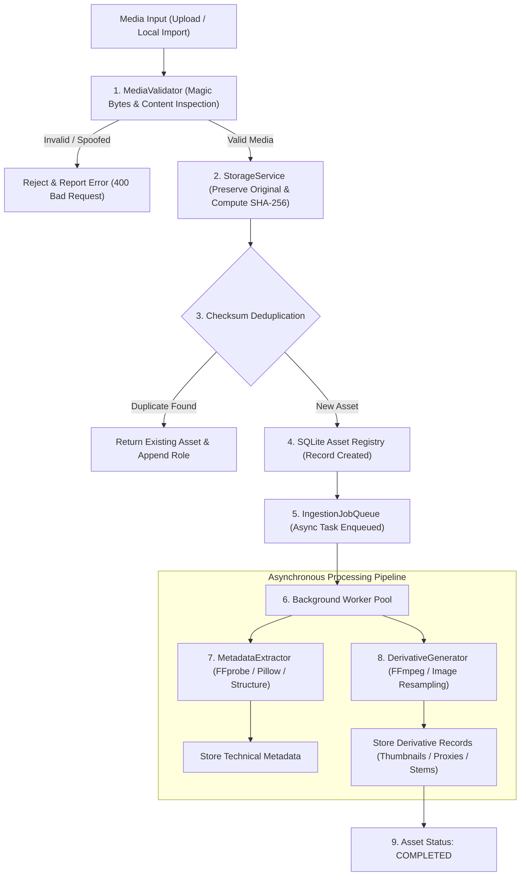

# Universal Media Ingestion Architecture
**Project:** Universal AI Video Production Studio  
**Phase:** Part 02 — Media Ingestion & Asset Management Infrastructure  
**Document Version:** 1.0.0  
**Status:** Implemented & Verified  
**Date:** 2026-11-21  

---

## 1. Architectural Mission

The Universal Media Ingestion Infrastructure serves as the input gateway for all physical media assets across the 22 production departments. It guarantees content validation, non-destructive original file preservation, stream metadata introspection, asynchronous derivative generation, and centralized registry indexing.

---

## 2. The 14-Step Ingestion Pipeline

1. **Intake & Transport:** Upload streamed via multipart HTTP chunking or local filesystem path pointer.
2. **Untrusted Input Validation:** Validates file size against category ceilings and sanitizes filename.
3. **Magic Signature Introspection:** Inspects binary headers (e.g. `ftyp`, `EBML`, `RIFF`, `fLaC`, `PNG`, `glTF`, `BLENDER`) rather than trusting file extensions.
4. **Stable Identity Generation:** Generates an immutable UUIDv4 (`asset_id`).
5. **Cryptographic Checksumming:** Computes streaming SHA-256 hash without loading entire file into RAM.
6. **Original Preservation:** Stores original file in isolated project storage (`assets/{project_id}/originals/{asset_id}_{filename}`). The original is never modified, transcoded, or overwritten.
7. **Deduplication Check:** Checks if an asset with the identical SHA-256 checksum already exists within the project. If found, returns existing asset and updates roles without redundant disk duplication.
8. **Registry Insertion:** Inserts asset record into SQLite with `ProcessingStatus.QUEUED`.
9. **Non-Blocking Handshake:** Returns `202 Accepted` immediately with `asset_id` and processing job ticket.
10. **Background Job Dispatch:** Pushes task into `IngestionJobQueue` with worker retry guarantees.
11. **Stream & Codec Metadata Extraction:** Executes `FFprobe` / `Pillow` to capture frame rate, resolution, duration, color space, HDR indicators, audio channels, and timecode.
12. **Configurable Derivative Synthesis:** Generates thumbnails, contact sheets, 720p web previews, ProRes editing proxies, extracted 48kHz WAV audio, and waveform peak vectors.
13. **Derivative Registration:** Links all generated artifacts to the parent asset record in SQLite.
14. **Downstream Service Availability:** Marks asset as `ProcessingStatus.COMPLETED`, publishing it for editorial assembly (OTIO), audio mixing (Pedalboard), and AI multimodal analysis.

---

## 3. Technology Selections & Rationale

| Component | Selected Technology | Rationale | Alternatives Evaluated & Rejected |
| :--- | :--- | :--- | :--- |
| **Media Probing** | **FFprobe 8.1.2** | Universal codec and container parser, frame-rate/VFR calculations, color transfer/primaries, audio layouts. Fast and deterministic. | `MediaInfo` (extra dependency; redundant with FFprobe), Python `pymediainfo` (requires external library). |
| **Transcoding & Proxies** | **FFmpeg 8.1.2 (Apple VideoToolbox / libx264)** | Production standard for ProRes Proxy, H.264 preview, and audio extraction. Leverages Apple Silicon hardware encoding. | GStreamer (complex C bindings, non-standard on macOS), libav directly (unnecessary C API complexity). |
| **Image Extraction** | **Pillow 12.1.1** | Fast Python image manipulation, EXIF inspection, color profile parsing, WebP/JPEG generation. | `ImageMagick` (heavier binary, historical security vulnerabilities with CVEs). |
| **Database Registry** | **SQLite 3.50.4 (WAL mode)** | Zero-dependency, file-based, transactional, embedded with Python standard library. Ideal for local and edge project storage. | PostgreSQL (requires background daemon, heavy setup for local workstation dev), MongoDB (schemaless unreliability). |
| **Job Queue** | **Asyncio Queue with SQLite Persistence** | Non-blocking execution, thread-safe, automated recovery upon server restart, zero external Redis broker requirement. | Celery/Redis (violates Part 01 rule against unnecessary external service dependencies during initial phases). |

