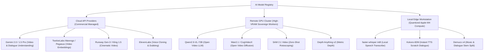

# Production AI Model Registry
**Project:** Universal AI Video Production Studio  
**Document Version:** 1.0.0  
**Status:** Active Foundation  
**Last Verified:** 2026-11-21  

---

## 1. Registry Architecture

The Model Registry catalogues all foundation models, specialized visual/audio encoders, and generative diffusion networks utilized across the studio. It specifies parameter scale, weights license, context windows, hosting tier, and endpoint protocols.

---

## 2. Multimodal Video Understanding & Reasoning Models

### 2.1 Gemini 1.5 Pro / Gemini 2.0 Pro
- **Model ID:** `model.multimodal.gemini_pro`
- **Developer:** Google DeepMind
- **Modalities:** Joint Interleaved Text, Audio, Image, Video
- **Context Window:** Up to 2,097,152 tokens (~2 hours of 1 fps video with synchronized audio)
- **Weights License:** Proprietary Commercial API (Google Cloud Vertex AI / AI Studio)
- **Commercial Use:** Permitted under standard enterprise terms. No training on enterprise data.
- **Hosting Tier:** Cloud API
- **Endpoint Protocol:** REST / gRPC via `google-genai` SDK
- **Primary Use:** Long-form narrative understanding, script-to-cut alignment, multi-scene documentary structuring.

### 2.2 TwelveLabs Marengo 2.6 & Pegasus 1.2
- **Model ID:** `model.multimodal.twelvelabs_marengo_pegasus`
- **Developer:** TwelveLabs
- **Modalities:** Video, Audio, Speech, Text-in-Video (OCR)
- **Output:** 1024-dimensional temporal vector embeddings & natural language video reasoning.
- **Weights License:** Proprietary Commercial API
- **Commercial Use:** Permitted via SaaS API subscription.
- **Hosting Tier:** Cloud API
- **Endpoint Protocol:** REST via `twelvelabs` Python SDK
- **Primary Use:** Sub-second semantic search over B-roll archives, action retrieval, foley match search.

### 2.3 Qwen2.5-VL-72B-Instruct
- **Model ID:** `model.multimodal.qwen2_5_vl_72b`
- **Developer:** Alibaba Cloud (Qwen Team)
- **Modalities:** Video, Image, Text
- **Architecture:** ViT with Dynamic Resolution + M-RoPE Multimodal LLM
- **Weights License:** Qwen Open License (Free commercial use for <100M MAU)
- **Hosting Tier:** Remote GPU Worker (NVIDIA A100/H100, 48GB VRAM in 4-bit AWQ)
- **Endpoint Protocol:** OpenAI-compatible ChatCompletions via vLLM
- **Primary Use:** Sovereign on-premise video reasoning, visual QA, frame-accurate spatial bounding box tracking.

---

## 3. Computer Vision & Visual Geometry Models

### 3.1 Segment Anything Model 2.1 (SAM 2.1 Video)
- **Model ID:** `model.cv.sam2_1_video`
- **Developer:** Meta FAIR
- **Architecture:** Streaming memory bank video transformer
- **Weights License:** **Apache 2.0**
- **Commercial Use:** 100% Permitted, unrestricted.
- **Hosting Tier:** Remote GPU Worker (16GB - 24GB VRAM)
- **Endpoint Protocol:** Python gRPC Worker / PyTorch
- **Primary Use:** Interactive video rotoscoping, automated subject matting, visual effects mask propagation.

### 3.2 Depth Anything v2 Large
- **Model ID:** `model.cv.depth_anything_v2_large`
- **Developer:** TikTok / HKUST
- **Architecture:** DINOv2 vision transformer with metric depth regression head
- **Weights License:** **Apache 2.0**
- **Commercial Use:** Permitted.
- **Hosting Tier:** Remote GPU / Local Workstation (Apple Silicon MPS)
- **Memory Footprint:** ~1.4 GB FP16
- **Primary Use:** Monocular z-depth channel extraction for 2.5D visual effects, depth-of-field synthesis, and relighting.

### 3.3 UniMatch (Unified Optical Flow)
- **Model ID:** `model.cv.unimatch`
- **Developer:** Autonomous Vision Group
- **Architecture:** Correlation transformer for dense optical flow
- **Weights License:** Apache 2.0
- **Commercial Use:** Permitted.
- **Hosting Tier:** Local Workstation / Remote GPU
- **Primary Use:** Frame-to-frame pixel velocity vectors, camera motion estimation, motion vector export.

---

## 4. Audio Intelligence & Speech Models

### 4.1 faster-whisper Large-v3
- **Model ID:** `model.audio.faster_whisper_large_v3`
- **Developer:** OpenAI / SYSTRAN (CTranslate2)
- **Architecture:** Encoder-decoder Transformer with int8 weight quantization
- **Weights License:** MIT
- **Commercial Use:** 100% Permitted.
- **Hosting Tier:** Local Workstation (Apple M4 CPU/NEON) & Remote GPU
- **Memory Footprint:** ~1.5 GB RAM (int8)
- **Primary Use:** Frame-accurate speech-to-text, subtitle generation, multi-language translation.

### 4.2 PyAnnote Audio 3.1
- **Model ID:** `model.audio.pyannote_diarization_3_1`
- **Developer:** Hervé Bredin / CNRS
- **Architecture:** SincNet acoustic encoder + temporal clustering transformer
- **Weights License:** CC-BY-4.0 (requires attribution / commercial enterprise clearance)
- **Hosting Tier:** Local M4 (PyTorch MPS) / Remote GPU
- **Primary Use:** Speaker diarization, conversational speaker timeline tagging.

### 4.3 Demucs v4 (HTDemucs)
- **Model ID:** `model.audio.demucs_v4_htdemucs`
- **Developer:** Meta AI Research
- **Architecture:** Hybrid Transformer + U-Net spectrogram separation
- **Weights License:** MIT
- **Commercial Use:** Permitted.
- **Hosting Tier:** Local Workstation (Apple M4) & Remote GPU
- **Memory Footprint:** ~3.5 GB RAM
- **Primary Use:** 4-stem audio splitting (Vocals, Drums, Bass, Other) for dialogue clean-up and dynamic re-scoring.

### 4.4 Kokoro-82M
- **Model ID:** `model.audio.kokoro_82m`
- **Developer:** Hexgrad
- **Parameters:** 82 Million
- **Weights License:** **Apache 2.0**
- **Commercial Use:** Permitted.
- **Hosting Tier:** Local Workstation (Instant CPU inference, >50x realtime)
- **Memory Footprint:** ~350 MB RAM
- **Primary Use:** Instant zero-cost scratch voice generation for storyboards and editorial timing.

---

## 5. Generative Video, Image & Music Models

### 5.1 Wan2.1 (Alibaba Video Diffusion)
- **Model ID:** `model.gen.wan2_1`
- **Developer:** Alibaba Cloud
- **Architecture:** 3D Spatiotemporal DiT (Diffusion Transformer)
- **Weights License:** **Apache 2.0**
- **Commercial Use:** 100% Permitted.
- **Hosting Tier:** Remote GPU Worker (NVIDIA A100 80GB)
- **Primary Use:** Sovereign high-fidelity text-to-video and image-to-video generation without vendor lock-in.

### 5.2 Runway Gen-3 Alpha & Kling 1.5
- **Model ID:** `model.gen.commercial_video_apis`
- **Developer:** Runway AI / Kuaishou Kling
- **Weights License:** Proprietary Commercial SaaS
- **Commercial Use:** Full commercial rights granted on paid plans.
- **Hosting Tier:** Cloud API
- **Primary Use:** Hero cinematic shots, camera motion choreography, high-impact commercial visuals.

### 5.3 Flux.1-schnell
- **Model ID:** `model.gen.flux_1_schnell`
- **Developer:** Black Forest Labs
- **Architecture:** 12B parameter Rectified Flow Transformer
- **Weights License:** **Apache 2.0**
- **Commercial Use:** 100% Permitted.
- **Hosting Tier:** Remote GPU Worker (24GB VRAM in FP8)
- **Primary Use:** Rapid concept art, character design plates, storyboard keyframes with flawless typography.

### 5.4 MusicGen Large & AudioLDM 2
- **Model ID:** `model.gen.musicgen_audioldm`
- **Developer:** Meta FAIR / University of Surrey
- **Weights License:** MIT
- **Commercial Use:** Permitted.
- **Hosting Tier:** Remote GPU Worker
- **Primary Use:** Royalty-free dynamic soundtrack synthesis and custom cinematic sound effects generation.
