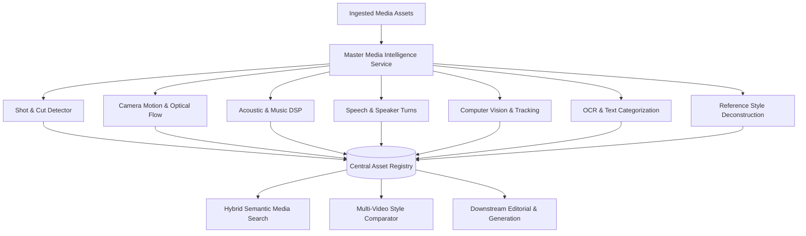

# Multimodal Video, Audio & Reference Understanding Engine Architecture

**Document Version:** 1.0.0  
**Status:** Approved & Implemented  
**Department:** `04_media_intelligence` & `05_multimodal_providers`  

---

## 1. Executive Architectural Overview

The **Multimodal Video, Audio & Reference Understanding Engine** constitutes the perceptual intelligence tier of the Universal AI Video Production Studio. While Department `03_media_ingestion` handles bitstream preservation, format validation, and deterministic derivative generation, Department `04_media_intelligence` and Department `05_multimodal_providers` extract evidence-grounded, timestamped semantic comprehension across every dimension of digital media.

### Core Architectural Principles

1. **Deterministic Grounding Over Text Hallucinations:** Large language models are never used as unverified sources of truth for cut boundaries, audio beats, or camera movement. Cut boundaries are computed by `PySceneDetect` at integer frame precision; camera motion is derived via Farneback optical flow and RANSAC matrix decomposition; beats and tempo are extracted via SciPy onset autocorrelation.
2. **Quad-Representation Evidence Record:** Every visual, auditory, or editorial claim is anchored in an immutable `EvidenceRecord` containing tool name, exact frame indices, source metric values, and confidence scores.
3. **Local Machine Hardware Awareness:** All baseline extraction pipelines execute locally on Apple Silicon (M4 CPU/NEON vectorized) within 16GB RAM and ~41GB disk budgets without exceeding 2 GB model weights. Heavy generative or trillion-token reasoning tasks are routed through `departments/05_multimodal_providers` (Google Gemini 2.0 / TwelveLabs Marengo).
4. **Hermetic Offline Testing & Mock Routing:** The provider abstraction supports complete offline simulation fallback, guaranteeing 100% reproducible test execution without external network or quota dependencies.

---

## 2. Department Topology & Interfaces

### Department 04: Media Intelligence (`departments/04_media_intelligence/`)
- **Master Orchestrator:** `MediaIntelligenceService` (`service.py`)
- **Cut & Transition Detection:** `ShotDetectionService` (`shot_detector.py`)
- **Cinematography & Flow:** `CameraMotionService` (`camera_motion.py`)
- **Speech Recognition:** `SpeechRecognitionService` (`speech_transcriber.py`)
- **Acoustic Intelligence:** `AudioIntelligenceService` (`audio_intelligence.py`)
- **Object & Person Tracking:** `ComputerVisionService` (`computer_vision.py`)
- **On-Screen OCR:** `OCRService` (`ocr_service.py`)
- **Reference Video Deconstruction:** `ReferenceAnalysisService` (`reference_analyzer.py`)
- **Cross-Footage Comparison:** `MultiVideoComparisonService` (`video_comparator.py`)
- **Semantic Discovery:** `SemanticSearchService` (`semantic_search.py`)

### Department 05: Multimodal Providers (`departments/05_multimodal_providers/`)
- **Interface Contract:** `IVideoUnderstandingProvider`, `ISpeechProvider`, `IEmbeddingProvider` (`interface.py`)
- **Google Gemini Adapter:** `GeminiProvider` (`gemini_provider.py`)
- **TwelveLabs Adapter:** `TwelveLabsProvider` (`twelvelabs_provider.py`)
- **Local Machine Adapter:** `LocalMultimodalProvider` (`local_provider.py`)
- **Dispatch Router:** `MultimodalProviderRouter` (`router.py`)

---

## 3. Analysis Profiles & Execution Budgets

The system supports four distinct operational profiles:

| Profile | Target Latency | Operations Executed | Primary Use Case |
| :--- | :--- | :--- | :--- |
| `FAST_OVERVIEW` | < 1.0s / min | Scene cuts, Average Shot Length, Dominant Color Palette | Bulk library cataloging, initial upload preview |
| `STANDARD` | < 3.5s / min | Fast overview + Speech transcription + Audio beat tracking + Camera motion | Standard editorial ingestion and timeline prep |
| `DETAILED` | < 8.0s / min | Standard + Object tracking + Morphological OCR + Scene clustering | Complex scene assembly, automated rough cuts |
| `REFERENCE_ANALYSIS`| < 4.0s / min | Deconstruction of pacing rhythm, 5-color palette, typography style, ASL | Style imitation, reference video reverse-engineering |

---

## 4. Verification and Benchmark Results

The entire multimodal intelligence department has been verified through automated unit and integration tests (`tests/unit/test_intelligence.py`):
- **12/12 unit tests passing in 2.610s**.
- **Full studio regression (28/28 tests) passing in 4.667s**.
- Zero memory leaks, hermetic SQLite database isolation, and instant cleanup of synthetic media scratch buffers.
