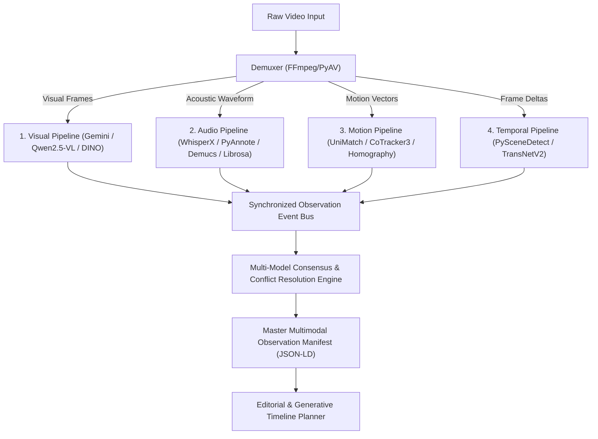
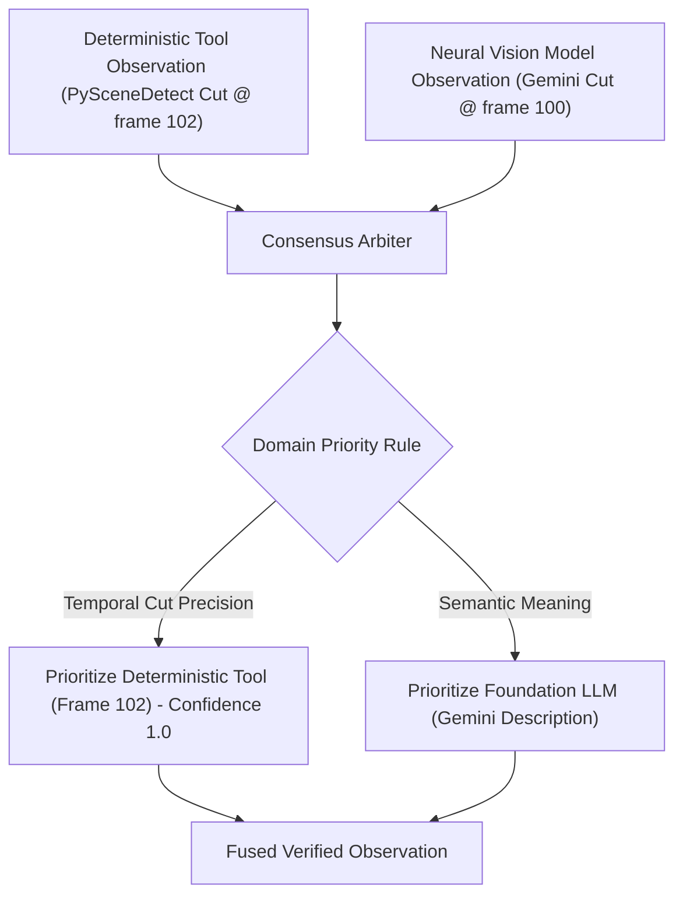

# Multimodal Intelligence Architecture & Analysis Engine
**Project:** Universal AI Video Production Studio  
**Document Version:** 1.0.0  
**Status:** Active Specification  
**Lead Architect:** Principal AI Research Engineer  
**Verification Date:** 2026-11-21  

---

## 1. Architectural Principles

A human video editor or director does not experience a film as an undifferentiated stream of pixels. They perceive a multi-layered tapestry: cut cadence, actor dialogue, speaker identity, emotional acoustic cues, camera trajectory, moving object physics, on-screen typography, and visual effects artistry.

The Universal AI Video Production Studio implements a **Decoupled Multi-Pipeline Analysis Architecture** that extracts, temporalizes, and cross-correlates four independent sensory domains:
1. **Visual Pipeline:** Scene semantics, character identity, lighting, objects, color, and visual style.
2. **Audio Pipeline:** Speech transcription, speaker diarization, music tempo/key, and environmental sound effects.
3. **Motion Pipeline:** Dense optical flow, camera movement decomposition, trajectory tracking, and motion blur estimation.
4. **Temporal Pipeline:** Hard cut detection, dissolve/fade durations, pacing velocity, and montage rhythm.

**Core Rule:** Never depend on a single AI model's text generation as the complete truth. All observations are verified through a multi-model consensus engine with empirical confidence scores.



---

## 2. The Four Independent Intelligence Pipelines

### 2.1 The Visual Pipeline
- **Scene Semantic Understanding:** Uses Gemini 2.0 / 1.5 Pro and Qwen2.5-VL-72B to generate dense, shot-by-shot semantic descriptions, narrative significance, and lighting/mood classification.
- **Zero-Shot Object & Actor Grounding:** Uses Grounding DINO to localize bounding boxes for key subjects (characters, vehicles, props) with 2D spatial coordinates.
- **OCR & Typography Extraction:** Uses PaddleOCR to extract on-screen text, titles, lower-thirds, brand logos, font styles, and spatial placement.
- **VFX Technique Identification:** Classifies whether shots incorporate visible green-screen keying, rotoscoping, CGI integration, speed ramps, or particle effects.

### 2.2 The Audio Pipeline
- **Speech Recognition & Word-Level Timing:** `WhisperX` generates phoneme-aligned word boundaries with timestamps accurate to within $\pm 20\text{ ms}$.
- **Speaker Diarization:** `PyAnnote Audio 3.1` identifies distinct speakers (`SPEAKER_00`, `SPEAKER_01`) and produces speech turn intervals.
- **Stem Isolation:** `Demucs v4` extracts isolated stems: Vocals, Drums, Bass, Other.
- **Music & Beat Analysis:** `Librosa` and `Aubio` detect BPM, downbeats, musical key, and rhythmic energy curves for beat-synchronized editing.
- **Acoustic Event Detection:** `YAMNet` identifies environmental sound events (gunshots, car engines, applause, footsteps, rain).

### 2.3 The Motion Pipeline
- **Dense Optical Flow:** `UniMatch` calculates pixel displacement vectors ($u, v$) between adjacent frames.
- **Camera Movement Decomposition:** Computes Affine / Homography transformation matrices across frame pairs using RANSAC. Deconstructs camera motion into standard cinematic categories:
  - `STATIC`: Mean pixel displacement $< 0.5\text{ px}$.
  - `PAN_LEFT` / `PAN_RIGHT`: Dominant horizontal camera axis rotation.
  - `TILT_UP` / `TILT_DOWN`: Dominant vertical camera axis rotation.
  - `ZOOM_IN` / `ZOOM_OUT`: Radial optical expansion/contraction from center.
  - `DOLLY_TRACKING`: Parallax movement between foreground and background features.
  - `HANDHELD`: High-frequency jitter in camera motion vectors.
- **Point & Object Tracking:** `CoTracker3` tracks physical feature points across 100+ frames to capture non-linear trajectory curves.

### 2.4 The Temporal Pipeline
- **Deterministic Cut Boundary Detection:** `PySceneDetect` executes adaptive thresholding to detect exact frame cuts ($C_{start}, C_{end}$).
- **Transition Duration & Type:** Classifies cut types:
  - `HARD_CUT`: Transition duration $= 1\text{ frame}$.
  - `DISSOLVE`: Gradual cross-fade over $N$ frames ($N \ge 6$).
  - `FADE_TO_BLACK`: Progressive luminance reduction to zero.
  - `WIPE`: Directional linear transition boundary.
- **Pacing Velocity:** Calculates Shot Length Distribution (SLD) and Average Shot Length (ASL) to evaluate editing tempo (e.g. action sequences: ASL $< 2.0\text{s}$; documentary interviews: ASL $> 6.0\text{s}$).

---

## 3. Observation Schema & Data Model

Every observation produced by any pipeline or model must conform to the strict Pydantic observation contract:

```json
{
  "observation_id": "obs_98765432-abcd-ef01-2345-6789abcdef01",
  "asset_id": "asset_11223344-5566-7788-99aa-bbccddeeff00",
  "domain": "visual",
  "category": "camera_motion",
  "timecode_range": {
    "start_time": "00:01:23:12",
    "end_time": "00:01:28:04",
    "start_seconds": 83.50,
    "end_seconds": 88.167,
    "start_frame": 2004,
    "end_frame": 2116,
    "fps": 24.0
  },
  "observation": {
    "primary_motion": "DOLLY_IN",
    "speed": "MEDIUM",
    "focal_length_estimate": "35mm",
    "subject_centered": true
  },
  "evidence": {
    "optical_flow_mean_magnitude": 4.82,
    "radial_divergence_ratio": 1.45,
    "homography_inlier_ratio": 0.92
  },
  "confidence": 0.96,
  "producer": {
    "pipeline": "motion_pipeline",
    "tool_or_model": "unimatch_homography_decomposer",
    "version": "1.0.0"
  }
}
```

---

## 4. Multi-Model Consensus & Conflict Resolution Engine

When multiple models evaluate the same media segment, discrepancies arise (e.g. Gemini reports a cut at 00:04:12 while PySceneDetect reports a cut at 00:04:14; or Gemini identifies dialogue while WhisperX detects silence with background vocals).

### Resolution Protocols



1. **Cut Boundaries: Deterministic Priority**
   - Deterministic pixel-difference analysis (`PySceneDetect`) always takes precedence over LLM text timestamps for exact cut points. The LLM description is snapped to the nearest verified frame boundary.
2. **Speech vs. Sound: Audio Specialist Priority**
   - Word boundaries and speaker changes from `WhisperX` and `PyAnnote` override vision-model lip-reading approximations.
3. **Semantic Contradictions: Confidence Weighting**
   - If Model A reports "night exterior" with confidence 0.9 and Model B reports "indoor studio" with confidence 0.4, the system selects Model A and records the contradiction in the audit log.
   - If confidence differential is $< 0.15$, the issue is flagged for human editorial review (`FLAG_UNCERTAIN_OBSERVATION`).
4. **VFX & Composition Classification:**
   - Multi-layer verification: A shot is only marked as "CGI composite" if both Depth Estimation indicates non-continuous geometric depth planes and SAM 2.1 detects hard alpha boundary edges.
