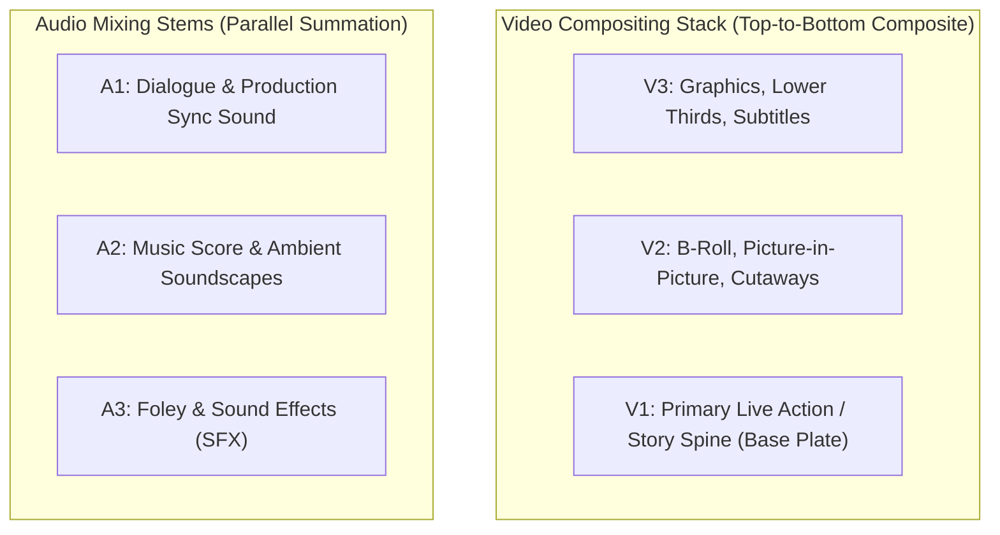

# Multi-Track Editing Specification
**Project:** Universal AI Video Production Studio  
**Document Version:** 1.0.0  
**Status:** Approved Master Specification  
**Lead Architect:** Principal Video Editing Systems Architect  
**Verification Date:** 2026-11-21  

---

## 1. Track Hierarchy & Z-Ordering

The editing engine supports an arbitrary number of video (`V1, V2, V3...`) and audio (`A1, A2, A3...`) tracks. Tracks are evaluated hierarchically according to strict stacking rules:

### 1.1 Video Layering (Visual Precedence)
- Tracks are ordered by their `index` integer.
- Lower index numbers (`V1`) form the foundational video plate.
- Higher index numbers (`V2`, `V3`) layer over lower tracks using alpha blending or geometric scaling/position transforms.
- When an upper track clip has `opacity < 1.0` or contains transparency, the underlying tracks show through.
- When a track has `is_muted = true`, its clips are bypassed entirely during preview and final render.

### 1.2 Audio Mixing (Stem Grouping)
Audio tracks run in parallel and sum into a master audio bus:
- Track A1 (Dialogue): Dialogue clips, ADR, and voiceover. Subject to dialogue ducking triggers.
- Track A2 (Music): Musical score, background beats. Automatically attenuated when dialogue is active.
- Track A3 (SFX): Impact hits, atmospheric room tone, whooshes, and foley.
- Audio tracks support individual volume attenuation, panning ($-1.0$ left to $+1.0$ right), and solo/mute states.

---

## 2. Track State Flags & Mutual Exclusivity

Every track maintains three operational boolean flags:
1. `is_locked`: When `true`, no clip, transition, or effect on this track can be added, deleted, trimmed, or moved. Prevents accidental ripple shifts.
2. `is_muted`:
   - For Video: Suppresses visual output (treated as transparent gap).
   - For Audio: Suppresses acoustic output (attenuated to $-\infty\text{ dB}$).
3. `is_solo`: When one or more tracks have `is_solo = true`, all non-soloed tracks of the same `TrackType` are automatically muted during preview and render.

---

## 3. Gap Representation & Track Topology

In physical NLE timelines, clips do not necessarily touch:
- **Gaps:** Regions of empty time on a track between the out-point of clip $i$ and in-point of clip $i+1$.
- In the Canonical Timeline Schema, gaps are implicit: clips specify their explicit `timeline_in` and `timeline_out` timestamps. Any empty duration is rendered as transparency (video) or silence (audio).
- In the **OpenTimelineIO Adapter**, gaps are materialized explicitly as `otio.schema.Gap` instances to preserve exact spacing when exporting to third-party NLEs (Premiere Pro, DaVinci Resolve).

---

## 4. Multi-Track Collision & Overlap Rules

1. **No Intra-Track Overlap:** Two clips on the same track cannot occupy the same timeline interval unless blended via an explicit `Transition`. An edit operation that places a clip over an existing clip on the same track must either:
   - Perform an **Overwrite Edit** (cutting and replacing the underlying clip range).
   - Perform an **Insert Edit** (splitting and rippling downstream clips forward).
2. **Inter-Track Independence:** Clips on different tracks (`V1` vs `V2`) may freely overlap in timeline coordinates. Upper tracks composite over lower tracks according to the complex filtergraph compositor.
