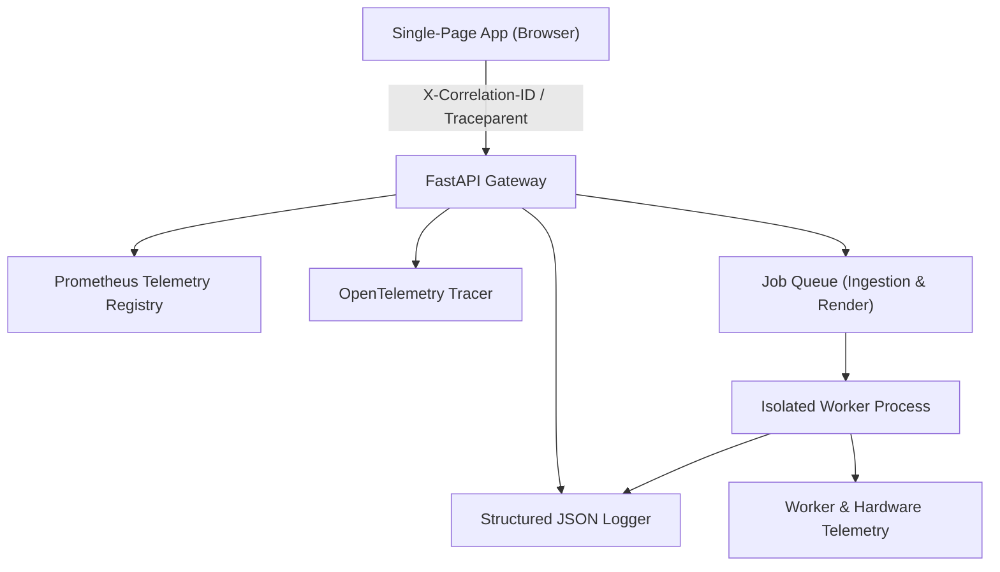

# Observability, Monitoring & Telemetry Strategy
**Project:** Universal AI Video Production Studio  
**Document Version:** 1.0.0  
**Status:** Approved Operational Specification  

---

## 1. Unified Telemetry Framework

The studio implements the three pillars of modern observability: **Structured Logging**, **Metric Instrumentation**, and **Distributed Tracing**. All telemetry events are correlated across frontend user actions, HTTP endpoints, asynchronous queues, DCC rendering engines, and cloud model providers.



---

## 2. Structured JSON Logging Architecture

All logging across all 22 departments outputs machine-readable JSON lines (`.jsonl`) to `stdout` and rotated disk logs under `logs/studio.log`.

### 2.1 Standardized Log Event Schema
```json
{
  "timestamp": "2026-11-21T17:15:30.123456Z",
  "level": "INFO",
  "correlation_id": "a98f12d4-7c3e-4b91-8d2a-194e9f3b5671",
  "trace_id": "4bf92f3577b34da6a3ce929d0e0e4736",
  "span_id": "00f067aa0ba902b7",
  "service": "studio_application",
  "department": "19_rendering_delivery",
  "project_id": "cb4f2bc9-1dc1-4445-a8af-f6b74f638851",
  "job_id": "8f12a3d4-9b12-4c8d-8a21-1123456789ab",
  "event": "render_segment_completed",
  "duration_ms": 342.5,
  "metrics": {
    "encoded_fps": 312.4,
    "output_size_bytes": 14205820,
    "hardware_acceleration": "videotoolbox"
  },
  "message": "Rendered segment 01 to ProRes 422 HQ via Apple VideoToolbox"
}
```

---

## 3. Metric Instrumentation & Telemetry Registry

The studio provides real-time system metrics via `/api/v1/system/telemetry` and standard Prometheus format at `/metrics`:

### 3.1 Primary Operational Metrics
1. **API Ingestion Rate & Latency:** `http_requests_total`, `http_request_duration_seconds{endpoint, method, status}`.
2. **Job Queue Depth & Execution:** `studio_job_queue_depth{queue_name}`, `studio_job_duration_seconds{department, task_type}`, `studio_job_failures_total{department, error_type}`.
3. **Hardware Utilization:**
   - `studio_cpu_utilization_percent`
   - `studio_memory_used_bytes` / `studio_memory_total_bytes`
   - `studio_disk_free_bytes`
   - `studio_videotoolbox_active_sessions`
4. **Media Quality Control Defect Density:** `studio_qc_defects_total{severity, rule_name}`.
5. **Generative Model Spend:** `studio_generation_cost_usd_total{provider_id, modality}`.

---

## 4. Alerting Rules & Thresholds

| Alert Name | Condition | Severity | Action Triggered |
| :--- | :--- | :--- | :--- |
| **DiskSpaceCritical** | Free disk space < 5.0 GB | **CRITICAL** | Pause all new ingestion and render jobs; trigger emergency cache cleanup. |
| **WorkerCrashLoop** | Worker restarts > 3 in 5 minutes | **CRITICAL** | Quarantine affected job ID; notify operator; alert UI popover. |
| **RenderJobTimeout** | Single segment render > 30 minutes | **WARNING** | Thread dump worker; terminate hanging FFmpeg process; attempt retry. |
| **ModelSpendSpike** | Project generation cost > $50.00 | **WARNING** | Pause autonomous agent generation loop; require human approval gate. |
| **DatabaseLockTimeout** | SQLite busy timeout > 5 seconds | **ERROR** | Log transaction trace; trigger WAL checkpoint; scale read pool. |

---

## 5. Distributed Tracing & Sentry Error Tracking

1. **W3C TraceContext Propagation:** Incoming HTTP requests receive a `traceparent` header. If absent, the API gateway mints a fresh root span. The span context is attached to asyncio tasks and passed across background job parameters.
2. **Sentry SDK Integration:** Uncaught exceptions in HTTP endpoints or background workers automatically capture stack traces, active project UUID, correlation ID, and OS hardware state without leaking user media tokens or file contents.
