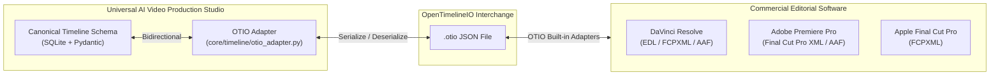

# OpenTimelineIO Interchange Support
**Project:** Universal AI Video Production Studio  
**Document Version:** 1.0.0  
**Status:** Approved Master Specification  
**Lead Architect:** Principal Video Editing Systems Architect  
**Verification Date:** 2026-11-21  

---

## 1. OpenTimelineIO Architecture

**OpenTimelineIO (OTIO)** is the open-source interchange standard governed by the Academy Software Foundation (ASWF). The Universal AI Video Production Studio adopts OTIO 0.18.1 as its primary interchange format for lossless import and export with commercial NLEs.

---

## 2. Bidirectional Mapping Specification

### 2.1 Studio `Timeline` $\to$ `otio.schema.Timeline`
1. **Container:** `otio.schema.Timeline` with global start timecode and name.
2. **Tracks:** `otio.schema.Track` instantiated for each `Track` in the sequence, preserving `TrackKind.Video` and `TrackKind.Audio`.
3. **Clips:** Each `Clip` is transformed into `otio.schema.Clip` with:
   - `source_range = otio.opentime.TimeRange(source_in, duration)`
   - `media_reference = otio.schema.ExternalReference(target_url=asset_path)`
4. **Gap Preservation:**
   - In physical timelines, clips may have empty spaces between them.
   - When converting to OTIO (which represents items strictly contiguously along a track), the adapter automatically calculates temporal deltas:
     $$\text{Gap Duration} = \text{clip}_{i+1}.\text{timeline\_in} - \text{clip}_i.\text{timeline\_out}$$
   - If $\text{Gap Duration} > 0$, an `otio.schema.Gap` of exact duration is inserted into the track.
5. **Transitions:** Instantiated as `otio.schema.Transition` linking adjacent clips.
6. **Markers:** Instantiated as `otio.schema.Marker` attached to the track or timeline.

### 2.2 `otio.schema.Timeline` $\to$ Studio `Timeline`
1. Re-creates `EditingProject` and `Timeline` in the SQLite database.
2. Unpacks tracks and iterates through items.
3. Automatically computes absolute `timeline_in` and `timeline_out` by accumulating item durations and discarding explicit `Gap` items.
4. Preserves clip media references and rational time bounds.

---

## 3. Supported Third-Party Interchange Adapters

Because the studio writes standard OTIO files, operators can use standard OTIO adapters to exchange sequences with:
- **Final Cut Pro XML (`.fcpxml`):** Direct export for Apple Final Cut Pro.
- **Premiere Pro XML (`.xml`):** Direct export for Adobe Premiere Pro.
- **CMX 3600 EDL (`.edl`):** Industry standard Edit Decision List for DaVinci Resolve color grading.
- **Avid AAF (`.aaf`):** Advanced Authoring Format for Avid Media Composer conform.
