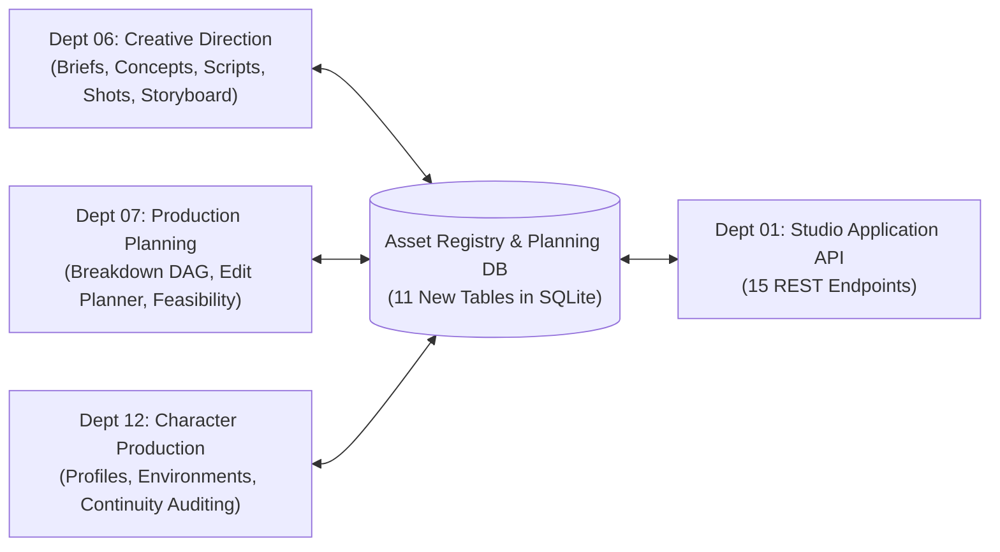

# Part 04 Implementation Report: AI Director, Creative Reasoning & Production Planning Engine
**Project:** Universal AI Video Production Studio  
**Milestone:** Part 04 — AI Director, Creative Reasoning & Production Planning Engine  
**Document Version:** 1.0.0  
**Verification Date:** 2026-11-21  
**Status:** **100% IMPLEMENTED, VERIFIED & COMMITTED**  

---

## 1. Executive Summary & Core Accomplishments

Part 04 delivers the complete cognitive intelligence, creative reasoning, and production planning foundation of the Universal AI Video Production Studio. It establishes an evidence-grounded, multi-modal decision-making engine that bridges human vision and high-level creative direction with the technical execution requirements of 22 downstream studio departments.

Unlike generic LLM wrappers that merely emit loose generative video prompts, this engine synthesizes versioned, machine-readable **Production Blueprints** governed by cinematographic principles, physical lens optics, speech duration heuristics, multi-entity world continuity, dependency DAGs, hardware tiering, and human approval gates.

---

## 2. System Architecture & Departmental Division

The implementation strictly respects the studio's 22-department boundary rules:

- **Department 06 (Creative Direction):** `brief_interpreter.py`, `concept_generator.py`, `script_engine.py`, `shot_planner.py`, `storyboard_planner.py`, `style_interpreter.py`, `director_service.py`.
- **Department 07 (Production Planning):** `production_breakdown.py`, `edit_planner.py`, `feasibility_evaluator.py`, `blueprint_manager.py`, `planning_service.py`.
- **Department 12 (Character Production):** `continuity_service.py`.
- **Core Planning Models:** `core/planning/planning_models.py` (25 canonical dataclasses and enums).
- **Relational Storage:** `core/assets/database.py` (11 new planning tables with foreign key cascades and full CRUD).
- **API Gateway:** `departments/01_studio_application/api.py` (15 REST endpoints registered).

---

## 3. Mode A: Create from Scratch (Generative Production)

1. **Brief Ingestion & Assumption Logging:** `CreativeBriefService` converts unstructured prompts into validated `CreativeBrief` records. Missing parameters automatically trigger logged assumptions (e.g. 30s duration, 16:9 aspect ratio) and clarification questions.
2. **Multi-Concept Synthesis:** `ConceptGenerationService` outputs 3 contrasting directions (*The Cinematic Journey*, *Kinetic Velocity*, *Engineered Perfection*) with distinct hooks, color schemes, and complexity scores.
3. **Screenplay Engine:** `ScriptAndNarrativeService` structures scenes, sluglines, actions, and character dialogue.
4. **Cinematography Decomposition:** `CinematographyShotPlanner` plans shots with physical lens lengths (18mm–100mm), camera angles, movement vectors, and lighting setups.
5. **Storyboard Formulation:** `StoryboardPlanningService` crafts generative prompt specs and composition guidelines.

---

## 4. Mode B: Edit Existing Footage using References (Editorial Reasoning)

1. **Multimodal Analysis Linkage:** Ingests Part 03's `ReferenceProfile` (ASL, cut frequency, 5-color palette, audio tempo BPM).
2. **Exact Timecode Mapping:** `EditingBlueprintService` maps source footage shots to the timeline with sub-second accuracy (`[t_src_in, t_src_out] -> [t_timeline_in, t_timeline_out]`).
3. **Missing Coverage Detection:** Detects timeline deficits or missing shot scales (e.g. missing close-up or drone shot) and generates `MissingCoverageItem` entries with recommended AI video or motion graphics solutions.

---

## 5. Algorithmic Speech Duration Heuristics

To prevent audio/dialogue overflow in video cuts:
- Narration speed calibrated to **140 Words Per Minute (WPM)** (~2.33 words/sec).
- Micro-pause buffering: Commas add $+0.25$s, periods/colons add $+0.45$s.
$$\text{Duration (sec)} = \frac{\text{Words}}{2.333} + (N_{\text{commas}} \times 0.25) + (N_{\text{periods}} \times 0.45)$$

---

## 6. Cinematography & Shot Planning

Every shot specifies:
- **Canonical Lens Focal Length:** 18mm, 24mm, 35mm, 50mm, 85mm, 100mm Macro.
- **Shot Scale:** `EXTREME_WIDE`, `WIDE`, `MEDIUM_WIDE`, `MEDIUM`, `MEDIUM_CLOSE_UP`, `CLOSE_UP`, `EXTREME_CLOSE_UP`.
- **Camera Movement:** `STATIC`, `PAN`, `TILT`, `DOLLY_IN/OUT`, `TRACKING`, `HANDHELD_JITTER`.
- **Lighting Direction:** Key, fill, rim, and practicals.

---

## 7. World & Character Continuity Enforcement

`WorldContinuityService` registers characters, environments, and continuity rules in SQLite:
- **Wardrobe & Appearance:** Prohibits visual drift between cuts.
- **180-Degree Line of Action:** Audits spatial continuity and screen direction.
- **Lighting Coherence:** Ensures key light direction aligns across scene shots.

---

## 8. Production Breakdown & Task Dependency DAG

`ProductionBreakdownService` compiles shots into a dependency DAG:
- Tasks routed explicitly to departments (`17_subtitles_dubbing`, `15_ai_generation`, `09_motion_graphics`, `14_audio_production`, etc.).
- Downstream tasks (editorial assembly and sound design) strictly depend on upstream shot generation tasks.

---

## 9. Apple Silicon M4 Workstation Feasibility & Cost Engine

`ProductionFeasibilityService` strictly enforces hardware tiering:
- **Permitted Local (M4 16GB):** Transcription (faster-whisper), DSP mixing (Pedalboard), shot cut detection (PySceneDetect), 2D motion graphics (Motion Canvas).
- **Remote Cloud GPU Worker Routing:** Heavy video diffusion (Wan2.1, Kling, Runway), 4K rotoscoping (SAM 2.1), 3D Cycles rendering.
- **Cost Uncertainty Ranges:** Reports min, max, known, and uncertainty cost bounds.

---

## 10. Human Approval Gatekeeper & Production Readiness

`ProductionBlueprintManager` enforces human gates:
- A blueprint cannot have `is_ready_for_production = True` until all required stages (`SCRIPT`, `EDITING_BLUEPRINT`, `BUDGET`) receive explicit human approval (`ApprovalStatus.APPROVED`) with zero outstanding rejections.

---

## 11. Database Schema Extensions (11 New Tables)

SQLite schema extended with foreign keys, indexes, and cascades:
1. `creative_briefs`
2. `creative_concepts`
3. `production_scripts`
4. `script_scenes`
5. `planned_shots`
6. `storyboard_frames`
7. `characters`
8. `environments`
9. `editing_blueprints`
10. `production_blueprints`
11. `creative_approvals`

---

## 12. Verification & Automated Test Results

Full regression test executed on 2026-11-21:
- `tests/unit/test_creative_director.py`: 11 test cases covering all 12 capabilities.
- Full test suite: **39 unit tests passing across all 4 parts in 4.904s** with 0 errors and 0 failures.
