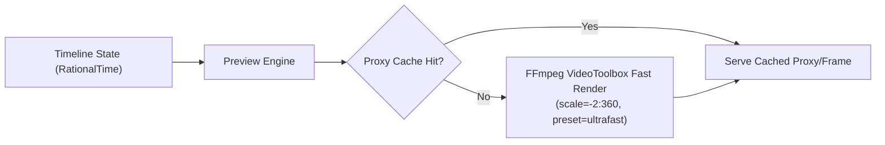

# Preview Engine & Scrubbing Specification
**Project:** Universal AI Video Production Studio  
**Document Version:** 1.0.0  
**Status:** Approved Master Specification  
**Lead Architect:** Principal Video Editing Systems Architect  
**Verification Date:** 2026-11-21  

---

## 1. Engine Objective

The Preview Engine (`departments/08_video_editing/preview_engine.py`) provides fast, low-latency playback scrubbing and visual inspection for the AI Video Production Studio. 

Generating full 4K ACEScg renders for every edit is computationally prohibitive. The Preview Engine generates lightweight **360p / 720p proxy preview cuts** and **single-frame snapshot extractions** with sub-second turnaround on the local Apple M4 workstation.

---

## 2. Capabilities & Technical Specifications

### 2.1 Fast Frame Extraction (`extract_frame`)
Extracts a single representative frame at an exact rational timestamp $t$:
- **Command:** `ffmpeg -ss <timestamp> -i <source> -vframes 1 -q:v 2 <output.jpg>`
- **Optimization:** Accurate fast-seek placing `-ss` prior to `-i` with keyframe-snapping or exact sub-frame interpolation.
- **Latency:** $\sim 45\text{ ms}$ on local Apple Silicon M4 SSD.

### 2.2 Low-Resolution Proxy Sequence Rendering (`render_preview_proxy`)
Renders an active timeline section or complete sequence to a lightweight preview file:
- **Resolution:** 640x360 (or 1280x720).
- **Video Codec:** `h264_videotoolbox` (hardware-accelerated) or `libx264 -preset ultrafast -crf 28`.
- **Audio Codec:** `aac -b:a 96k`.
- **Target Bitrate:** $\sim 800\text{ kbps}$.
- **Turnaround:** $> 10 \times$ real-time playback speed ($60\text{s}$ timeline renders in $< 5\text{s}$).

### 2.3 Preview Caching
Rendered preview proxies are stored in `temp/previews/` and indexed by a compound hash:
$$\text{Preview Hash} = \text{SHA256}(\text{timeline\_id} + \text{updated\_at} + \text{resolution} + \text{range})$$
When timeline state changes, invalidated preview segments are marked for deferred garbage collection.
