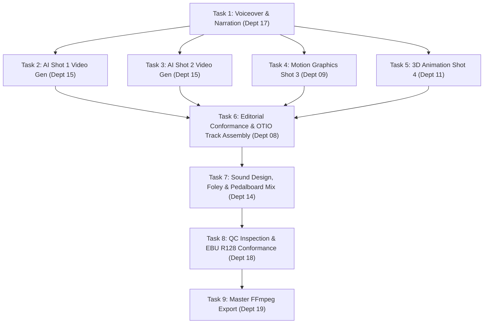

# Production Breakdown & Task Dependency DAG Specification
**Project:** Universal AI Video Production Studio  
**Document Version:** 1.0.0  
**Department:** 07 Production Planning  
**Last Verified:** 2026-11-21  

---

## 1. Overview & Architectural Role

The `ProductionBreakdownService` transforms high-level creative assets (`ProductionScript`, `PlannedShot` sequences, and `CreativeBrief`) into a rigorous, multi-departmental execution DAG (**Directed Acyclic Graph**).

No shot can be rendered, cut, or dubbed without an explicit `ProductionTask` declaring:
1. **Departmental Ownership:** Routing to the specific studio department interface.
2. **Task Dependencies:** Upstream assets required before execution starts.
3. **Complexity & Estimated Compute Duration:** Benchmarked workload units.
4. **Estimated Cost:** API token/GPU cost calculation.



---

## 2. Departmental Task Routing Matrix

| Task Type | Assigned Department | Execution Target | Cost Model |
| :--- | :---: | :---: | :---: |
| `VOICEOVER_RECORDING` | `17_subtitles_dubbing` | ElevenLabs / Kokoro API | \$0.001 / sec |
| `AI_VIDEO_GENERATION` | `15_ai_generation` | Remote Cloud GPU (Runway/Kling/Wan) | \$0.040 / sec |
| `AI_IMAGE_GENERATION` | `15_ai_generation` | Flux.1 / Imagen API | \$0.020 / frame |
| `MOTION_GRAPHICS_CREATION`| `09_motion_graphics`| Motion Canvas Headless (Local M4) | \$0.000 (Local) |
| `ANIMATION_2D` | `10_animation_2d` | Blender Grease Pencil 3.0 (Local M4) | \$0.000 (Local) |
| `ANIMATION_3D` | `11_animation_3d` | Blender Cycles / OpenUSD (Cloud GPU) | \$0.050 / sec |
| `VFX_COMPOSITING` | `13_vfx_compositing` | SAM 2.1 / OpenCV / OCIO ACEScg | \$0.020 / sec |
| `EXISTING_FOOTAGE_CONFORMANCE`| `03_media_ingestion`| FFmpeg VideoToolbox Proxy/Conform | \$0.000 (Local) |
| `SOUND_DESIGN` | `14_audio_production`| Spotify Pedalboard / SciPy (Local M4) | \$0.000 (Local) |
| `EDITORIAL_ASSEMBLY` | `08_video_editing` | OpenTimelineIO Rational Math (Local M4)| \$0.000 (Local) |

---

## 3. Data Structures

The breakdown produces a `ProductionBreakdown` dataclass saved to SQLite:
```python
@dataclass
class ProductionTask:
    task_id: UUID
    shot_id: Optional[UUID]
    task_type: ProductionTaskType
    description: str
    assigned_department: str
    status: str = "PLANNED"
    dependencies: List[UUID] = field(default_factory=list)
    estimated_duration_sec: float = 3.0
    estimated_cost_usd: float = 0.0

@dataclass
class ProductionBreakdown:
    breakdown_id: UUID
    project_id: UUID
    tasks: List[ProductionTask] = field(default_factory=list)
    total_shots: int = 0
    shots_by_type: Dict[str, int] = field(default_factory=dict)
    required_assets_summary: Dict[str, Any] = field(default_factory=dict)
    missing_assets_summary: Dict[str, Any] = field(default_factory=dict)
    estimated_cost_usd: float = 0.0
    technical_risks: List[str] = field(default_factory=list)
```
