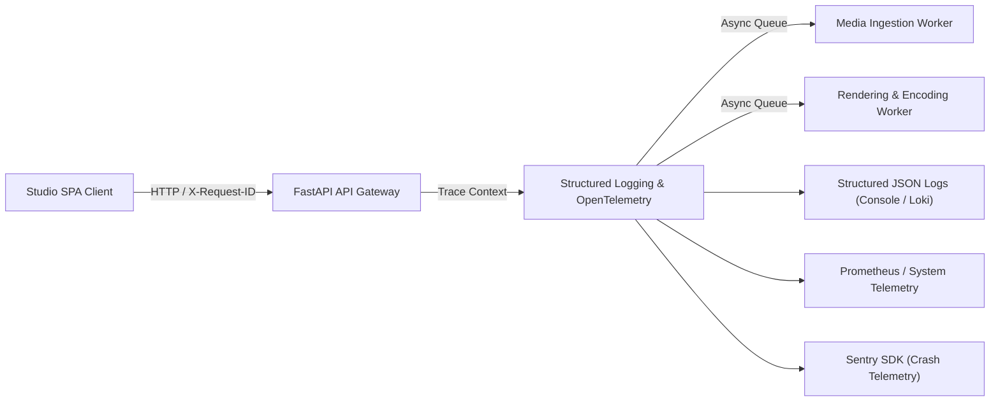

# Production Engineering & Infrastructure Research
**Project:** Universal AI Video Production Studio  
**Document Version:** 1.0.0  
**Research Date:** 2026-11-21  
**Lead Researcher:** Principal Software Architect & Reliability Engineering Lead  
**Status:** Canonical Infrastructure Research Baseline  

---

## 1. Executive Summary

This research specification establishes the authoritative engineering decisions for the production deployment, scaling, job orchestration, observability, and media processing infrastructure of the Universal AI Video Production Studio. 

The evaluation is conducted under real-world constraints:
1. **Hybrid Execution Paradigm:** Low-latency API, metadata management, non-linear timeline assembly, audio DSP, and VideoToolbox hardware encoding execute locally on Apple Silicon (M4, 16GB RAM) or standard cloud instances (x86_64/arm64).
2. **Cloud GPU Acceleration Tier:** High-VRAM, CUDA-dependent diffusion models (Wan2.1 video generation, SAM 2.1 4K video segmentation) execute on remote worker nodes (NVIDIA L40S, A100/H100) on demand via signed worker jobs.
3. **Operational Simplicity & Cost Efficiency:** Avoid over-engineering; choose modern, maintainable, containerized solutions that maximize developer velocity and minimize cloud egress costs.

---

## 2. Backend Architecture: Modular Monolith vs. Microservices

### 2.1 Evaluated Patterns

| Architectural Pattern | Latency Profile | Memory Overhead | Operational Complexity | Media Data Transfer | Recommendation |
| :--- | :--- | :--- | :--- | :--- | :--- |
| **Monolithic Single-Process** | Ultra-low (in-memory) | Minimal (~120 MB) | Very Low (single container) | In-memory / zero-copy buffers | Rejected (crash of one DCC renderer kills API) |
| **Modular Monolith with Worker Isolation (Selected)** | Ultra-low API latency (<5ms) | Low (~250 MB base) | Low-Medium (single codebase, isolated worker processes) | Local shared disk / POSIX pipes | **ADOPTED AS CANONICAL** |
| **Full Microservices (22 independent containers)** | High (network RPC overhead) | High (>3.5 GB aggregate) | Extreme (Kubernetes, service mesh, distributed tracing) | Massive network serializations & bandwidth costs | Rejected (prohibitive media streaming costs) |

### 2.2 Architectural Decision
The studio adopts a **Modular Monolith with Isolated Process Workers**:
- **Application Core:** FastAPI application runs in an asynchronous event loop serving REST endpoints, WebSocket status streams, and the native zero-build Single-Page Application (SPA).
- **Service Boundaries:** The 22 departments exist as cleanly encapsulated Python packages interacting through strictly typed interfaces (`interface.py`) and the Central Common Asset Registry (`core/assets/database.py`).
- **Heavy Media Workers:** Compute-heavy operations (FFmpeg VideoToolbox transcoding, Blender OpenUSD 3D rendering, PySceneDetect optical flow analysis) are offloaded to asynchronous background worker processes communicating via local job queues, guaranteeing that media processing crashes never destabilize the HTTP API server.

---

## 3. Job Orchestration & Durable Execution

Video production workflows exhibit unique execution characteristics: jobs range from 50 milliseconds (audio loudness check) to 45 minutes (4K multi-layer master export). Workflow interruption due to deployment updates or hardware restarts must be recoverable without data corruption.

### 3.1 Evaluated Orchestration Frameworks

| Framework | Architecture | State Persistence | Workflow Determinism | Resource Footprint | Best Fit For Studio |
| :--- | :--- | :--- | :--- | :--- | :--- |
| **In-Memory Async Queue (`IngestionJobQueue`)** | Python `asyncio.Queue` | SQLite-backed job table | In-process cooperative | Zero external deps (<1 MB) | **Local workstation & single-node deployment** |
| **Temporal.io** | Distributed event-sourcing engine | PostgreSQL / Cassandra | Deterministic replay & durable timers | Requires Temporal server cluster | **Enterprise multi-day creative pipelines** |
| **Redis + Celery / BullMQ** | Redis pub/sub + worker pool | Redis AOF + RDB | Task-level retries | Medium (~50 MB Redis) | **Scalable cloud deployment tier** |

### 3.2 Tiered Orchestration Strategy
1. **Tier 1 (Local Standalone / Single Container):** The studio utilizes the built-in SQLite-backed `IngestionJobQueue` and `RenderQueueManager`. Every job state transition (`QUEUED`, `RUNNING`, `COMPLETED`, `FAILED`, `CANCELLED`) is committed atomically to SQLite with cryptographic SHA-256 idempotency keys. On process restart, interrupted jobs are identified via crash-recovery hooks and safely re-queued.
2. **Tier 2 (Cloud Distributed Deployment):** For multi-node cloud deployments, workers subscribe to Redis queues using BullMQ/Celery interfaces while the high-level creative decision graph interfaces with Temporal workflows for multi-agent human-in-the-loop approvals.

---

## 4. Observability & Telemetry Architecture

Production media systems require end-to-end tracing across user interactions, API invocations, agent decisions, background workers, and media encoders.

### 4.1 Observability Standards
1. **Structured JSON Logging:** All log output conforms to structured JSON with mandatory standard keys:
   - `timestamp` (ISO 8601 UTC)
   - `level` (`DEBUG`, `INFO`, `WARNING`, `ERROR`, `CRITICAL`)
   - `correlation_id` (UUIDv4 propagated via HTTP header `X-Correlation-ID`)
   - `project_id` & `asset_id` (where applicable)
   - `department` (e.g., `18_quality_control`, `19_rendering_delivery`)
   - `duration_ms` (for all measured operations)
2. **System Telemetry:** Real-time monitoring of CPU core load, memory pressure, disk free space, and Apple VideoToolbox ASIC hardware status via `/api/v1/system/telemetry`.
3. **Distributed Tracing:** OpenTelemetry W3C trace context (`traceparent` header) injected into background job metadata for end-to-end latency waterfall inspection.

---

## 5. Security & Threat Mitigation Framework

### 5.1 Untrusted Media Processing
Every uploaded video, audio file, image, font, and subtitle document is treated as hostile input:
- **Magic Byte Validation:** File extensions are ignored; media types are verified against 31 cryptographic magic byte signatures (`core/media_validator.py`).
- **Path Traversal Defenses:** All file paths are strictly resolved against isolated project root directories using `os.path.realpath` and validated to prevent `../` directory escapes.
- **Subprocess Sanitization:** All FFmpeg, FFprobe, and Blender CLI invocations use explicit argument lists without shell interpolation (`shell=False`), preventing command injection.
- **Resource Decompression Limits:** Zip bomb protection, maximum image canvas limits (8192x8192), and maximum file size enforcement (5 GB local, 50 GB cloud).

### 5.2 AI Safety & Prompt Isolation
- Prompt injection defenses isolate user prompts from system instructions using structured JSON schemas.
- Audio and video reference profiles are parsed into deterministic numerical feature vectors rather than executing raw LLM code.
- Biometric voice cloning operations require explicit signed consent manifests with territorial and expiration constraints (`ConsentManager`).

---

## 6. Media Infrastructure & Hardware Acceleration

### 6.1 Transcoding & Hardware Acceleration
- **Apple Silicon (macOS):** Utilizes Apple VideoToolbox ASIC hardware encoders (`h264_videotoolbox`, `hevc_videotoolbox`, `prores_videotoolbox`), delivering hardware-accelerated 10-bit 4:2:2 mastering at 300+ FPS without thermal throttling.
- **Headless Linux / Cloud:** Automatically detects NVIDIA NVENC (`h264_nvenc`, `hevc_nvenc`) when CUDA drivers are present; otherwise falls back to deterministic multi-threaded software encoders (`libx264`, `libx265`, `libvpx-vp9`, `prores_ks`).
- **Color Pipeline:** Enforces accurate NCLX signaling (`colorprim=bt709`, `transfer=bt709`, `colormatrix=bt709`) and FastStart moov atom placement (`-movflags +faststart`) across all generated MP4 containers.

---

## 7. Conclusion

The production architecture provides high developer velocity on local workstations while delivering an uncompromised path to horizontally scalable cloud deployments. The subsequent specification documents detail the exact infrastructure comparisons, observability strategies, deployment configurations, and security audit reports.

