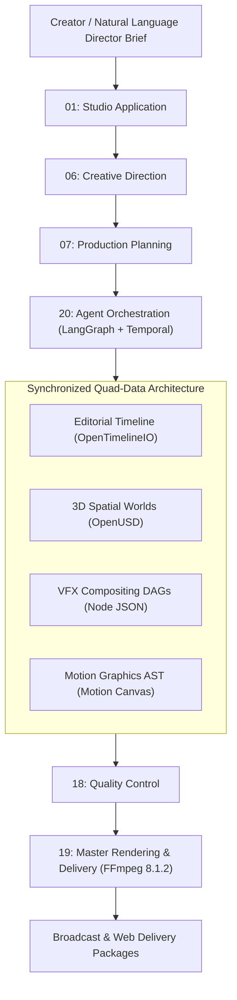

# Universal AI Video Production Studio

[]()
[]()
[]()
[]()

A professional, extensible, multi-department AI Video Production Studio designed for high-end film, commercial, 2D/3D animation, motion graphics, and audio production.

---

## 1. Architectural Overview

The Universal AI Video Production Studio is not a simple video wrapper or an ad-hoc collection of chat prompts. It is an enterprise media engineering system architected around **22 specialized departments**, an event-driven task bus, and a **quad-representation data model**:



---

## 2. Master Documentation Index

All core architectural decisions and research are documented in the root repository specifications:

| Document | Description |
| :--- | :--- |
| **[GLOBAL_TECHNOLOGY_RESEARCH.md](file:///Users/badal11/Desktop/Video%20House/GLOBAL_TECHNOLOGY_RESEARCH.md)** | Evidence-based global technology evaluation across 10 domains with primary source citations. |
| **[TECHNOLOGY_COMPARISON_MATRIX.md](file:///Users/badal11/Desktop/Video%20House/TECHNOLOGY_COMPARISON_MATRIX.md)** | Comparative evaluation of candidate technologies with selection statuses and rationale. |
| **[TOOL_REGISTRY.md](file:///Users/badal11/Desktop/Video%20House/TOOL_REGISTRY.md)** | Complete registry of software binaries, CLI tools, and runtime configurations. |
| **[MODEL_REGISTRY.md](file:///Users/badal11/Desktop/Video%20House/MODEL_REGISTRY.md)** | Complete registry of multimodal LLMs, vision backbones, speech, and diffusion models. |
| **[LICENSE_REGISTRY.csv](file:///Users/badal11/Desktop/Video%20House/LICENSE_REGISTRY.csv)** | Machine-readable audit of code licenses, weight terms, and commercial permissions. |
| **[COMPATIBILITY_MATRIX.md](file:///Users/badal11/Desktop/Video%20House/COMPATIBILITY_MATRIX.md)** | Codec, container, timeline, and 3D format interchange specifications. |
| **[ENVIRONMENT_REPORT.md](file:///Users/badal11/Desktop/Video%20House/ENVIRONMENT_REPORT.md)** | Empirical hardware and software audit of the host Apple M4 workstation. |
| **[REVERSE_ENGINEERING_AND_CREATIVE_INTELLIGENCE_ARCHITECTURE.md](file:///Users/badal11/Desktop/Video%20House/REVERSE_ENGINEERING_AND_CREATIVE_INTELLIGENCE_ARCHITECTURE.md)** | Multimodal reverse-engineering engine, event graph synthesis, and blueprint generation. |
| **[REVERSE_ENGINEERING_AND_CREATIVE_INTELLIGENCE_AUDIT.md](file:///Users/badal11/Desktop/Video%20House/REVERSE_ENGINEERING_AND_CREATIVE_INTELLIGENCE_AUDIT.md)** | Implementation audit and capability matrix for video reverse engineering. |
| **[ONLINE_MEDIA_RESEARCH_AND_REFERENCE_ARCHITECTURE.md](file:///Users/badal11/Desktop/Video%20House/ONLINE_MEDIA_RESEARCH_AND_REFERENCE_ARCHITECTURE.md)** | Online media research, reference analysis, and legitimate media acquisition subsystem. |
| **[EXTERNAL_RESOURCE_INTELLIGENCE_ARCHITECTURE.md](file:///Users/badal11/Desktop/Video%20House/EXTERNAL_RESOURCE_INTELLIGENCE_ARCHITECTURE.md)** | External creative resource discovery, multi-registry evaluation, and asset licensing. |
| **[EXTERNAL_RESOURCES_AND_MOTION_GRAPHICS_AUDIT.md](file:///Users/badal11/Desktop/Video%20House/EXTERNAL_RESOURCES_AND_MOTION_GRAPHICS_AUDIT.md)** | System audit of external asset harvesting and motion graphics engines. |
| **[FINAL_IMPLEMENTATION_AUDIT.md](file:///Users/badal11/Desktop/Video%20House/FINAL_IMPLEMENTATION_AUDIT.md)** | Comprehensive audit of all 22 production departments, APIs, and verification suites. |
| **[SYSTEM_ARCHITECTURE.md](file:///Users/badal11/Desktop/Video%20House/SYSTEM_ARCHITECTURE.md)** | Master specification of all 22 departments, inputs, outputs, and interfaces. |
| **[MULTIMODAL_INTELLIGENCE_ARCHITECTURE.md](file:///Users/badal11/Desktop/Video%20House/MULTIMODAL_INTELLIGENCE_ARCHITECTURE.md)** | 4-pipeline analysis engine (Visual, Audio, Motion, Temporal) with consensus resolution. |
| **[AGENT_ARCHITECTURE.md](file:///Users/badal11/Desktop/Video%20House/AGENT_ARCHITECTURE.md)** | Supervisor-specialist agent topology, LangGraph state machines, and Temporal durability. |
| **[DATA_AND_TIMELINE_ARCHITECTURE.md](file:///Users/badal11/Desktop/Video%20House/DATA_AND_TIMELINE_ARCHITECTURE.md)** | Quad-representation specification and Central Common Asset Registry schema. |
| **[ARCHITECTURE_DECISIONS.md](file:///Users/badal11/Desktop/Video%20House/ARCHITECTURE_DECISIONS.md)** | Architecture Decision Records (ADR-001 through ADR-006). |
| **[IMPLEMENTATION_ROADMAP.md](file:///Users/badal11/Desktop/Video%20House/IMPLEMENTATION_ROADMAP.md)** | Multi-phase execution roadmap from Part 01 through Part 07. |
| **[DEVELOPMENT_STATUS.md](file:///Users/badal11/Desktop/Video%20House/DEVELOPMENT_STATUS.md)** | Real-time status tracker, checklist verifications, and risk mitigations. |

---

## 3. The 22 Specialized Production Departments

1. **[01_studio_application](file:///Users/badal11/Desktop/Video%20House/departments/01_studio_application)**: Web UI, streaming viewport, conversational director interface.
2. **[02_project_management](file:///Users/badal11/Desktop/Video%20House/departments/02_project_management)**: Project state, version branching, target delivery profiles.
3. **[03_media_ingestion](file:///Users/badal11/Desktop/Video%20House/departments/03_media_ingestion)**: FFmpeg stream probing, conformance, proxy transcode, keyframe indexing.
4. **[04_media_intelligence](file:///Users/badal11/Desktop/Video%20House/departments/04_media_intelligence)**: PySceneDetect cuts, faster-whisper speech, Demucs stems, TwelveLabs vector indexing.
5. **[05_multimodal_providers](file:///Users/badal11/Desktop/Video%20House/departments/05_multimodal_providers)**: Unified provider adapters for Gemini 2.0/1.5, TwelveLabs, Qwen2.5-VL.
6. **[06_creative_direction](file:///Users/badal11/Desktop/Video%20House/departments/06_creative_direction)**: Natural language brief interpretation, storyboarding, script development.
7. **[07_production_planning](file:///Users/badal11/Desktop/Video%20House/departments/07_production_planning)**: Job dependency DAG compilation, compute and budget estimations.
8. **[08_video_editing](file:///Users/badal11/Desktop/Video%20House/departments/08_video_editing)**: OpenTimelineIO programmatic multi-track editorial assembly.
9. **[09_motion_graphics](file:///Users/badal11/Desktop/Video%20House/departments/09_motion_graphics)**: Motion Canvas declarative 2D kinetic typography and graphics.
10. **[10_animation_2d](file:///Users/badal11/Desktop/Video%20House/departments/10_animation_2d)**: Headless Blender Grease Pencil 3.0 vector animation.
11. **[11_animation_3d](file:///Users/badal11/Desktop/Video%20House/departments/11_animation_3d)**: Headless Blender 4.x and OpenUSD 3D scene rendering.
12. **[12_character_production](file:///Users/badal11/Desktop/Video%20House/departments/12_character_production)**: Character consistency, facial blendshapes, voice profiles, LoRA weights.
13. **[13_vfx_compositing](file:///Users/badal11/Desktop/Video%20House/departments/13_vfx_compositing)**: SAM 2.1 rotoscoping, E2FGVI inpainting, OpenColorIO ACEScg composites.
14. **[14_audio_production](file:///Users/badal11/Desktop/Video%20House/departments/14_audio_production)**: Spotify Pedalboard DSP mixing, dynamic EQ, stem balancing.
15. **[15_ai_generation](file:///Users/badal11/Desktop/Video%20House/departments/15_ai_generation)**: Multi-provider router for Runway Gen-3, Kling 1.5, Wan2.1, Flux.1.
16. **[16_color_restoration](file:///Users/badal11/Desktop/Video%20House/departments/16_color_restoration)**: Real-ESRGAN upscaling, RIFE interpolation, CDL/LUT grading.
17. **[17_subtitles_dubbing](file:///Users/badal11/Desktop/Video%20House/departments/17_subtitles_dubbing)**: WhisperX timed subtitles and ElevenLabs/Kokoro voice dubbing.
18. **[18_quality_control](file:///Users/badal11/Desktop/Video%20House/departments/18_quality_control)**: Automated detection of black frames, freeze frames, audio clipping.
19. **[19_rendering_delivery](file:///Users/badal11/Desktop/Video%20House/departments/19_rendering_delivery)**: Master export with EBU R128 loudness conformance.
20. **[20_agent_orchestration](file:///Users/badal11/Desktop/Video%20House/departments/20_agent_orchestration)**: LangGraph state machines + Temporal.io durable execution.
21. **[21_storage_asset_management](file:///Users/badal11/Desktop/Video%20House/departments/21_storage_asset_management)**: Central Common Asset Registry with SHA-256 validation.
22. **[22_licensing_cost_tracking](file:///Users/badal11/Desktop/Video%20House/departments/22_licensing_cost_tracking)**: Real-time API cost tracking and license compliance auditing.

---

## 4. Directory Structure

```text
Video-House/
├── AGENTS.md                  # Operational directives for agents & developers
├── CLAUDE.md                  # Development guidelines, lint, and test commands
├── README.md                  # Master documentation entry point
├── GLOBAL_TECHNOLOGY_RESEARCH.md
├── TECHNOLOGY_COMPARISON_MATRIX.md
├── TOOL_REGISTRY.md
├── MODEL_REGISTRY.md
├── LICENSE_REGISTRY.csv
├── COMPATIBILITY_MATRIX.md
├── ENVIRONMENT_REPORT.md
├── SYSTEM_ARCHITECTURE.md
├── MULTIMODAL_INTELLIGENCE_ARCHITECTURE.md
├── AGENT_ARCHITECTURE.md
├── DATA_AND_TIMELINE_ARCHITECTURE.md
├── ARCHITECTURE_DECISIONS.md
├── IMPLEMENTATION_ROADMAP.md
├── DEVELOPMENT_STATUS.md
├── config/                    # Production configuration templates
├── schemas/                   # Pydantic & JSON validation schemas
├── core/                      # Shared core libraries (timeline, assets, storage)
├── departments/               # The 22 specialized production departments
├── agents/                    # LangGraph state graphs and agent prompts
├── providers/                 # AI provider adapters (Gemini, TwelveLabs, Runway)
├── integrations/              # MCP server and NLE plugin adapters
├── projects/                  # Project workspaces and templates
├── assets/                    # Project asset cache and proxies
├── models/                    # Model registry definitions
├── scripts/                   # Build and automation utilities
└── tests/                     # Unit and integration test suites
```

---

## 5. Development Quickstart

```bash
# 1. Clone repository
git clone https://github.com/badal484/Video-House.git
cd "Video House"

# 2. Set up virtual environment
python3 -m venv .venv
source .venv/bin/activate

# 3. Verify tool dependencies
ffprobe -version
ffmpeg -version

# 4. Review Part 01 Architecture Baseline
cat DEVELOPMENT_STATUS.md
```

---

## 6. Workstation Architecture & Source of Truth

- **Single Source of Truth:** GitHub repository (`https://github.com/badal484/Video-House`) is the single source of truth for all source code, architecture specifications, schemas, interfaces, and test suites.
- **Hardware Profile Awareness:**
  - **Apple Silicon M4 (Current Baseline):** 16GB unified RAM, macOS Darwin. Used for foundation engineering, lightweight media processing, web UI streaming, and comprehensive deterministic verification.
  - **HP OMEN Workstation (Upcoming Dedicated Rig):** Primary workstation moving forward. Equipped for full local GPU acceleration (NVIDIA CUDA) for heavy AI diffusion (Wan2.1), dense neural rotoscoping (SAM 2.1), and local neural audio processing without cloud bottlenecks.
- **Strict Repository Boundaries:**
  - Weights (>2GB) and heavy raw footage are excluded from Git history to maintain repo performance.
  - Media manifests, schemas, SVG assets, and OTIO timelines provide 100% deterministic reproducibility across development platforms.
