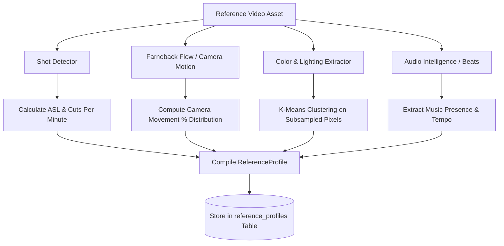

# Reference Video Intelligence & Style Deconstruction

**Document Version:** 1.0.0  
**Status:** Approved & Implemented  
**Engine:** `departments/04_media_intelligence/reference_analyzer.py` & `departments/04_media_intelligence/video_comparator.py`  

---

## 1. Core Purpose & Creative Challenge

Modern video production frequently begins with a **reference video** (e.g. an Apple product commercial, a high-energy YouTube intro, a cinematic Nike advertisement, or a music video).

Rather than giving an AI assistant vague instructions like *"make it look like this reference"*, the studio programmatically deconstructs the reference into mathematical, reproducible stylistic dimensions:
1. **Average Shot Length (ASL)** and Cut Frequency (Cuts Per Minute, CPM).
2. **Editing Rhythm & Pacing Dynamic** (`FAST_PACED`, `DYNAMIC`, `CALM_CONTEMPLATIVE`).
3. **K-Means 5-Color Dominant Palette** (hex values) and Luminance/Contrast metrics.
4. **Cinematography & Camera Movement Distribution** (% static, % pan, % handheld).
5. **Acoustic & Musical Energy** (BPM, sync-to-beat pacing).

---

## 2. Deconstruction Workflow

### Mathematical Formulations:
- **Average Shot Length (ASL):**
  $$ASL = \frac{1}{N_{shots}} \sum_{i=1}^{N_{shots}} \Delta t_i$$
- **Cut Frequency (Cuts Per Minute):**
  $$CPM = \frac{N_{shots} - 1}{T_{total} / 60.0}$$
- **Pacing Classification:**
  - $ASL \le 2.0\text{s}$: `FAST_PACED` (commercials, trailers, TikTok).
  - $2.0\text{s} < ASL \le 5.0\text{s}$: `DYNAMIC_BALANCED` (documentary, corporate, YouTube).
  - $ASL > 5.0\text{s}$: `CALM_CONTEMPLATIVE` (cinematic drama, ambient).
- **Color Palette Extraction:**
  - Decoded video frames are subsampled across the asset duration.
  - Pixel colors in BGR are converted to RGB and clustered into $k = 5$ centroids using OpenCV K-Means (`cv2.kmeans` with `KMEANS_PP_CENTERS`).
  - Centroid RGB values are formatted into standard hexadecimal color strings (`#FF4500`, `#1A1A1A`, etc.).

---

## 3. Footage Comparison & Style Alignment

`MultiVideoComparisonService` compares user source footage against a reference profile to compute:
1. **Pacing Match Score:**
   $$S_{pacing} = \max\left(0.0, 1.0 - \frac{|ASL_{source} - ASL_{ref}|}{\max(ASL_{ref}, 2.0)}\right)$$
2. **Visual Lighting Match Score:**
   Compares average luminance and contrast delta ($0.0 \le S_{visual} \le 1.0$).
3. **Camera Motion Overlap:**
   Measures cosine similarity of camera movement distributions.
4. **Actionable Editorial Recommendations:**
   Generates concrete instructions (e.g. *"Pacing in reference is 2.1x faster. Cut source shots at downbeats to tighten rhythm"*).

