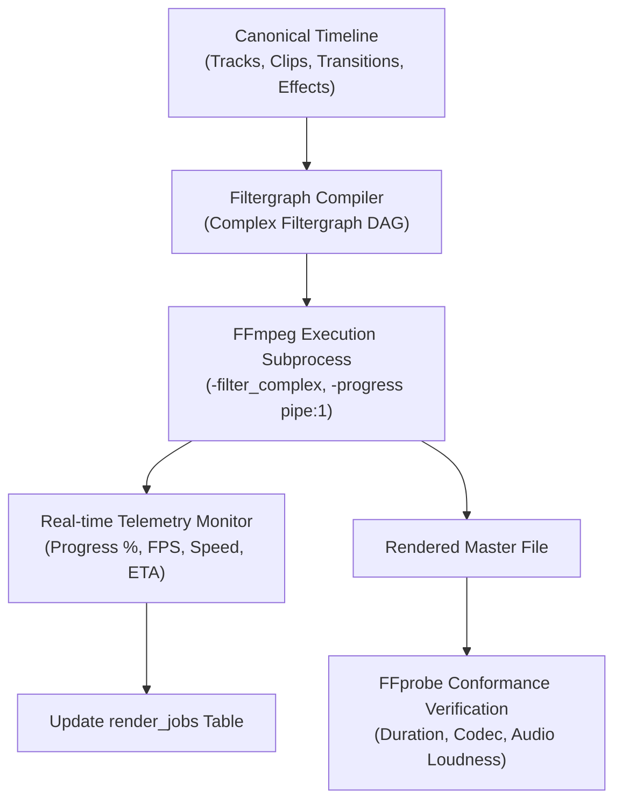

# Deterministic Rendering Engine Specification
**Project:** Universal AI Video Production Studio  
**Document Version:** 1.0.0  
**Status:** Approved Master Specification  
**Lead Architect:** Principal Video Editing Systems Architect & Rendering Engineer  
**Verification Date:** 2026-11-21  

---

## 1. Engine Objective & Architecture

The Rendering Engine (`departments/08_video_editing/render_engine.py`) transforms multi-track timelines containing clips, transitions, and effects into final, high-fidelity master delivery media.



---

## 2. Dynamic FFmpeg Complex Filtergraph Generation

The engine compiles arbitrary multi-track timeline topologies into a single deterministic FFmpeg `-filter_complex` command string:

### 2.1 Video Stream Trimming and Conformance
For each clip $i$ on track $k$:
```text
[k:v]trim=start=source_in:end=source_out,setpts=PTS-STARTPTS,scale=1920:1080:force_original_aspect_ratio=decrease,pad=1920:1080:(ow-iw)/2:(oh-ih)/2,setsar=1[v_clip_i];
```

### 2.2 Transition Filter Chaining
Consecutive clips connected by a `CROSS_DISSOLVE` are joined using the `xfade` filter:
```text
[v_clip_0][v_clip_1]xfade=transition=fade:duration=1.0:offset=4.0[v_trans_01];
```

### 2.3 Multi-Track Alpha Compositing
Upper tracks (`V2`, `V3`) composite over lower tracks (`V1`) using the `overlay` filter with keyframe-evaluated coordinates:
```text
[v_base][v_overlay]overlay=x=0:y=0:enable='between(t, 2.5, 7.5)'[v_comp_out];
```

### 2.4 Multi-Track Audio Mixing
Audio clips are trimmed with `atrim`, conformed to 48kHz, and mixed down via `amix`:
```text
[0:a]atrim=start=0:end=5,asetpts=PTS-STARTPTS,volume=1.0[a0];
[1:a]atrim=start=0:end=10,asetpts=PTS-STARTPTS,volume=0.35[a1];
[a0][a1]amix=inputs=2:duration=longest:dropout_transition=0[aout]
```

---

## 3. Render Presets

| Preset Name | Video Codec | Bitrate / Quality | Audio Codec | Container | Target |
| :--- | :--- | :--- | :--- | :--- | :--- |
| **`H264_MASTER`** | H.264 (`libx264` / `h264_videotoolbox`) | High (CRF 18 or 20 Mbps) | AAC 320 kbps 48kHz | `.mp4` | Universal Master / Web |
| **`PRORES_422`** | Apple ProRes 422 (`prores_ks`) | Native ProRes Profile 2 | PCM 24-bit 48kHz | `.mov` | Broadcast & Archival Master |
| **`WEB_PREVIEW`** | H.264 Fast | 1.5 Mbps, 720p | AAC 128 kbps | `.mp4` | Review & Client Streaming |
| **`AUDIO_MASTER`** | None | N/A | PCM 24-bit 48kHz Stereo | `.wav` | Audio Mix Deliverable |

---

## 4. Execution Monitoring & Cancellation

1. **Non-Blocking Execution:** Renders run as detached asynchronous tasks or sub-processes tracked in `render_jobs`.
2. **Telemetry Parsing:** Reads standard output progress pipes line-by-line (`out_time_ms`, `fps`, `speed`) to compute:
   $$\text{Progress \%} = \min\left(100.0, \frac{\text{rendered\_microseconds}}{\text{total\_timeline\_microseconds}} \times 100\right)$$
3. **Graceful Cancellation:** Signals SIGTERM to the FFmpeg process, deletes incomplete temporary output, and marks job status as `CANCELLED`.
4. **Post-Render FFprobe Verification:** Inspects the rendered output to ensure duration matches timeline duration within $\pm 0.05\text{s}$, streams are valid, and no corrupt packets exist.
