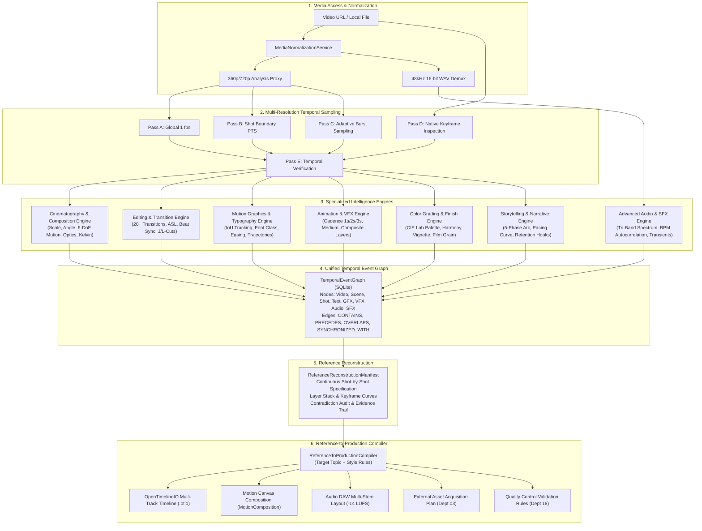

# Multimodal Video Reverse Engineering & Reference-to-Production Architecture
## Universal AI Video Production Studio
**Document Version:** 1.0.0  
**Author:** AI Creative Technology & Systems Architecture Team  
**Target Hardware:** Apple MacBook Pro (Apple M4, 16GB Unified RAM, ~34GB Free Storage)

---

## 1. Executive Mission & System Architecture

The Multimodal Video Reverse Engineering and Reference-to-Production System enables any user or AI agent to paste an accessible video URL or provide local media and automatically derive a comprehensive, evidence-grounded, timestamped technical and creative reconstruction.

Unlike basic screenshot-to-LLM summarizers, this system performs **continuous, multi-resolution temporal engineering** across 12 distinct dimensions, storing the results in a **Unified Temporal Event Graph** and compiling the extracted grammar into **executable production assets** (OpenTimelineIO timelines, Motion Canvas AST trees, multi-stem Audio DAW sessions, external asset acquisition manifests, and QC validation policies).

---

## 2. Detailed Technical Capabilities

### 2.1 Media Normalization & Proxy Pipeline (`departments/04_media_intelligence/temporal_engine/normalization.py`)
- **Memory Guarding:** Analyzes input media using `ffprobe` to inspect Presentation Timestamps (PTS), audio stream layout, and spatial dimensions.
- **Analysis Proxies:** Generates low-resolution 360p/720p H.264 ultrafast proxies for computer vision and optical flow, ensuring heap memory consumption on Apple Silicon M4 remains strictly below $1.8$ GB during video analysis.
- **Deterministic Audio Demuxing:** Demuxes native audio streams directly to 48kHz 16-bit uncompressed WAV in `temp/` without video re-encoding, preserving exact sample-to-frame temporal alignment. Post-analysis cleanup guarantees zero lingering disk bloat.

### 2.2 Five-Pass High-Resolution Temporal Sampling Engine (`departments/04_media_intelligence/temporal_engine/sampling_engine.py`)
- **Pass A (Global Overview):** 1 frame per second sampling to establish global color trends, coarse scene changes, and baseline motion energy.
- **Pass B (Shot Boundary PTS):** Deterministic boundary detection using `PySceneDetect` and color histogram intersection to capture precise frame indices.
- **Pass C (Adaptive Burst Sampling):** Automatically triggers high-density sampling ($\pm 0.5$s window around cuts, text reveals, and high-motion bursts) at native framerate to resolve rapid transitions and kinetic typography reveals.
- **Pass D (High-Res Native Keyframe Inspection):** Selectively reads the native 1080p/4K master file only at the midpoint of each identified shot to preserve full spatial resolution for OCR, typography weight, and rule-of-thirds composition.
- **Pass E (Temporal Verification & Evidence):** Audits timestamp coverage and assigns evidence confidence ratings.

### 2.3 Cinematography & Visual Composition Intelligence (`departments/04_media_intelligence/cinematography.py`)
- **Composition Geometry:** Evaluates rule-of-thirds adherence ($3\times 3$ grid intersection edge density), left-to-right bilateral symmetry score, center-of-mass visual balance ($c_x, c_y$), and foreground/background depth separation.
- **Shot Scale Classification:** Dynamically categorizes shots into `EXTREME_WIDE`, `WIDE`, `MEDIUM`, `MEDIUM_CLOSE_UP`, `CLOSE_UP`, and `EXTREME_CLOSE_UP` based on salient subject area and height proportions.
- **Camera Angle Estimation:** Perspective line convergence and horizon line altitude classification into `EYE_LEVEL`, `LOW_ANGLE`, `HIGH_ANGLE`, and `DUTCH_ANGLE`.
- **6-DoF Camera Motion:** Affine transformation and Farneback dense optical flow decomposition with RANSAC: classifies `STATIC`, `PAN`, `TILT`, `ZOOM`, `DOLLY`, `TRUCK`, `PEDESTAL`, and organic handheld shake frequency.
- **Optics & Lighting:** Inferred focal length class (Wide $<35$mm, Normal $50$mm, Telephoto $>85$mm), depth-of-field bokeh gradient, luminance contrast ratio, and correlated color temperature ($K$) in Kelvin.

### 2.4 Advanced Editing & Transition Reconstruction (`departments/04_media_intelligence/editing_intelligence.py`)
- **20+ Transition Mechanics:** Evaluates boundary frames using Edge Change Ratio (ECR), cross-frame luminance dip/flash analysis, and motion vector discontinuities to classify `HARD_CUT`, `DISSOLVE`, `CROSS_DISSOLVE`, `DIP_TO_BLACK`, `FLASH_CUT`, `WHIP_PAN`, `ZOOM_TRANSITION`, `SPEED_RAMP`, and cut duration.
- **Cutting Rhythm & ASL Curves:** Computes Average Shot Length (ASL), ASL variance, cutting frequency (Cuts Per Minute), and rolling 10-second velocity curves.
- **Audio-Visual Cut Synchronization:** Measures synchronization lag $\Delta t$ between cut timestamps and nearest musical downbeats or audio transients. Classifies dialogue overlaps into J-cuts (audio leads video) and L-cuts (video leads audio).

### 2.5 Motion Graphics & Kinetic Typography Reverse Engineering (`departments/04_media_intelligence/motion_graphics_intelligence.py`)
- **Element Localization:** Multi-scale morphological text region connect algorithm locating on-screen titles, lower-thirds, subtitle captions, telemetry HUDs, progress bars, callouts, and icon badges.
- **Spatio-Temporal IoU Tracking:** Tracks bounding box coordinates $(x, y, w, h)$ across frames, measuring lifespan, entry time, and exit time.
- **Typography Parameter Reconstruction:** Font family class (`SANS_SERIF_GEOMETRIC`, `SERIF_EDITORIAL`, `MONOSPACE_TECH`, `DISPLAY_BOLD`), weight (`REGULAR`, `BOLD`, `BLACK`), primary color hex, background accent, drop shadow/glow, and hierarchy level.
- **Motion Behavior & Easing:** Reconstructs entry animations (`KINETIC_BOUNCE`, `SLIDE_IN_UP`, `SLIDE_IN_DOWN`, `FADE_IN`, `SCALE_POP`), exit animations (`FADE_OUT`, `SLIDE_DOWN`), velocity in px/sec, and easing curve classification (`EASE_OUT_EXPO`, `SPRING_BOUNCE`, `LINEAR`).

### 2.6 Animation Medium & VFX Layer Decomposition (`departments/04_media_intelligence/animation_vfx.py`)
- **Medium Classification:** Inter-frame pixel delta variance and color gradient flatness analysis to distinguish `LIVE_ACTION`, `2D_VECTOR_MOTION_GRAPHICS`, `3D_CGI`, and `HYBRID_COMPOSITE`.
- **Frame Cadence Detection:** Quantifies frame-hold ratios to classify "On 1s" (30/60 fps full updates), "On 2s" (12/15 fps anime/stop-motion holds), and "On 3s".
- **Compositing Layers:** Reconstructs inferred layer DAG: Background Plate, Midground Subject, Atmospheric Overlays (additive screen glow, light leaks), and Foreground Graphics.

### 2.7 Advanced Audio, Music & Sound Design Intelligence (`departments/04_media_intelligence/audio_intelligence_v2.py`)
- **Tri-Band Energy Decomposition:** Fast Fourier Transform (FFT) tri-band filter bank separating Sub-bass ($<250$ Hz), Midrange vocal ($250$ Hz - $4$ kHz), and High sparkle ($>4$ kHz).
- **Tempo & Beat Grid Tracking:** Spectral flux autocorrelation measuring tempo in Beats Per Minute (BPM), beat grid timestamps, and downbeat alignment.
- **SFX Transient Classification:** Transient onset peak detection classifying `IMPACT` (bass punch), `WHOOSH` (high-frequency sweep), and `RISER` (energy ramp), flagging whether each effect coincides with a visual cut.
- **Loudness Compliance:** True RMS and EBU R128 integrated loudness (LUFS) measurement.

### 2.8 Color Grading & Visual Finish (`departments/04_media_intelligence/color_grading_intelligence.py`)
- **Dominant Palette:** K-Means clustering in CIE Lab / BGR space extracting 5 dominant color hex codes.
- **Color Harmony:** Classifies palette into `COMPLEMENTARY` (e.g. Teal-Orange), `ANALOGOUS`, `TRIADIC`, or `MONOCHROMATIC`.
- **Vignette & Film Grain:** Measures radial corner-to-center brightness falloff and high-frequency Laplacian noise variance (`SUBTLE_35MM`, `HEAVY_16MM`, `CLEAN_DIGITAL`).
- **Recommended LUT:** Suggests matching studio LUT (e.g. `TEAL_AND_ORANGE_BLOCKBUSTER`, `MUTED_DOCUMENTARY_NATURAL`).

### 2.9 Narrative Arc & Storytelling Intelligence (`departments/04_media_intelligence/narrative_intelligence.py`)
- **5-Phase Structure:** Decomposes video into `HOOK` (0-15%), `SETUP_AND_CORE_QUESTION` (15-30%), `DEEP_EXPLORATION` (30-65%), `CLIMAX_REVELATION` (65-85%), and `RESOLUTION_AND_OUTRO` (85-100%).
- **Pacing & Retention:** Computes pacing intensity curves and identifies curiosity gap retention drivers.

---

## 3. The Unified Temporal Event Graph (`core/intelligence/event_graph.py`)

The `TemporalEventGraph` provides a strongly-typed graph database model representing the continuous timeline of any analyzed video:
- **Node Entities:** `VIDEO`, `SCENE`, `SHOT`, `FRAME`, `AUDIO_EVENT`, `MUSIC_SEGMENT`, `TRANSCRIPT_SEGMENT`, `TEXT_ELEMENT`, `GRAPHIC_ELEMENT`, `TRANSITION`, `NARRATIVE_EVENT`.
- **Directed Edges:**
  - `CONTAINS`: Root video contains shots, narrative phases, and audio events.
  - `PRECEDES`: Shot $i$ precedes Shot $i+1$.
  - `OVERLAPS`: Motion graphics or audio events active simultaneously with video shots.
  - `SYNCHRONIZED_WITH`: Precise simultaneous triggers ($|\Delta t| < 120$ms), such as an audio SFX impact occurring exactly on a hard cut or kinetic text reveal.
  - `SUPPORTS_NARRATIVE`: Graphic or visual element reinforcing the narrative phase.
- **Query Engine:** Fast sub-second queries by timestamp (`query_at_timestamp`), time window overlaps (`query_overlapping`), and natural language text search (`search_nodes`).

---

## 4. Reference-to-Production Compiler (`departments/06_creative_direction/production_compiler.py`)

The `ReferenceToProductionCompiler` takes a `ReferenceReconstructionManifest` and a `TargetProductionBrief` (topic, target duration, aspect ratio, language) and generates:
1. **OpenTimelineIO Multi-Track Timeline (`.otio`):**
   - Video Track 1 (`V1_VISUAL_PLATES`): Inferred shot scales and camera motions.
   - Video Track 2 (`V2_MOTION_GRAPHICS`): Motion graphics overlays with exact entry/exit bounds.
   - Audio Track 1 (`A1_VOICEOVER`): Reserved voiceover narration track.
   - Audio Track 2 (`A2_MUSIC_BED`): Background music bed matched to inferred BPM.
   - Audio Track 3 (`A3_SFX_IMPACTS`): SFX transient impacts placed exactly on cut boundaries.
2. **Motion Canvas 2D Composition (`MotionComposition`):**
   - Declarative multi-scene structure matching narrative phases.
   - Kinetic typography with inferred font weights, colors, and easing physics (`EASE_OUT_EXPO`).
   - HUD telemetry and reticle overlays.
3. **Audio DAW Multi-Stem Layout:**
   - EBU R128 $-14.0$ LUFS master target with ducking sidechain specifications.
4. **External Asset Acquisition Plan:**
   - Formulated queries for Department 03 (Creative Discovery) for original CC0 / CC-BY B-roll.
5. **Quality Control Validation Policies:**
   - Department 18 rules for max drift ($\le 40$ms), safe zones, and zero black frames.

---

## 5. UI Workspace: Deep Video Intelligence (`departments/01_studio_application/ui/`)

Mounted directly into the studio interface:
- **Video Viewport:** Frame-accurate player with SVG overlay toggles for Rule-of-Thirds grid and detected bounding boxes.
- **Inspector Panels:** Multi-tab inspection of Shots, Cinematography, Motion Graphics, Audio, Color, and Storytelling.
- **Timeline Visualizer:** Multi-track visualization of Narrative, Shots, Graphics, and SFX.
- **Event Graph Search:** Natural language search bar querying the temporal event graph.
- **One-Click Action:** "⚡ Compile to Studio Production Blueprint" with modal inspection.

