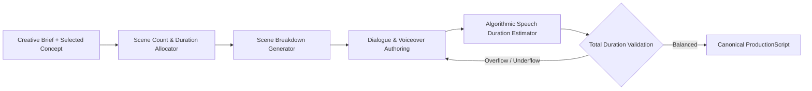

# Script and Narrative Engine Specification
**Project:** Universal AI Video Production Studio  
**Document Version:** 1.0.0  
**Department:** 06 Creative Direction  
**Last Verified:** 2026-11-21  

---

## 1. Narrative Architecture

The Script & Narrative Engine structures raw story concepts into formal screenplays and commercial scripts. It guarantees that narrative beats, emotional pacing, scene boundaries, and spoken dialogue strictly fit the project's target duration.

---

## 2. Spoken Dialogue Pacing & Duration Heuristics

A frequent failure mode in AI-generated video is dialogue that overflows the allocated shot duration. The studio enforces an **algorithmic speech duration model**:

### 2.1 Standard Reading Rate
Broadcast voiceover narration conforms to **140 words per minute (WPM)**, or **~2.33 words per second**.
$$\text{Base Speech Duration (sec)} = \frac{\text{Word Count}}{140 / 60} = \frac{\text{Word Count}}{2.333}$$

### 2.2 Punctuation Pause Modeling
Human speech naturally includes micro-pauses at punctuation boundaries. The engine applies deterministic pause buffers:
- **Comma (`,`) or Semicolon (`;`):** $+0.25$ seconds.
- **Period (`.`), Exclamation (`!`), or Question (`?`):** $+0.45$ seconds.

$$\text{Estimated Duration (sec)} = \frac{\text{Words}}{2.333} + (N_{\text{commas}} \times 0.25) + (N_{\text{periods}} \times 0.45)$$

---

## 3. Screenplay Structure (`ProductionScript` & `ScriptScene`)

Every script is persisted in SQLite with relational foreign keys:
- `production_scripts`: Top-level script metadata, logline, target duration, and word count.
- `script_scenes`: Sequential scenes with sluglines (e.g., `EXT. ICELANDIC DESERT - TWILIGHT`), setting (`INTERIOR`/`EXTERIOR`), narrative purpose, character lists, action descriptions, and dialogue entries.
- `dialogue_entries`: Structured line-by-line speech records with speaker names, text, emotional directions, and calculated durations.

