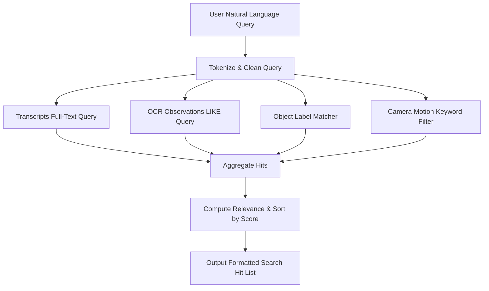

# Semantic Media Search Specification

**Document Version:** 1.0.0  
**Status:** Approved & Implemented  
**Engine:** `departments/04_media_intelligence/semantic_search.py`  

---

## 1. Search Engine Overview

A modern production studio contains hundreds of raw footage clips, B-roll reels, voiceovers, and sound effects. Traditional filename search is useless for locating moments like:
- *"Where does the speaker say 'universal AI studio'?"*
- *"Find all shots where the camera pans left."*
- *"Find scenes with detected people or cars."*
- *"Show me moments where 'DIRECTOR CUT' appears on screen."*

The **Semantic Search Service** executes hybrid queries across multiple structured modalities in SQLite:
1. **Full-Text Dialogue Search (`transcripts`):** Matches spoken words and phrases.
2. **On-Screen Typography Search (`ocr_observations`):** Matches text rendered in frame.
3. **Structured Computer Vision Search (`detected_objects`):** Queries object/person labels.
4. **Cinematography Movement Search (`camera_movements`):** Queries camera dynamics (`pan`, `zoom`, `static`).
5. **Acoustic Event Search (`audio_events`):** Queries sound events (`music`, `silence`, `speech`).

---

## 2. Multi-Modal Query Ranking & Execution

### Result Schema:
Every search hit returns:
- `asset_id`: Parent asset UUID.
- `asset_name`: Display name or original filename.
- `match_type`: `TRANSCRIPT_SPEECH`, `ON_SCREEN_OCR`, `DETECTED_OBJECT`, `CAMERA_MOTION`.
- `start_seconds`, `end_seconds`: Exact temporal boundaries for timeline jumping.
- `headline`: Human-readable summary (e.g. `Spoken Dialogue: "Welcome to the universal AI studio."`).
- `relevance_score`: Normalized relevance rank (0.0 to 1.0).
- `evidence`: Raw detection metadata for editorial verification.

