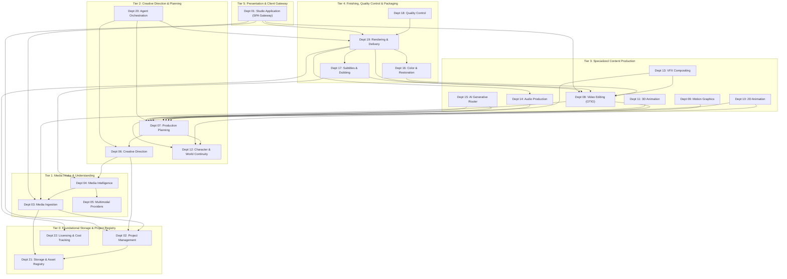

# Service Dependency Graph & Failure Domains
**Project:** Universal AI Video Production Studio  
**Document Version:** 1.0.0  
**Status:** Approved System Architecture Baseline  

---

## 1. Directed Acyclic Service Dependency Graph

The 22 departments form a strict Directed Acyclic Graph (DAG) with zero circular dependencies. 

---

## 2. Failure Domain Isolation & Graceful Degradation

| Department Failure | Blast Radius | System Impact | Graceful Degradation Strategy |
| :--- | :--- | :--- | :--- |
| **Dept 03: Ingestion Worker Crash** | Single asset transcode failure | Asset marked `FAILED`; API unblocked | Automatic retry with exponential backoff; original file intact. |
| **Dept 04: Whisper / PySceneDetect Failure** | Automatic metadata extraction fails | Shot boundaries & transcript missing | Manual cut markers & manual text transcript input enabled in UI. |
| **Dept 05: Multimodal Provider Outage** | External LLM analysis unavailable | Brief analysis hangs | Local deterministic rule fallback generates structured script stub. |
| **Dept 09: Motion Canvas Render Failure** | Motion graphic layer render error | Transparent title missing | Fallback to deterministic SVG text overlay on timeline V2 track. |
| **Dept 14: Audio DSP / Demucs Error** | Audio stem extraction fails | Stems unavailable | Fallback to original stereo mix with baseline -14 LUFS gain adjustment. |
| **Dept 15: AI Video Generation Timeout** | Cloud diffusion job times out | Generative shot missing | Production planner flags missing coverage; prompts manual replacement. |
| **Dept 18: Quality Control Policy Alert** | Broadcast compliance defect detected | Delivery package blocked | Detailed defect report returned to user with specific remediation hints. |
| **Dept 19: Hardware Encoder Crash** | VideoToolbox ASIC error | Master export interrupted | Automatic fallback to deterministic CPU software encoder (`libx264`). |
