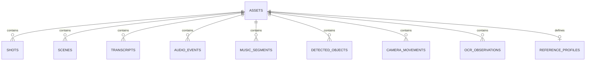

# Shot and Scene Database Schema Specification

**Document Version:** 1.0.0  
**Status:** Approved & Implemented  
**Storage Tier:** Central Asset Registry (`projects/studio_asset_registry.db`)  

---

## 1. Schema Overview

To support evidence-grounded AI video production without floating-point time drift or ambiguous cut references, Department `04_media_intelligence` implements a normalized, relational SQLite schema comprising 9 specialized tables linked to parent assets.



---

## 2. DDL Schema Definitions

### 1. `shots` Table
Represents single, continuous camera takes bounded by cuts, transitions, or scene boundaries.
```sql
CREATE TABLE IF NOT EXISTS shots (
    shot_id TEXT PRIMARY KEY,
    asset_id TEXT NOT NULL,
    shot_number INTEGER NOT NULL,
    start_sec REAL NOT NULL,
    end_sec REAL NOT NULL,
    start_frame INTEGER NOT NULL,
    end_frame INTEGER NOT NULL,
    transition_in TEXT DEFAULT 'HARD_CUT',
    transition_out TEXT DEFAULT 'HARD_CUT',
    shot_scale TEXT DEFAULT 'UNKNOWN',
    camera_angle TEXT DEFAULT 'UNKNOWN',
    camera_motion TEXT DEFAULT 'STATIC',
    summary TEXT DEFAULT '',
    visual_features_json TEXT DEFAULT '{}',
    confidence REAL DEFAULT 1.0,
    created_at TEXT NOT NULL,
    FOREIGN KEY(asset_id) REFERENCES assets(asset_id) ON DELETE CASCADE
);
CREATE INDEX IF NOT EXISTS idx_shots_asset ON shots(asset_id);
```

### 2. `scenes` Table
Represents multi-shot dramatic or thematic units sharing narrative location, mood, or lighting.
```sql
CREATE TABLE IF NOT EXISTS scenes (
    scene_id TEXT PRIMARY KEY,
    asset_id TEXT NOT NULL,
    scene_number INTEGER NOT NULL,
    start_sec REAL NOT NULL,
    end_sec REAL NOT NULL,
    start_frame INTEGER NOT NULL,
    end_frame INTEGER NOT NULL,
    summary TEXT DEFAULT '',
    setting_description TEXT DEFAULT '',
    mood_tags_json TEXT DEFAULT '[]',
    created_at TEXT NOT NULL,
    FOREIGN KEY(asset_id) REFERENCES assets(asset_id) ON DELETE CASCADE
);
```

### 3. `transcripts` Table
Contains spoken speech segments with speaker turn tagging and word alignments.
```sql
CREATE TABLE IF NOT EXISTS transcripts (
    segment_id TEXT PRIMARY KEY,
    asset_id TEXT NOT NULL,
    speaker_id TEXT NOT NULL,
    start_sec REAL NOT NULL,
    end_sec REAL NOT NULL,
    text TEXT NOT NULL,
    language TEXT DEFAULT 'en',
    words_json TEXT DEFAULT '[]',
    confidence REAL DEFAULT 1.0,
    created_at TEXT NOT NULL,
    FOREIGN KEY(asset_id) REFERENCES assets(asset_id) ON DELETE CASCADE
);
CREATE INDEX IF NOT EXISTS idx_transcripts_asset ON transcripts(asset_id);
```

### 4. `audio_events` Table
Acoustic sound event observations (Speech, Music, Silence, Sound Effects).
```sql
CREATE TABLE IF NOT EXISTS audio_events (
    event_id TEXT PRIMARY KEY,
    asset_id TEXT NOT NULL,
    event_type TEXT NOT NULL,
    description TEXT DEFAULT '',
    start_sec REAL NOT NULL,
    end_sec REAL NOT NULL,
    confidence REAL DEFAULT 1.0,
    created_at TEXT NOT NULL,
    FOREIGN KEY(asset_id) REFERENCES assets(asset_id) ON DELETE CASCADE
);
```

### 5. `music_segments` Table
Rhythmic segments with tempo (BPM) and beat grid timestamps.
```sql
CREATE TABLE IF NOT EXISTS music_segments (
    segment_id TEXT PRIMARY KEY,
    asset_id TEXT NOT NULL,
    start_sec REAL NOT NULL,
    end_sec REAL NOT NULL,
    tempo_bpm REAL NOT NULL,
    beat_timestamps_json TEXT DEFAULT '[]',
    energy_level REAL DEFAULT 0.5,
    created_at TEXT NOT NULL,
    FOREIGN KEY(asset_id) REFERENCES assets(asset_id) ON DELETE CASCADE
);
```

### 6. `detected_objects` Table
Tracked visual objects and persons with normalized bounding boxes.
```sql
CREATE TABLE IF NOT EXISTS detected_objects (
    detection_id TEXT PRIMARY KEY,
    asset_id TEXT NOT NULL,
    track_id INTEGER NOT NULL,
    label TEXT NOT NULL,
    timestamp_sec REAL NOT NULL,
    frame_number INTEGER NOT NULL,
    box_x REAL NOT NULL,
    box_y REAL NOT NULL,
    box_width REAL NOT NULL,
    box_height REAL NOT NULL,
    confidence REAL DEFAULT 1.0,
    created_at TEXT NOT NULL,
    FOREIGN KEY(asset_id) REFERENCES assets(asset_id) ON DELETE CASCADE
);
CREATE INDEX IF NOT EXISTS idx_objects_asset ON detected_objects(asset_id);
```

### 7. `camera_movements` Table
Cinematographic camera movement segments.
```sql
CREATE TABLE IF NOT EXISTS camera_movements (
    movement_id TEXT PRIMARY KEY,
    asset_id TEXT NOT NULL,
    start_sec REAL NOT NULL,
    end_sec REAL NOT NULL,
    motion_type TEXT NOT NULL,
    magnitude REAL NOT NULL,
    direction_vector_json TEXT DEFAULT '[0.0, 0.0]',
    confidence REAL DEFAULT 1.0,
    created_at TEXT NOT NULL,
    FOREIGN KEY(asset_id) REFERENCES assets(asset_id) ON DELETE CASCADE
);
```

### 8. `ocr_observations` Table
On-screen text regions, words, and typographic categories.
```sql
CREATE TABLE IF NOT EXISTS ocr_observations (
    ocr_id TEXT PRIMARY KEY,
    asset_id TEXT NOT NULL,
    text TEXT NOT NULL,
    text_category TEXT DEFAULT 'GENERAL',
    timestamp_sec REAL NOT NULL,
    frame_number INTEGER NOT NULL,
    box_x REAL NOT NULL,
    box_y REAL NOT NULL,
    box_width REAL NOT NULL,
    box_height REAL NOT NULL,
    confidence REAL DEFAULT 1.0,
    created_at TEXT NOT NULL,
    FOREIGN KEY(asset_id) REFERENCES assets(asset_id) ON DELETE CASCADE
);
CREATE INDEX IF NOT EXISTS idx_ocr_asset ON ocr_observations(asset_id);
```

### 9. `reference_profiles` Table
Deconstructed visual and editorial style profiles for style-transfer and matching.
```sql
CREATE TABLE IF NOT EXISTS reference_profiles (
    profile_id TEXT PRIMARY KEY,
    asset_id TEXT NOT NULL UNIQUE,
    name TEXT NOT NULL,
    visual_style_json TEXT DEFAULT '{}',
    editing_style_json TEXT DEFAULT '{}',
    motion_graphics_json TEXT DEFAULT '{}',
    audio_style_json TEXT DEFAULT '{}',
    created_at TEXT NOT NULL,
    FOREIGN KEY(asset_id) REFERENCES assets(asset_id) ON DELETE CASCADE
);
```
