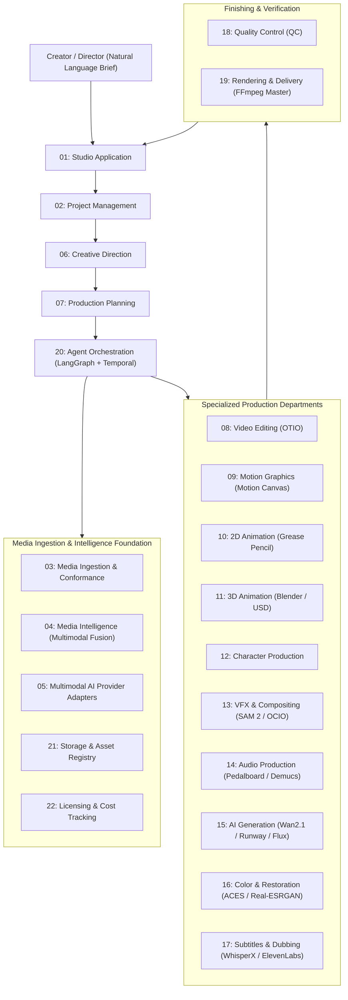

# Universal AI Video Production Studio: System Architecture
**Project:** Universal AI Video Production Studio  
**Document Version:** 1.0.0  
**Status:** Approved Master Architecture  
**Architect:** Principal Software & Media Pipeline Architect  
**Verification Date:** 2026-11-21  

---

## 1. Architectural Philosophy & Principles

The Universal AI Video Production Studio is an enterprise-grade, event-driven media pipeline designed for modularity, durability, format independence, and multi-model consensus.

### Core Principles
1. **Decoupled Editorial vs. Spatial Representations:** The editorial timeline is managed via **OpenTimelineIO (OTIO)** for track-based temporal sequencing. Non-editorial representations (3D scenes, node-based VFX compositing, and vector motion graphics) maintain their own specialized hierarchical representations (**OpenUSD**, **Node Composition Graphs**, and **Vector Scene ASTs**) and link into OTIO clips via deterministic render passes and timecode alignment.
2. **Synchronized Project Identity & Asset Registry:** All 22 departments operate on a single immutable `project_id`. Every piece of media, proxy, mask, depth map, audio stem, script, and prompt is registered in a centralized **Common Asset Registry** with cryptographic content hashes (`SHA-256`), source lineage, and SMPTE timecode metadata.
3. **Pluggable Multi-Tier Execution:** Department tasks dynamically route to local execution (Apple M4 CPU/VideoToolbox), self-hosted remote GPU worker clusters (NVIDIA A100/H100), or commercial cloud APIs (Gemini, TwelveLabs, ElevenLabs, Runway) based on data privacy, latency, and hardware constraints.
4. **Human-in-the-Loop (HITL) by Design:** Long-running creative or high-cost generative decisions require explicit user approval checkpoints before execution.
5. **No Monolithic Agent Locks:** Agents operate through strict tool contracts via the **Model Context Protocol (MCP)** and state graphs (**LangGraph**). The runtime engine does not depend on proprietary developer tooling.

---

## 2. Global Department Topology



---

## 3. Departmental Specifications (22 Departments)

### Department 01: Studio Application (`departments/01_studio_application`)
- **Purpose:** Primary user interface, visual timeline inspection, conversational director prompt interface, asset browser, and real-time streaming preview.
- **Inputs:** User natural language prompts, media drag-and-drop uploads, review approvals/rejections, manual timeline nudges.
- **Outputs:** `UserIntentEvent`, `ApprovalEvent`, UI viewport state.
- **Interface:** REST / WebSocket / Server-Sent Events (FastAPI + Vite/React).
- **Dependencies:** None (Top-level consumer).
- **Test Strategy:** End-to-end Playwright tests for UI rendering, WebSocket telemetry latency, and approval button interactions.

### Department 02: Project Management (`departments/02_project_management`)
- **Purpose:** Lifecycle management of projects, versions, branches, configuration settings, target delivery profiles (e.g. 16:9 4K Film vs. 9:16 TikTok Vertical), and state serialization.
- **Inputs:** `CreateProjectRequest`, `UpdateProjectConfigRequest`.
- **Outputs:** `ProjectManifest` (JSON), `ProjectStateChangeEvent`.
- **Interface:** `IProjectManager`: `create_project()`, `get_project()`, `save_snapshot()`, `create_branch()`.
- **Dependencies:** Core Storage, Schemas.
- **Test Strategy:** Unit tests for project creation, JSON schema validation, version branching, and rollback consistency.

### Department 03: Media Ingestion & Conformance (`departments/03_media_ingestion`)
- **Purpose:** Ingests raw video, audio, image, and graphic files. Performs stream probing (`ffprobe`), validates codec integrity, generates editing proxies (720p/1080p ProRes Proxy / H.264), extracts uncompressed 48kHz WAV audio, and registers media in the Asset Registry.
- **Inputs:** Raw binary files (`.mp4`, `.mov`, `.wav`, `.png`, `.exr`).
- **Outputs:** `MediaAssetRecord`, Proxy file paths, Canonical WAV file paths, Keyframe index tables.
- **Interface:** `IMediaIngestion`: `ingest_file(path: Path) -> IngestResult`.
- **Dependencies:** FFmpeg 8.1.2, FFprobe, Department 21 (Storage & Asset Registry).
- **Test Strategy:** Integration tests ingesting corrupt video, variable-frame-rate (VFR) media, high-bitrate ProRes, and multi-channel audio files.

### Department 04: Media Intelligence (`departments/04_media_intelligence`)
- **Purpose:** Performs multi-modal feature extraction on ingested media: deterministic cut detection (`PySceneDetect`), speech transcription (`faster-whisper`), speaker diarization (`PyAnnote`), music stem separation (`Demucs`), optical flow (`UniMatch`), and semantic video indexing (`TwelveLabs` / `Gemini`).
- **Inputs:** `MediaAssetRecord`, Proxy video, 48kHz audio.
- **Outputs:** `MultimodalObservationManifest` containing timestamp-grounded cuts, transcripts, speaker IDs, camera motion labels, and vector embeddings.
- **Interface:** `IMediaIntelligence`: `analyze_asset(asset_id: UUID) -> MultimodalObservationManifest`.
- **Dependencies:** PySceneDetect, faster-whisper, Demucs, TwelveLabs SDK, Department 05.
- **Test Strategy:** Benchmark accuracy against ground-truth cut lists, word-error-rate (WER) on benchmark speech audio, and timestamp drift tests.

### Department 05: Multimodal AI Provider Adapters (`departments/05_multimodal_providers`)
- **Purpose:** Standardized abstraction layer isolating external AI APIs and local inference engines behind unified provider interfaces.
- **Inputs:** Standardized provider request objects (`VideoAnalysisRequest`, `EmbeddingRequest`, `ChatRequest`).
- **Outputs:** Standardized provider response objects with confidence scores, token usage, and latency metrics.
- **Interface:** `IVideoUnderstandingProvider`, `IEmbeddingProvider`, `ITextLLMProvider`. Implements adapters: `GeminiProvider`, `TwelveLabsProvider`, `QwenVLProvider`.
- **Dependencies:** `google-genai`, `twelvelabs`, `httpx`.
- **Test Strategy:** Mocked API responses, rate-limit retry handling, fallback failover tests from Gemini to Qwen2.5-VL.

### Department 06: Creative Direction (`departments/06_creative_direction`)
- **Purpose:** Interprets natural language user briefs, analyzes visual/audio style references, establishes creative narrative arcs, generates shot lists, scripts, and mood boards.
- **Inputs:** Natural language prompt, reference video observation manifests, genre/brand guidelines.
- **Outputs:** `CreativeBrief`, `ScriptDocument`, `StoryboardManifest` with shot-by-shot visual and acoustic specifications.
- **Interface:** `ICreativeDirector`: `develop_creative_plan(prompt: str, references: List[UUID]) -> CreativeBrief`.
- **Dependencies:** Multimodal LLMs (Gemini / Claude / Qwen), Department 02.
- **Test Strategy:** Deterministic structured output validation against `schemas/creative_brief_schema.json`.

### Department 07: Production Planning (`departments/07_production_planning`)
- **Purpose:** Converts the creative brief and storyboard into an executable dependency graph of production jobs (asset generation tasks, 3D renders, voice synthesis, editing assembly). Calculates compute costs and estimates completion times.
- **Inputs:** `CreativeBrief`, `StoryboardManifest`, compute budget constraints.
- **Outputs:** `ProductionPlanDAG` (Directed Acyclic Graph of `JobTicket`s), `CostEstimateReport`.
- **Interface:** `IProductionPlanner`: `generate_plan(brief: CreativeBrief) -> ProductionPlanDAG`.
- **Dependencies:** Department 06, Department 22 (Licensing & Cost Tracking).
- **Test Strategy:** Graph cycle detection, dependency topological sort verification, cost calculation edge cases.

### Department 08: Video Editing (`departments/08_video_editing`)
- **Purpose:** Assembles, trims, splices, syncs, and arranges multi-track video and audio clips into the canonical editorial timeline using OpenTimelineIO. Manages transitions, cuts on beats, and multi-camera switching.
- **Inputs:** `EditorialJobTicket`, `MultimodalObservationManifest` (for cuts and beats), Source Asset IDs.
- **Outputs:** `OpenTimelineIO.Timeline` object serialized to `.otio` JSON, EDL/FCPXML exports.
- **Interface:** `IVideoEditor`: `create_timeline()`, `append_clip()`, `trim_clip()`, `add_transition()`, `export_otio()`.
- **Dependencies:** OpenTimelineIO, Department 21.
- **Test Strategy:** Frame-accuracy tests, rational time math assertions, roundtrip export/import across FCPXML and OTIO without duration drift.

### Department 09: Motion Graphics (`departments/09_motion_graphics`)
- **Purpose:** Generates 2D animated titles, lower-thirds, subtitles, kinetic typography, callouts, and data visualizations using Motion Canvas (TypeScript) and Lottie runtimes.
- **Inputs:** Typography copy, timing boundaries, color palette, motion style preset.
- **Outputs:** Rendered transparent PNG frame sequences or ProRes 4444 quicktimes with alpha channels.
- **Interface:** `IMotionGraphics`: `render_graphic(spec: MotionGraphicSpec) -> GraphicAssetRecord`.
- **Dependencies:** Node.js, Motion Canvas CLI, Department 21.
- **Test Strategy:** Automated render verification, alpha channel transparency validation, font rendering checks.

### Department 10: 2D Animation (`departments/10_animation_2d`)
- **Purpose:** Produces 2D traditional and anime-style animations, character turnarounds, and vector keyframe sequences using headless Blender Grease Pencil 3.0.
- **Inputs:** 2D character model sheets, vector keyframes, motion curves.
- **Outputs:** 2D vector animation renders, transparent alpha plates.
- **Interface:** `I2DAnimation`: `generate_2d_sequence(spec: Animation2DSpec) -> RenderResult`.
- **Dependencies:** Blender headless subprocess.
- **Test Strategy:** Headless script execution tests, frame integrity checks.

### Department 11: 3D Animation (`departments/11_animation_3d`)
- **Purpose:** Manages 3D scene hierarchies, camera staging, skeletal animation, lighting setups, and rendering using Blender 4.x and OpenUSD scene descriptions.
- **Inputs:** `OpenUSD` scene files, camera trajectory curves, skeletal motion capture data.
- **Outputs:** 3D render passes (Beauty, Depth, Normal, Cryptomatte) in OpenEXR format.
- **Interface:** `I3DAnimation`: `render_usd_scene(scene_path: Path, camera_id: str) -> List[Path]`.
- **Dependencies:** Blender 4.x, OpenUSD library (`pxr.Usd`).
- **Test Strategy:** Headless Blender rendering tests with mock USD scenes, render pass output validation.

### Department 12: Character Production (`departments/12_character_production`)
- **Purpose:** Establishes and preserves character consistency across 2D and 3D scenes. Manages character LoRAs, model sheets, voice profiles, facial blendshapes, and wardrobe references.
- **Inputs:** Character descriptions, reference portrait images, voice sample audio.
- **Outputs:** `CharacterProfileRecord` (LoRA weights path, USD mesh rig, ElevenLabs voice ID, blendshape mappings).
- **Interface:** `ICharacterProducer`: `create_character()`, `get_character_assets()`.
- **Dependencies:** Department 15 (AI Generation), Department 14 (Audio), Department 21.
- **Test Strategy:** Facial similarity verification tests across multiple generated shots.

### Department 13: VFX & Compositing (`departments/13_vfx_compositing`)
- **Purpose:** Performs rotoscoping (SAM 2.1), object removal/inpainting (E2FGVI), green-screen keying, 2.5D depth effects, particle effects, and multi-layer compositing under OpenColorIO ACEScg.
- **Inputs:** Background plates, foreground elements, matte masks, depth maps.
- **Outputs:** Composited video plates, alpha mattes, OpenEXR multi-channel composites.
- **Interface:** `ICompositor`: `composite_layers(spec: CompositingSpec) -> CompositeResult`.
- **Dependencies:** SAM 2.1 Video Predictor, Blender Compositor / FFmpeg filtergraph, OpenColorIO.
- **Test Strategy:** Pixel-level alpha matte verification, OCIO color space transform roundtrip tests.

### Department 14: Audio Production (`departments/14_audio_production`)
- **Purpose:** Multi-track audio mixing, stem balancing, dialogue leveling, sound design (foley and ambient background synthesis), dynamic EQ, and spatial reverb via Spotify Pedalboard.
- **Inputs:** Dialogue tracks, voiceover stems, sound effects, background music tracks, beat grids.
- **Outputs:** Final mixed stereo / 5.1 surround 24-bit 48kHz WAV audio master.
- **Interface:** `IAudioProducer`: `mix_tracks(tracks: List[AudioTrackSpec]) -> Path`.
- **Dependencies:** Spotify Pedalboard, Demucs v4, Librosa.
- **Test Strategy:** Audio clipping check (0 dBFS ceiling), signal-to-noise ratio measurements, track alignment timing tests.

### Department 15: AI Generation (`departments/15_ai_generation`)
- **Purpose:** Generates text-to-video, image-to-video, character concept images, synthetic music, and sound effects using commercial APIs (Runway, Kling) and open-weight diffusion models (Wan2.1, Flux.1-schnell, MusicGen).
- **Inputs:** `GenerationPromptSpec` (prompt, seed, negative prompt, reference image, camera motion parameters).
- **Outputs:** Generated video clips, high-res images, synthesized audio files.
- **Interface:** `IAIGenerator`: `generate_video()`, `generate_image()`, `generate_audio()`.
- **Dependencies:** Wan2.1 runner, Runway API, Kling API, Flux runner.
- **Test Strategy:** Generation timeout handling, seed reproducibility tests, error backoff retry logic.

### Department 16: Color & Restoration (`departments/16_color_restoration`)
- **Purpose:** Color grading (LUT application, CDL color decision lists), contrast adjustment, video denoising, super-resolution upscaling (Real-ESRGAN), and frame rate interpolation (RIFE).
- **Inputs:** Edit master clips, target color grading profile (LUT/CDL), target resolution.
- **Outputs:** Color-graded, upscaled master video plates.
- **Interface:** `IColorRestoration`: `grade_clip()`, `upscale_video()`.
- **Dependencies:** OpenColorIO, Real-ESRGAN, FFmpeg.
- **Test Strategy:** Color delta ($E$) checks, resolution upscale dimension assertions.

### Department 17: Subtitles & Dubbing (`departments/17_subtitles_dubbing`)
- **Purpose:** Generates timed subtitles (SRT, VTT, styled ASS), executes automated multilingual translation, voice cloning dubbing, and acoustic lip-synchronization.
- **Inputs:** Dialogue audio stems, source transcript, target languages.
- **Outputs:** Subtitle files (`.srt`, `.vtt`, `.ass`), translated and dubbed synchronized audio tracks.
- **Interface:** `ISubtitlesDubbing`: `generate_subtitles()`, `dub_dialogue()`.
- **Dependencies:** WhisperX, ElevenLabs Dubbing API / Kokoro-82M.
- **Test Strategy:** Subtitle timecode overlap detection, dubbing speech duration matching.

### Department 18: Quality Control (`departments/18_quality_control`)
- **Purpose:** Automated inspection of render outputs before delivery. Detects black frames, flash frames, freeze frames, audio clipping/silence, codec non-compliance, missing fonts, and aspect ratio mismatches.
- **Inputs:** Final rendered video and audio files.
- **Outputs:** `QualityControlReport` (PASS / FAIL / WARN) with exact frame numbers of detected anomalies.
- **Interface:** `IQualityControl`: `verify_media(path: Path) -> QCReport`.
- **Dependencies:** FFmpeg (`blackdetect`, `freezedetect`, `astats`), FFprobe.
- **Test Strategy:** Automated detection tests against test files with known black frames, digital hits, and audio distortion.

### Department 19: Rendering & Delivery (`departments/19_rendering_delivery`)
- **Purpose:** Final master assembly and multi-format delivery export. Renders OTIO editorial timeline to final delivery targets (ProRes 422 HQ Broadcast Master, YouTube 4K H.264, Instagram Reels 9:16 Vertical, AV1 Web Stream). Implements EBU R128 loudness normalization.
- **Inputs:** Canonical OTIO timeline, rendered VFX plates, final mixed audio master, delivery profile.
- **Outputs:** Final delivery media packages with checksum manifests (`SHA-256`).
- **Interface:** `IRenderDelivery`: `render_delivery(timeline: otio.schema.Timeline, profile: str) -> Path`.
- **Dependencies:** FFmpeg 8.1.2 VideoToolbox / NVENC, OpenTimelineIO.
- **Test Strategy:** Complete render pass verification, checksum validation, stream profile conformance checks.

### Department 20: Agent Orchestration (`departments/20_agent_orchestration`)
- **Purpose:** Coordinates the multi-agent decision engine. Executes stateful workflow graphs (LangGraph), tracks job states durably (Temporal), manages task queues, handles agent communication via MCP, and pauses for human reviews.
- **Inputs:** `JobTicket`s, agent prompt instructions, execution events.
- **Outputs:** Dispatched tasks, updated state snapshots, review prompt notifications.
- **Interface:** `IAgentOrchestrator`: `dispatch_task()`, `pause_for_human()`, `resume_task()`.
- **Dependencies:** LangGraph, Temporal SDK, Redis / In-Memory State.
- **Test Strategy:** State machine transition tests, worker crash recovery tests, pause/resume state snapshot tests.

### Department 21: Storage & Asset Management (`departments/21_storage_asset_management`)
- **Purpose:** Manages the centralized Common Asset Registry. Indexes raw media, generated assets, intermediates, and project metadata with unique UUIDs, file paths, MIME types, cryptographic SHA-256 hashes, and tags. Manages proxy cache eviction.
- **Inputs:** File registration requests, asset lookup queries, cache cleanup commands.
- **Outputs:** `AssetRecord`s, resolved local/cloud URIs.
- **Interface:** `IAssetRegistry`: `register_asset()`, `get_asset()`, `evict_cache()`.
- **Dependencies:** SQLite / PostgreSQL, local filesystem, S3 / GCS cloud storage adapters.
- **Test Strategy:** Asset registration uniqueness tests, SHA-256 hash collision checks, cache eviction LRU tests.

### Department 22: Licensing & Cost Tracking (`departments/22_licensing_cost_tracking`)
- **Purpose:** Audits software licenses and model weight terms for commercial compliance. Tracks real-time API spending (Gemini, TwelveLabs, Runway, ElevenLabs) and compute costs. Prevents budget overruns.
- **Inputs:** API execution telemetry, model invocation records, budget limit configs.
- **Outputs:** `CostAndLicenseAuditReport`, budget warning alerts.
- **Interface:** `ILicenseCostTracker`: `record_api_usage()`, `check_license_compliance()`, `get_budget_status()`.
- **Dependencies:** `LICENSE_REGISTRY.csv`, config budgets.
- **Test Strategy:** Budget cap threshold enforcement tests, non-commercial license detection alerts.

---

## 4. Unified Project Model & Common Asset Registry

Every department interacts with a unified project schema:

```json
{
  "project_id": "proj_a1b2c3d4-e5f6-7890-abcd-1234567890ab",
  "project_name": "Cyberpunk Neon Chase",
  "version": "1.0.0",
  "created_at": "2026-11-21T16:30:00Z",
  "settings": {
    "timeline_rate_fps": 24.0,
    "canvas_width": 3840,
    "canvas_height": 2160,
    "aspect_ratio": "16:9",
    "color_space": "ACEScg",
    "audio_sample_rate": 48000,
    "audio_channels": 2
  },
  "asset_manifest_ref": "assets/manifest.json",
  "timeline_ref": "timeline/master_editorial.otio",
  "scene_3d_ref": "scenes/main_world.usd",
  "mograph_ref": "mograph/titles.ts"
}
```
