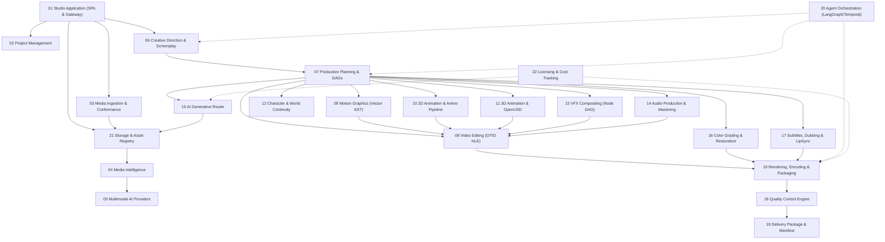

# System Integration Map & Inter-Department Topology
**Project:** Universal AI Video Production Studio  
**Document Version:** 1.0.0  
**Status:** Authoritative Architectural Integration Map  

---

## 1. Global Inter-Department Topology

The studio coordinates 22 specialized production departments into a cohesive media creation pipeline. Every department communicates through strictly typed interfaces (`interface.py`) and the Central Common Asset Registry (`core/assets/database.py`), preventing tight coupling and circular dependencies.

---

## 2. Departmental Integration Contracts Summary

| Dept ID | Department Name | Upstream Inputs | Primary Outputs | Downstream Consumers |
| :---: | :--- | :--- | :--- | :--- |
| **01** | **Studio Application** | User actions, HTTP requests, WebSockets | Unified Workspace, UI Telemetry | End users, browser client |
| **02** | **Project Management** | Project configs, stage triggers | `ProjectRecord`, `ProjectVersionSnapshot` | All departments |
| **03** | **Media Ingestion** | Uploaded files, local file paths | `AssetRecord`, proxies, WAV audio, thumbnails | Dept 04, 08, 14, 21 |
| **04** | **Media Intelligence**| Ingested media assets (`AssetRecord`) | Scene list, Whisper transcript, audio stems | Dept 06, 07, 17 |
| **05** | **Multimodal Providers**| Raw multimodal prompts & footage | Embeddings, visual feature vectors | Dept 04, 06, 15 |
| **06** | **Creative Direction** | Natural language brief, project genre | `ProductionScript`, `CreativeConcept`, `Storyboard`| Dept 07, 10, 15 |
| **07** | **Production Planning**| Script, shots, reference profiles | `EditBlueprint`, dependency DAG, cost estimate| Dept 08, 09, 13, 14, 15 |
| **08** | **Video Editing** | Ingested clips, cuts, transitions, blueprint| `Timeline` (OpenTimelineIO format) | Dept 16, 18, 19 |
| **09** | **Motion Graphics** | Declarative presets, title parameters | Vector SVG layers, ProRes 4444 video overlay | Dept 08, 19 |
| **10** | **2D Animation** | Character briefs, storyboard shots | Turnaround sheets, rig files, transparent ProRes| Dept 08, 13 |
| **11** | **3D Animation** | OpenUSD assets, scene parameters | Blender rendered sequences, EXR/PNG rasters | Dept 08, 13 |
| **12** | **Character Production**| Turnarounds, prompt styling | Consistency rules, facial/wardrobe DNA | Dept 10, 15 |
| **13** | **VFX Compositing** | Background footage, foreground plates, DAG | Composite video masters, matte masks | Dept 08, 19 |
| **14** | **Audio Production** | Dialogue tracks, music, procedural SFX | Mixed multitrack stems, mastered audio (-14 LUFS)| Dept 08, 19 |
| **15** | **AI Generation** | Structured prompts, character profiles | Synthesized images, videos, audio | Dept 03, 08, 21 |
| **16** | **Color & Restoration**| Video frames, 3D LUTs, look styles | Color graded frames (ACEScg/Rec.709), upscales | Dept 08, 19 |
| **17** | **Localization** | Audio tracks, transcripts, target languages | Broadcast subtitles (SRT/VTT), dubbed audio | Dept 08, 18, 19 |
| **18** | **Quality Control** | Rendered media files, QC policies | `QCReport` (defects, metrics, pass/fail) | Dept 01, 19 |
| **19** | **Rendering & Delivery**| Active timeline, render profiles, audio stems | Master video, stems, manifest (`delivery_manifest`)| End users, broadcast |
| **20** | **Agent Orchestration**| User briefs, execution tickets | Orchestrated task transitions, agent states | Dept 06, 07, 19 |
| **21** | **Storage & Asset Mgmt**| Binary files, metadata records | Central SQLite Asset Registry, persistent paths | All departments |
| **22** | **Licensing & Cost** | Model invocations, cloud render tickets | Ledger entries, license compliance audits | Dept 02, 15, 19 |
