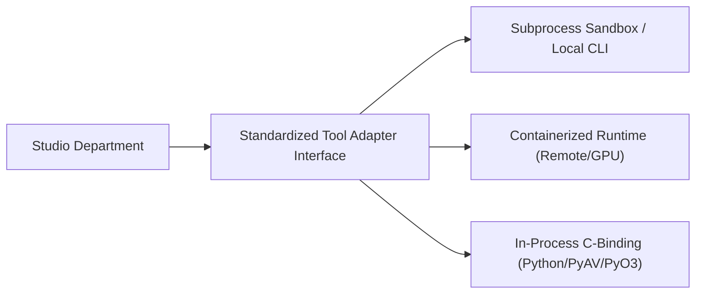

# Production Tool & Software Registry
**Project:** Universal AI Video Production Studio  
**Document Version:** 1.0.0  
**Status:** Active Production Specification  
**Last Verified:** 2026-11-21  

---

## 1. Registry Architecture

The Tool Registry defines the exact software executables, shared libraries, and CLI runtimes utilized across the 22 studio departments. Every tool registered below must declare its invocation path, execution sandboxing, configuration defaults, and automated health check command.

---

## 2. Media Processing & Ingestion Engines

### 2.1 FFmpeg
- **Identifier:** `tool.media.ffmpeg`
- **Version:** `8.1.2` (Homebrew Build, Apple Clang 21.0.0)
- **Executable Path:** `/opt/homebrew/bin/ffmpeg`
- **License:** LGPL v2.1+ (or GPL v2+ depending on enabled filters)
- **Role:** Primary media transcoder, demuxer, stream filter, proxy generator, and final master muxer.
- **Hardware Acceleration:** Apple VideoToolbox (`-c:v h264_videotoolbox`, `-c:v hevc_videotoolbox`), NVIDIA NVENC/NVDEC on remote nodes.
- **Invocation Method:** Python `subprocess.Popen` with JSON progress telemetry via `-progress pipe:1` or `PyAV` C-bindings.
- **Standard Configuration:**
  - Proxy Encoding: `-c:v h264_videotoolbox -b:v 4000k -vf scale=-2:720 -g 1 -pix_fmt yuv420p`
  - Audio Normalization: `-filter_complex "[0:a]loudnorm=I=-14:TP=-1.5:LRA=11[aout]"`
- **Health Check Command:** `/opt/homebrew/bin/ffmpeg -version`

### 2.2 FFprobe
- **Identifier:** `tool.media.ffprobe`
- **Version:** `8.1.2`
- **Executable Path:** `/opt/homebrew/bin/ffprobe`
- **License:** LGPL v2.1+
- **Role:** Deep stream introspection, packet inspection, keyframe timestamp index generation, SAR/DAR calculation.
- **Invocation Method:** Direct execution with structured JSON output: `ffprobe -v quiet -print_format json -show_format -show_streams -show_chapters <input>`.
- **Health Check Command:** `/opt/homebrew/bin/ffprobe -version`

### 2.3 PySceneDetect
- **Identifier:** `tool.cv.scenedetect`
- **Version:** `0.7.3`
- **Invocation Method:** Python library `scenedetect` with OpenCV backend.
- **License:** BSD 3-Clause
- **Role:** Deterministic hard-cut and dissolve transition detection. Generates frame-accurate cut lists before multimodal AI ingestion.
- **Default Algorithm:** `AdaptiveDetector(adaptive_threshold=3.0, min_scene_len=15)` with property accessors (`.seconds`, `.frame_num`, `.frame_rate`).
- **Health Check Command:** `python3 -c "import scenedetect; print(scenedetect.__version__)"`

### 2.4 Pillow (PIL)
- **Identifier:** `tool.media.pillow`
- **Version:** `12.1.1`
- **License:** Historical Permission Notice and Disclaimer (HPND) / MIT Equivalent
- **Role:** Primary image inspection, EXIF/color metadata parsing, WebP/JPEG thumbnail scaling with Lanczos filter.
- **Health Check Command:** `python3 -c "import PIL; print('Pillow:', PIL.__version__)"`

### 2.5 SQLite Database Engine
- **Identifier:** `tool.storage.sqlite`
- **Version:** `3.50.4`
- **License:** Public Domain
- **Role:** Embedded ACID transactional engine for Central Asset Registry, project metadata, and job state tracking.
- **Configuration:** WAL mode (`PRAGMA journal_mode=WAL;`), Foreign Keys enabled (`PRAGMA foreign_keys=ON;`).
- **Health Check Command:** `python3 -c "import sqlite3; print('SQLite3:', sqlite3.sqlite_version)"`

### 2.6 OpenCV (Computer Vision Engine)
- **Identifier:** `tool.cv.opencv`
- **Version:** `5.0.0`
- **License:** Apache 2.0
- **Role:** Farneback dense optical flow camera motion decomposition, MOG2 background subtraction object tracking, K-Means 5-color palette extraction.
- **Health Check Command:** `python3 -c "import cv2; print('OpenCV:', cv2.__version__)"`

### 2.7 faster-whisper (Speech Transcription Engine)
- **Identifier:** `tool.speech.faster_whisper`
- **Version:** `1.2.1`
- **License:** MIT
- **Role:** CTranslate2 int8 vectorized speech transcription, word-level alignment, and acoustic speaker turn heuristics.
- **Health Check Command:** `python3 -c "import faster_whisper; print('faster-whisper:', faster_whisper.__version__)"`

### 2.8 SciPy Signal Processing
- **Identifier:** `tool.audio.scipy`
- **Version:** `1.18.0`
- **License:** BSD 3-Clause
- **Role:** Windowed short-time RMS energy profiling, onset envelope autocorrelation for tempo (BPM) and beat grid timestamp generation.
- **Health Check Command:** `python3 -c "import scipy.signal; print('SciPy:', scipy.__version__)"`

---

## 3. Editorial & Timeline Engines

### 3.1 OpenTimelineIO (OTIO)
- **Identifier:** `tool.timeline.otio`
- **Version:** `0.18.1`
- **License:** Apache 2.0 (Academy Software Foundation)
- **Role:** Universal editorial interchange format. Represents tracks, clips, gaps, transitions, and markers with rational-time arithmetic (`RationalTime(value, rate)`).
- **Interchange Adapters:** Final Cut Pro XML (`fcpxml`), DaVinci Resolve, Adobe Premiere (`xml`), Avid AAF, CMX 3600 EDL.
- **Invocation Method:** Native Python module `opentimelineio`.
- **Health Check Command:** `python3 -c "import opentimelineio as otio; print(otio.__version__)"`

### 3.2 Canonical Non-Linear Timeline Engine
- **Identifier:** `tool.timeline.canonical_nle`
- **Version:** `1.0.0`
- **License:** Proprietary (Studio Core)
- **Role:** Multi-track non-linear video editing engine supporting rational time arithmetic, clip placement (append, insert, overwrite), trimming (trim in/out, split, roll edit, slip edit, slide edit, ripple delete), transitions, and keyframed effects.
- **Invocation Method:** Python in-process (`TimelineManager`, `TimelineOperations`).
- **Health Check Command:** `python3 -c "from core.timeline import TimelineManager; print('NLE Timeline Engine OK')"`

### 3.3 Multi-Track FFmpeg Filtergraph Compiler
- **Identifier:** `tool.render.filtergraph_compiler`
- **Version:** `1.0.0`
- **License:** Proprietary (Studio Core)
- **Role:** Dynamically compiles multi-track video sequences, transitions (`xfade`), audio mixes (`amix`), and animated spatial/color effects into deterministic FFmpeg `-filter_complex` execution commands with real-time telemetry.
- **Invocation Method:** Python in-process (`RenderEngine`, `PreviewEngine`).
- **Health Check Command:** `python3 -c "from departments.video_editing.render_engine import RenderEngine; print('Render Engine OK')"`

---

## 4. Motion Graphics & Animation Runtimes

### 4.1 Motion Canvas
- **Identifier:** `tool.mograph.motion_canvas`
- **Version:** `3.16.0`
- **Runtime:** Node.js v24.11.0 / Vite
- **License:** MIT
- **Role:** Programmatic, declarative 2D motion graphics, kinetic typography, technical diagrams, and animated data widgets.
- **Invocation Method:** Node CLI `npx motion-canvas render --output-format png_sequence`.
- **Health Check Command:** `node -e "console.log('Motion Canvas Environment Ready')"`

### 4.2 Procedural Vector SVG Renderer
- **Identifier:** `tool.mograph.procedural_vector`
- **Version:** `1.0.0`
- **License:** Proprietary (Studio Core) / Apache 2.0
- **Role:** Deterministic, resolution-independent vector frame generation. Renders kinetic typography, animated data charts, HUD reticles, and brand marks directly to standalone SVG XML.
- **Invocation Method:** Python in-process (`SVGVectorRenderer`).
- **Health Check Command:** `python3 -c "from departments.motion_graphics.renderers.svg_vector_renderer import SVGVectorRenderer; print('SVG Vector Renderer OK')"`

### 4.3 Canvas2D Raster & Image2Pipe Engine
- **Identifier:** `tool.mograph.canvas_raster`
- **Version:** `1.0.0`
- **License:** Proprietary (Studio Core) / HPND (Pillow)
- **Role:** High-performance 32-bit RGBA direct canvas drawing. Streams uncompressed PNG frames directly into FFmpeg `image2pipe` to encode transparent Apple ProRes 4444 (`yuva444p10le`) and WebM (`yuva420p`) videos with zero disk cache thrashing.
- **Invocation Method:** Python in-process (`CanvasRasterRenderer`).
- **Health Check Command:** `python3 -c "from departments.motion_graphics.renderers.canvas_renderer import CanvasRasterRenderer; print('Canvas Raster OK')"`

### 4.4 Motion Graphics Preset & Typography Engine
- **Identifier:** `tool.mograph.preset_engine`
- **Version:** `1.0.0`
- **License:** Proprietary (Studio Core)
- **Role:** Parameterized preset catalog (kinetic typewriter, cinematic titles, documentary lower thirds, progress rings, telemetry HUDs) with Devanagari Unicode grapheme cluster shaping and safe-margin design validation.
- **Invocation Method:** Python in-process (`PresetRegistry`, `TypographyEngine`, `DesignValidator`).
- **Health Check Command:** `python3 -c "from departments.motion_graphics.presets.preset_registry import PresetRegistry; print('Preset Registry OK')"`

### 4.2 Blender (Headless Automation)
- **Identifier:** `tool.vfx.blender`
- **Version:** `4.3.x` / `4.4.x`
- **License:** GPL v3.0
- **Role:** 3D scene assembly, procedural geometry nodes, skeletal character animation (Rigify), Cycles/EEVEE rendering, and Grease Pencil 2D anime animation.
- **Execution Sandboxing:** Subprocess isolation (`blender -b -P <script.py> -- <args>`) to preserve commercial isolation of host studio software.
- **Health Check Command:** `blender -b --version`

---

## 5. Audio Intelligence & DSP Engines

### 5.1 Spotify Pedalboard
- **Identifier:** `tool.audio.pedalboard`
- **Version:** `0.9.16`
- **License:** Apache 2.0
- **Role:** Programmatic digital signal processing (DSP). Multi-track mixing, parametric EQ, studio compression, spatial reverb, noise gating, and VST3/AU hosting.
- **Invocation Method:** Python C-extension (`import pedalboard`).
- **Health Check Command:** `python3 -c "import pedalboard; print('Pedalboard OK')"`

### 5.2 DeepFilterNet 3
- **Identifier:** `tool.audio.deepfilternet`
- **Version:** `0.5.6`
- **License:** MIT / Apache 2.0
- **Role:** Deep-learning speech enhancement, noise suppression, and room acoustic dereverberation.
- **Invocation Method:** Python library or CLI `deepFilter`.
- **Health Check Command:** `python3 -c "import df; print('DeepFilterNet OK')"`

---

## 6. Agent Orchestration & Protocol Engines

### 6.1 LangGraph
- **Identifier:** `tool.agent.langgraph`
- **Version:** `0.2.x`
- **License:** MIT
- **Role:** Stateful cyclical multi-agent graph orchestration. Manages creative reasoning, departmental planning, and human-in-the-loop review checkpoints.
- **Invocation Method:** Python library (`from langgraph.graph import StateGraph`).
- **Health Check Command:** `python3 -c "import langgraph; print('LangGraph OK')"`

### 6.2 Model Context Protocol (MCP) Server
- **Identifier:** `tool.protocol.mcp`
- **Version:** `1.2.0` (Specification)
- **License:** MIT
- **Role:** Exposes studio capabilities (timeline query, clip slicing, render trigger, asset inspection) as standardized JSON-RPC endpoints for AI coding and operational agents.
- **Transport:** Standard I/O (`stdio`) and Server-Sent Events (`HTTP-SSE`).
- **Health Check Command:** `python3 -m core.orchestration.mcp_server --ping`

---

## 7. Creative Planning & AI Director Tools

### 7.1 Creative Brief Interpreter
- **Identifier:** `tool.creative.brief_interpreter`
- **Version:** `1.0.0`
- **License:** Proprietary (Studio Core)
- **Role:** Parses natural language prompts, extracts target durations, aspect ratios, and platforms, logs explicit assumptions, and generates clarification questions for ambiguous briefs.
- **Invocation Method:** Python in-process (`CreativeBriefService`).
- **Health Check Command:** `python3 -c "from departments.creative_direction.brief_interpreter import CreativeBriefService; print('Brief Interpreter OK')"`

### 7.2 Screenplay & Pacing Engine
- **Identifier:** `tool.creative.script_engine`
- **Version:** `1.0.0`
- **License:** Proprietary (Studio Core)
- **Role:** Decomposes concepts into structured screenplay scenes and computes algorithmic speech durations using 140 WPM broadcast baseline plus punctuation pause buffering.
- **Invocation Method:** Python in-process (`ScriptAndNarrativeService`).
- **Health Check Command:** `python3 -c "from departments.creative_direction.script_engine import ScriptAndNarrativeService; print('Script Engine OK')"`

### 7.3 Cinematography Shot Planner
- **Identifier:** `tool.creative.shot_planner`
- **Version:** `1.0.0`
- **License:** Proprietary (Studio Core)
- **Role:** Translates narrative screenplay scenes into granular `PlannedShot` records with lens focal lengths (18mm-100mm), camera angles, motions, and lighting keys.
- **Invocation Method:** Python in-process (`CinematographyShotPlanner`).
- **Health Check Command:** `python3 -c "from departments.creative_direction.shot_planner import CinematographyShotPlanner; print('Shot Planner OK')"`

### 7.4 Production Breakdown & Feasibility Engine
- **Identifier:** `tool.planning.production_engine`
- **Version:** `1.0.0`
- **License:** Proprietary (Studio Core)
- **Role:** Generates task dependency DAGs, verifies local Apple M4 hardware compatibility (<2GB weight downloads), routes heavy diffusion to remote GPUs, models compute cost ranges, and enforces human approval gates.
- **Invocation Method:** Python in-process (`ProductionBreakdownService`, `ProductionFeasibilityService`, `ProductionBlueprintManager`).
- **Health Check Command:** `python3 -c "from departments.production_planning.planning_service import ProductionPlanningService; print('Planning Engine OK')"`

---

## 8. VFX & Compositing Tools (Department 13)

### 8.1 Local Node Compositor Engine
- **Identifier:** `tool.vfx.local_compositor`
- **Version:** `1.0.0`
- **License:** Apache 2.0 / BSD-3-Clause (Studio Core)
- **Role:** Topological DAG node graph evaluator executing chroma keying, perspective warping, inpainting, and multi-layer premultiplied alpha merges.
- **Invocation Method:** Python in-process (`LocalCompositorEngine`, `VFXEngineRouter`).
- **Health Check Command:** `python3 -c "from departments.vfx_compositing import LocalCompositorEngine; print('Local Compositor OK')"`

### 8.2 Chroma Keying & Despill Engine
- **Identifier:** `tool.vfx.chroma_keyer`
- **Version:** `1.0.0`
- **License:** Apache 2.0 (Studio Core)
- **Role:** Extracts alpha mattes from green and blue screens using color difference metrics with despill suppression and morphological edge feathering.
- **Invocation Method:** Python in-process (`ChromaKeyer`).
- **Health Check Command:** `python3 -c "from departments.vfx_compositing import ChromaKeyer; print('Chroma Keyer OK')"`

### 8.3 Planar Tracking & Perspective Warper
- **Identifier:** `tool.vfx.planar_tracker`
- **Version:** `1.0.0`
- **License:** Apache 2.0 (OpenCV / Studio Core)
- **Role:** 4-point perspective homography estimation and Lanczos4 warping for screen and billboard replacements.
- **Invocation Method:** Python in-process (`PlanarTracker`).
- **Health Check Command:** `python3 -c "from departments.vfx_compositing import PlanarTracker; print('Planar Tracker OK')"`

### 8.4 Video Cleanup & Inpainting Engine
- **Identifier:** `tool.vfx.inpainting_engine`
- **Version:** `1.0.0`
- **License:** Apache 2.0 (OpenCV / Studio Core)
- **Role:** Wire, rig, logo, and blemish removal using Telea fast marching and Navier-Stokes differential equations.
- **Invocation Method:** Python in-process (`InpaintingEngine`).
- **Health Check Command:** `python3 -c "from departments.vfx_compositing import InpaintingEngine; print('Inpainting Engine OK')"`

### 8.5 Automated VFX Quality Auditor
- **Identifier:** `tool.vfx.quality_checker`
- **Version:** `1.0.0`
- **License:** Proprietary (Studio Core)
- **Role:** Automatically inspects composite frames for matte pinholes, green/blue spill leakage, and edge transition halos.
- **Invocation Method:** Python in-process (`VFXQualityChecker`).
- **Health Check Command:** `python3 -c "from departments.vfx_compositing import VFXQualityChecker; print('VFX QC OK')"`

---

## 9. 2D Animation & Character Production Tools (Departments 10 & 12)

### 9.1 Character Generator & Settei Model Sheet Engine
- **Identifier:** `tool.animation.character_generator`
- **Version:** `1.0.0`
- **License:** Apache 2.0 (Studio Core)
- **Role:** Generates persistent character DNA, 5-view Settei turnaround sheets with alignment guides, expression matrices, and pose presets.
- **Invocation Method:** Python in-process (`CharacterGenerator`).
- **Health Check Command:** `python3 -c "from departments.animation_2d import CharacterGenerator; print('Character Generator OK')"`

### 9.2 Quantitative Character Identity Validator
- **Identifier:** `tool.animation.identity_validator`
- **Version:** `1.0.0`
- **License:** Apache 2.0 (Studio Core)
- **Role:** Programmatically checks candidate character frames for proportion drift ($\Delta_{prop} \le 5\%$) and CIE Lab color distance ($\Delta E \le 8.0$), rejecting inconsistent generations.
- **Invocation Method:** Python in-process (`IdentityValidator`).
- **Health Check Command:** `python3 -c "from departments.animation_2d import IdentityValidator; print('Identity Validator OK')"`

### 9.3 2D Skeletal Puppet & IK Engine
- **Identifier:** `tool.animation.puppet_animator`
- **Version:** `1.0.0`
- **License:** Apache 2.0 (Studio Core)
- **Role:** Evaluates hierarchical 2D bone trees, solves analytical 2-bone Inverse Kinematics, maps cut-out sprites, and renders walk cycles.
- **Invocation Method:** Python in-process (`PuppetAnimator`, `IKSolver2D`).
- **Health Check Command:** `python3 -c "from departments.animation_2d import PuppetAnimator; print('Puppet Animator OK')"`

### 9.4 Anime Cel Shading Engine
- **Identifier:** `tool.animation.cel_shader`
- **Version:** `1.0.0`
- **License:** Apache 2.0 (Studio Core)
- **Role:** Renders 3-tier anime shading (flat base, core shadow, specular rim highlight) with directional lighting.
- **Invocation Method:** Python in-process (`AnimeCelShader`).
- **Health Check Command:** `python3 -c "from departments.animation_2d import AnimeCelShader; print('Anime Cel Shader OK')"`

### 9.5 Multiplane Parallax Background Engine
- **Identifier:** `tool.animation.multiplane_background`
- **Version:** `1.0.0`
- **License:** Apache 2.0 (Studio Core)
- **Role:** Renders multiplane layered anime environments (sky, distant skyline, midground buildings, foreground railing) with depth-scaled scrolling velocities.
- **Invocation Method:** Python in-process (`MultiplaneBackgroundEngine`).
- **Health Check Command:** `python3 -c "from departments.animation_2d import MultiplaneBackgroundEngine; print('Multiplane BG OK')"`

### 9.6 Facial Dialogue Lip-Sync & Viseme Engine
- **Identifier:** `tool.animation.facial_animator`
- **Version:** `1.0.0`
- **License:** Apache 2.0 (Studio Core)
- **Role:** Generates 8 dialogue-synced mouth visemes (`REST`, `AI_A`, `E_EE`, `O_OH`, `U_OO`, `M_B_P`, `F_V`, `L_TH`) and natural eye blinks.
- **Invocation Method:** Python in-process (`FacialAnimator`).
- **Health Check Command:** `python3 -c "from departments.animation_2d import FacialAnimator; print('Facial Animator OK')"`

---

## 10. Department 14 & 17: Audio Production & Dubbing Tools

### 10.1 In-Process DSP Engine (Spotify Pedalboard & SciPy)
- **Identifier:** `tool.audio.dsp_engine`
- **Version:** `0.9.26` / `1.0.0`
- **License:** Apache 2.0 / BSD-3-Clause
- **Role:** Executes high-speed C++ JUCE parametric EQ, dynamic compression, brickwall limiting, algorithmic reverb, and delay in memory.
- **Invocation Method:** Python in-process (`EqualizerEngine`, `DynamicsEngine`, `EffectsEngine`).
- **Health Check Command:** `python3 -c "import departments; from departments.audio_production.dsp import EqualizerEngine; print('DSP Engine OK')"`

### 10.2 ITU-R BS.1770-4 & EBU R128 Loudness Meter & Normalizer
- **Identifier:** `tool.audio.loudness_meter`
- **Version:** `1.0.0`
- **License:** Apache 2.0 (Studio Core)
- **Role:** K-weighting gated integrated loudness (LUFS), true peak (dBTP) oversampling, and 2-pass mastering normalization.
- **Invocation Method:** Python in-process (`LoudnessMeter`, `MasteringEngine`).
- **Health Check Command:** `python3 -c "import departments; from departments.audio_production.dsp import LoudnessMeter; print('Loudness Meter OK')"`

### 10.3 Dialogue Restoration & De-Esser Engine
- **Identifier:** `tool.audio.dialogue_restoration`
- **Version:** `1.0.0`
- **License:** Apache 2.0 (Studio Core)
- **Role:** Attenuates 50Hz/60Hz mains hum, removes low rumble, performs spectral subtraction gating, and compresses sibilance.
- **Invocation Method:** Python in-process (`DialogueCleaner`, `DeEsser`, `RoomToneGenerator`).
- **Health Check Command:** `python3 -c "import departments; from departments.audio_production.dialogue import DialogueCleaner; print('Dialogue Cleaner OK')"`

### 10.4 Procedural Foley & Cinematic SFX Synthesizer
- **Identifier:** `tool.audio.procedural_sfx`
- **Version:** `1.0.0`
- **License:** Apache 2.0 (Studio Core)
- **Role:** Mathematically synthesizes cinematic sub-impacts, swept whoosh transitions, exponential tension risers, and ambient drones without media files.
- **Invocation Method:** Python in-process (`ProceduralSFXEngine`).
- **Health Check Command:** `python3 -c "import departments; from departments.audio_production.sound_design import ProceduralSFXEngine; print('Procedural SFX OK')"`

### 10.5 Multitrack Mixer & Sidechain Dialogue Ducker
- **Identifier:** `tool.audio.multitrack_mixer`
- **Version:** `1.0.0`
- **License:** Apache 2.0 (Studio Core)
- **Role:** 32-bit floating point multitrack summing, equal-power clip crossfading, parameter automation, and dialogue-triggered music ducking.
- **Invocation Method:** Python in-process (`MultitrackMixer`).
- **Health Check Command:** `python3 -c "import departments; from departments.audio_production.mixing import MultitrackMixer; print('Multitrack Mixer OK')"`

### 10.6 4-Stem Source Separation Engine
- **Identifier:** `tool.audio.source_separator`
- **Version:** `1.0.0`
- **License:** BSD-3-Clause / MIT
- **Role:** Separates mixed audio into 4 isolated stems (`vocals`, `drums`, `bass`, `other`) using harmonic-percussive STFT median filtering.
- **Invocation Method:** Python in-process (`SourceSeparator`).
- **Health Check Command:** `python3 -c "import departments; from departments.audio_production.separation import SourceSeparator; print('Source Separator OK')"`

### 10.7 Voice Talent Dubbing & Consent Verifier
- **Identifier:** `tool.audio.voice_producer`
- **Version:** `1.0.0`
- **License:** Apache 2.0 (Studio Core)
- **Role:** Synthesizes emotional, character-consistent speech with word timestamps and verifies biometric talent commercial consent.
- **Invocation Method:** Python in-process (`VoiceProducer`, `SubtitlesDubbingService`).
- **Health Check Command:** `python3 -c "import departments; from departments.audio_production.voice import VoiceProducer; print('Voice Producer OK')"`

---

## 11. AI Media Generation & Multi-Provider Engines

### 11.1 Capability-Based Generation Router
- **Identifier:** `tool.generation.router`
- **Version:** `1.0.0`
- **License:** Apache 2.0 (Studio Core)
- **Role:** Matches incoming multimodal generation requests against registered provider capabilities, selecting the optimal model based on modality, resolution, aspect ratio, frame rate, and budget constraints.
- **Invocation Method:** Python in-process (`GenerationRouter`).
- **Health Check Command:** `python3 -c "import departments; from departments.ai_generation.router import GenerationRouter; print('Generation Router OK')"`

### 11.2 Multi-Dimensional Prompt Compiler
- **Identifier:** `tool.generation.prompt_compiler`
- **Version:** `1.0.0`
- **License:** Apache 2.0 (Studio Core)
- **Role:** Translates structured creative dimensions (subject, action, camera, lighting, mood) into model-native prompt dialects (Runway bracketed camera tags, Kling motion tags, FLUX prose paragraphs).
- **Invocation Method:** Python in-process (`PromptCompiler`).
- **Health Check Command:** `python3 -c "import departments; from departments.ai_generation.prompts import PromptCompiler; print('Prompt Compiler OK')"`

### 11.3 Asynchronous Generation Job Queue & Idempotency Cache
- **Identifier:** `tool.generation.job_queue`
- **Version:** `1.0.0`
- **License:** Apache 2.0 (Studio Core)
- **Role:** Orchestrates non-blocking background generation workers with cryptographic SHA-256 idempotency caching to prevent duplicate API spend.
- **Invocation Method:** Python in-process (`GenerationJobQueue`).
- **Health Check Command:** `python3 -c "import departments; from departments.ai_generation.orchestration import GenerationJobQueue; print('Job Queue OK')"`

### 11.4 Multi-Tier Budget Firewall & Cost Estimator
- **Identifier:** `tool.generation.budget_manager`
- **Version:** `1.0.0`
- **License:** Apache 2.0 (Studio Core)
- **Role:** Enforces hard financial stop-losses ($5.00/shot, $100.00/project) and maintains immutable real-time expenditure ledgers across paid generative APIs.
- **Invocation Method:** Python in-process (`GenerationBudgetManager`).
- **Health Check Command:** `python3 -c "import departments; from departments.ai_generation.router import GenerationBudgetManager; print('Budget Manager OK')"`

### 11.5 Post-Generation Media Quality Control Validator
- **Identifier:** `tool.generation.media_validator`
- **Version:** `1.0.0`
- **License:** Apache 2.0 (Studio Core)
- **Role:** Inspects generated video, image, and audio files for black frames, freeze frames, duration drift, blank images, and digital audio clipping.
- **Invocation Method:** Python in-process (`MediaValidator`).
- **Health Check Command:** `python3 -c "import departments; from departments.ai_generation.qc import MediaValidator; print('Media Validator OK')"`

### 11.6 Human-in-the-Loop Approval Gate Manager
- **Identifier:** `tool.generation.approval_gate`
- **Version:** `1.0.0`
- **License:** Apache 2.0 (Studio Core)
- **Role:** Holds high-cost generation tickets (> $1.00) and unverified talent voice clones in pending status until human sign-off.
- **Invocation Method:** Python in-process (`ApprovalGateManager`).
- **Health Check Command:** `python3 -c "import departments; from departments.ai_generation.approval import ApprovalGateManager; print('Approval Gate OK')"`

---

## 8. VFX & Compositing Tools (Department 13)

### 8.1 Local Node Compositor Engine
- **Identifier:** `tool.vfx.local_compositor`
- **Version:** `1.0.0`
- **License:** Apache 2.0 / BSD-3-Clause (Studio Core)
- **Role:** Topological DAG node graph evaluator executing chroma keying, perspective warping, inpainting, and multi-layer premultiplied alpha merges.
- **Invocation Method:** Python in-process (`LocalCompositorEngine`, `VFXEngineRouter`).
- **Health Check Command:** `python3 -c "from departments.vfx_compositing import LocalCompositorEngine; print('Local Compositor OK')"`

### 8.2 Chroma Keying & Despill Engine
- **Identifier:** `tool.vfx.chroma_keyer`
- **Version:** `1.0.0`
- **License:** Apache 2.0 (Studio Core)
- **Role:** Extracts alpha mattes from green and blue screens using color difference metrics with despill suppression and morphological edge feathering.
- **Invocation Method:** Python in-process (`ChromaKeyer`).
- **Health Check Command:** `python3 -c "from departments.vfx_compositing import ChromaKeyer; print('Chroma Keyer OK')"`

### 8.3 Planar Tracking & Perspective Warper
- **Identifier:** `tool.vfx.planar_tracker`
- **Version:** `1.0.0`
- **License:** Apache 2.0 (OpenCV / Studio Core)
- **Role:** 4-point perspective homography estimation and Lanczos4 warping for screen and billboard replacements.
- **Invocation Method:** Python in-process (`PlanarTracker`).
- **Health Check Command:** `python3 -c "from departments.vfx_compositing import PlanarTracker; print('Planar Tracker OK')"`

### 8.4 Video Cleanup & Inpainting Engine
- **Identifier:** `tool.vfx.inpainting_engine`
- **Version:** `1.0.0`
- **License:** Apache 2.0 (OpenCV / Studio Core)
- **Role:** Wire, rig, logo, and blemish removal using Telea fast marching and Navier-Stokes differential equations.
- **Invocation Method:** Python in-process (`InpaintingEngine`).
- **Health Check Command:** `python3 -c "from departments.vfx_compositing import InpaintingEngine; print('Inpainting Engine OK')"`

### 8.5 Automated VFX Quality Auditor
- **Identifier:** `tool.vfx.quality_checker`
- **Version:** `1.0.0`
- **License:** Proprietary (Studio Core)
- **Role:** Automatically inspects composite frames for matte pinholes, green/blue spill leakage, and edge transition halos.
- **Invocation Method:** Python in-process (`VFXQualityChecker`).
- **Health Check Command:** `python3 -c "from departments.vfx_compositing import VFXQualityChecker; print('VFX QC OK')"`

---

## 9. 2D Animation & Character Production Tools (Departments 10 & 12)

### 9.1 Character Generator & Settei Model Sheet Engine
- **Identifier:** `tool.animation.character_generator`
- **Version:** `1.0.0`
- **License:** Apache 2.0 (Studio Core)
- **Role:** Generates persistent character DNA, 5-view Settei turnaround sheets with alignment guides, expression matrices, and pose presets.
- **Invocation Method:** Python in-process (`CharacterGenerator`).
- **Health Check Command:** `python3 -c "from departments.animation_2d import CharacterGenerator; print('Character Generator OK')"`

### 9.2 Quantitative Character Identity Validator
- **Identifier:** `tool.animation.identity_validator`
- **Version:** `1.0.0`
- **License:** Apache 2.0 (Studio Core)
- **Role:** Programmatically checks candidate character frames for proportion drift ($\Delta_{prop} \le 5\%$) and CIE Lab color distance ($\Delta E \le 8.0$), rejecting inconsistent generations.
- **Invocation Method:** Python in-process (`IdentityValidator`).
- **Health Check Command:** `python3 -c "from departments.animation_2d import IdentityValidator; print('Identity Validator OK')"`

### 9.3 2D Skeletal Puppet & IK Engine
- **Identifier:** `tool.animation.puppet_animator`
- **Version:** `1.0.0`
- **License:** Apache 2.0 (Studio Core)
- **Role:** Evaluates hierarchical 2D bone trees, solves analytical 2-bone Inverse Kinematics, maps cut-out sprites, and renders walk cycles.
- **Invocation Method:** Python in-process (`PuppetAnimator`, `IKSolver2D`).
- **Health Check Command:** `python3 -c "from departments.animation_2d import PuppetAnimator; print('Puppet Animator OK')"`

### 9.4 Anime Cel Shading Engine
- **Identifier:** `tool.animation.cel_shader`
- **Version:** `1.0.0`
- **License:** Apache 2.0 (Studio Core)
- **Role:** Renders 3-tier anime shading (flat base, core shadow, specular rim highlight) with directional lighting.
- **Invocation Method:** Python in-process (`AnimeCelShader`).
- **Health Check Command:** `python3 -c "from departments.animation_2d import AnimeCelShader; print('Anime Cel Shader OK')"`

### 9.5 Multiplane Parallax Background Engine
- **Identifier:** `tool.animation.multiplane_background`
- **Version:** `1.0.0`
- **License:** Apache 2.0 (Studio Core)
- **Role:** Renders multiplane layered anime environments (sky, distant skyline, midground buildings, foreground railing) with depth-scaled scrolling velocities.
- **Invocation Method:** Python in-process (`MultiplaneBackgroundEngine`).
- **Health Check Command:** `python3 -c "from departments.animation_2d import MultiplaneBackgroundEngine; print('Multiplane BG OK')"`

### 9.6 Facial Dialogue Lip-Sync & Viseme Engine
- **Identifier:** `tool.animation.facial_animator`
- **Version:** `1.0.0`
- **License:** Apache 2.0 (Studio Core)
- **Role:** Generates 8 dialogue-synced mouth visemes (`REST`, `AI_A`, `E_EE`, `O_OH`, `U_OO`, `M_B_P`, `F_V`, `L_TH`) and natural eye blinks.
- **Invocation Method:** Python in-process (`FacialAnimator`).
- **Health Check Command:** `python3 -c "from departments.animation_2d import FacialAnimator; print('Facial Animator OK')"`

---

## 10. Department 14 & 17: Audio Production & Dubbing Tools

### 10.1 In-Process DSP Engine (Spotify Pedalboard & SciPy)
- **Identifier:** `tool.audio.dsp_engine`
- **Version:** `0.9.26` / `1.0.0`
- **License:** Apache 2.0 / BSD-3-Clause
- **Role:** Executes high-speed C++ JUCE parametric EQ, dynamic compression, brickwall limiting, algorithmic reverb, and delay in memory.
- **Invocation Method:** Python in-process (`EqualizerEngine`, `DynamicsEngine`, `EffectsEngine`).
- **Health Check Command:** `python3 -c "import departments; from departments.audio_production.dsp import EqualizerEngine; print('DSP Engine OK')"`

### 10.2 ITU-R BS.1770-4 & EBU R128 Loudness Meter & Normalizer
- **Identifier:** `tool.audio.loudness_meter`
- **Version:** `1.0.0`
- **License:** Apache 2.0 (Studio Core)
- **Role:** K-weighting gated integrated loudness (LUFS), true peak (dBTP) oversampling, and 2-pass mastering normalization.
- **Invocation Method:** Python in-process (`LoudnessMeter`, `MasteringEngine`).
- **Health Check Command:** `python3 -c "import departments; from departments.audio_production.dsp import LoudnessMeter; print('Loudness Meter OK')"`

### 10.3 Dialogue Restoration & De-Esser Engine
- **Identifier:** `tool.audio.dialogue_restoration`
- **Version:** `1.0.0`
- **License:** Apache 2.0 (Studio Core)
- **Role:** Attenuates 50Hz/60Hz mains hum, removes low rumble, performs spectral subtraction gating, and compresses sibilance.
- **Invocation Method:** Python in-process (`DialogueCleaner`, `DeEsser`, `RoomToneGenerator`).
- **Health Check Command:** `python3 -c "import departments; from departments.audio_production.dialogue import DialogueCleaner; print('Dialogue Cleaner OK')"`

### 10.4 Procedural Foley & Cinematic SFX Synthesizer
- **Identifier:** `tool.audio.procedural_sfx`
- **Version:** `1.0.0`
- **License:** Apache 2.0 (Studio Core)
- **Role:** Mathematically synthesizes cinematic sub-impacts, swept whoosh transitions, exponential tension risers, and ambient drones without media files.
- **Invocation Method:** Python in-process (`ProceduralSFXEngine`).
- **Health Check Command:** `python3 -c "import departments; from departments.audio_production.sound_design import ProceduralSFXEngine; print('Procedural SFX OK')"`

### 10.5 Multitrack Mixer & Sidechain Dialogue Ducker
- **Identifier:** `tool.audio.multitrack_mixer`
- **Version:** `1.0.0`
- **License:** Apache 2.0 (Studio Core)
- **Role:** 32-bit floating point multitrack summing, equal-power clip crossfading, parameter automation, and dialogue-triggered music ducking.
- **Invocation Method:** Python in-process (`MultitrackMixer`).
- **Health Check Command:** `python3 -c "import departments; from departments.audio_production.mixing import MultitrackMixer; print('Multitrack Mixer OK')"`

### 10.6 4-Stem Source Separation Engine
- **Identifier:** `tool.audio.source_separator`
- **Version:** `1.0.0`
- **License:** BSD-3-Clause / MIT
- **Role:** Separates mixed audio into 4 isolated stems (`vocals`, `drums`, `bass`, `other`) using harmonic-percussive STFT median filtering.
- **Invocation Method:** Python in-process (`SourceSeparator`).
- **Health Check Command:** `python3 -c "import departments; from departments.audio_production.separation import SourceSeparator; print('Source Separator OK')"`

### 10.7 Voice Talent Dubbing & Consent Verifier
- **Identifier:** `tool.audio.voice_producer`
- **Version:** `1.0.0`
- **License:** Apache 2.0 (Studio Core)
- **Role:** Synthesizes emotional, character-consistent speech with word timestamps and verifies biometric talent commercial consent.
- **Invocation Method:** Python in-process (`VoiceProducer`, `SubtitlesDubbingService`).
- **Health Check Command:** `python3 -c "import departments; from departments.audio_production.voice import VoiceProducer; print('Voice Producer OK')"`

---

## 11. AI Media Generation & Multi-Provider Engines

### 11.1 Capability-Based Generation Router
- **Identifier:** `tool.generation.router`
- **Version:** `1.0.0`
- **License:** Apache 2.0 (Studio Core)
- **Role:** Matches incoming multimodal generation requests against registered provider capabilities, selecting the optimal model based on modality, resolution, aspect ratio, frame rate, and budget constraints.
- **Invocation Method:** Python in-process (`GenerationRouter`).
- **Health Check Command:** `python3 -c "import departments; from departments.ai_generation.router import GenerationRouter; print('Generation Router OK')"`

### 11.2 Multi-Dimensional Prompt Compiler
- **Identifier:** `tool.generation.prompt_compiler`
- **Version:** `1.0.0`
- **License:** Apache 2.0 (Studio Core)
- **Role:** Translates structured creative dimensions (subject, action, camera, lighting, mood) into model-native prompt dialects (Runway bracketed camera tags, Kling motion tags, FLUX prose paragraphs).
- **Invocation Method:** Python in-process (`PromptCompiler`).
- **Health Check Command:** `python3 -c "import departments; from departments.ai_generation.prompts import PromptCompiler; print('Prompt Compiler OK')"`

### 11.3 Asynchronous Generation Job Queue & Idempotency Cache
- **Identifier:** `tool.generation.job_queue`
- **Version:** `1.0.0`
- **License:** Apache 2.0 (Studio Core)
- **Role:** Orchestrates non-blocking background generation workers with cryptographic SHA-256 idempotency caching to prevent duplicate API spend.
- **Invocation Method:** Python in-process (`GenerationJobQueue`).
- **Health Check Command:** `python3 -c "import departments; from departments.ai_generation.orchestration import GenerationJobQueue; print('Job Queue OK')"`

### 11.4 Multi-Tier Budget Firewall & Cost Estimator
- **Identifier:** `tool.generation.budget_manager`
- **Version:** `1.0.0`
- **License:** Apache 2.0 (Studio Core)
- **Role:** Enforces hard financial stop-losses ($5.00/shot, $100.00/project) and maintains immutable real-time expenditure ledgers across paid generative APIs.
- **Invocation Method:** Python in-process (`GenerationBudgetManager`).
- **Health Check Command:** `python3 -c "import departments; from departments.ai_generation.router import GenerationBudgetManager; print('Budget Manager OK')"`

### 11.5 Post-Generation Media Quality Control Validator
- **Identifier:** `tool.generation.media_validator`
- **Version:** `1.0.0`
- **License:** Apache 2.0 (Studio Core)
- **Role:** Inspects generated video, image, and audio files for black frames, freeze frames, duration drift, blank images, and digital audio clipping.
- **Invocation Method:** Python in-process (`MediaValidator`).
- **Health Check Command:** `python3 -c "import departments; from departments.ai_generation.qc import MediaValidator; print('Media Validator OK')"`

### 11.6 Human-in-the-Loop Approval Gate Manager
- **Identifier:** `tool.generation.approval_gate`
- **Version:** `1.0.0`
- **License:** Apache 2.0 (Studio Core)
- **Role:** Holds high-cost generation tickets (> $1.00) and unverified talent voice clones in pending status until human sign-off.
- **Invocation Method:** Python in-process (`ApprovalGateManager`).
- **Health Check Command:** `python3 -c "import departments; from departments.ai_generation.approval import ApprovalGateManager; print('Approval Gate OK')"`

