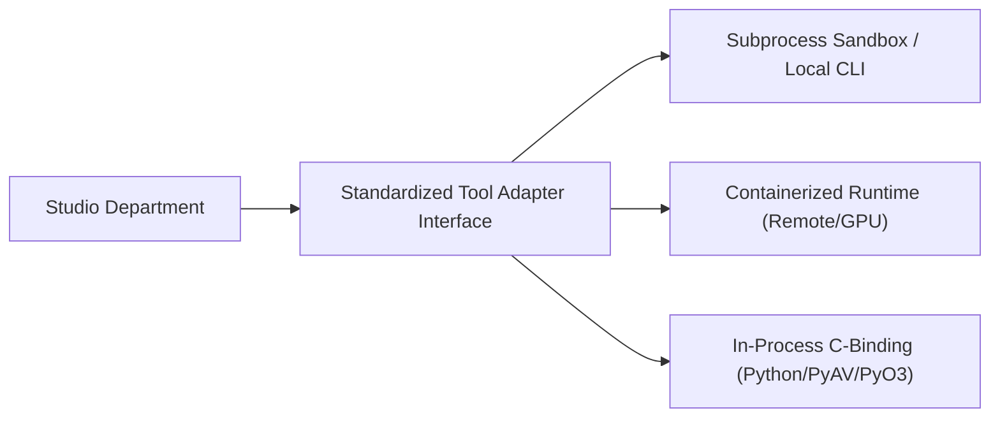

# Production Tool & Software Registry
**Project:** Universal AI Video Production Studio  
**Document Version:** 1.0.0  
**Status:** Active Production Specification  
**Last Verified:** 2026-11-21  

---

## 1. Registry Architecture

The Tool Registry defines the exact software executables, shared libraries, and CLI runtimes utilized across the 22 studio departments. Every tool registered below must declare its invocation path, execution sandboxing, configuration defaults, and automated health check command.

---

## 2. Media Processing & Ingestion Engines

### 2.1 FFmpeg
- **Identifier:** `tool.media.ffmpeg`
- **Version:** `8.1.2` (Homebrew Build, Apple Clang 21.0.0)
- **Executable Path:** `/opt/homebrew/bin/ffmpeg`
- **License:** LGPL v2.1+ (or GPL v2+ depending on enabled filters)
- **Role:** Primary media transcoder, demuxer, stream filter, proxy generator, and final master muxer.
- **Hardware Acceleration:** Apple VideoToolbox (`-c:v h264_videotoolbox`, `-c:v hevc_videotoolbox`), NVIDIA NVENC/NVDEC on remote nodes.
- **Invocation Method:** Python `subprocess.Popen` with JSON progress telemetry via `-progress pipe:1` or `PyAV` C-bindings.
- **Standard Configuration:**
  - Proxy Encoding: `-c:v h264_videotoolbox -b:v 4000k -vf scale=-2:720 -g 1 -pix_fmt yuv420p`
  - Audio Normalization: `-filter_complex "[0:a]loudnorm=I=-14:TP=-1.5:LRA=11[aout]"`
- **Health Check Command:** `/opt/homebrew/bin/ffmpeg -version`

### 2.2 FFprobe
- **Identifier:** `tool.media.ffprobe`
- **Version:** `8.1.2`
- **Executable Path:** `/opt/homebrew/bin/ffprobe`
- **License:** LGPL v2.1+
- **Role:** Deep stream introspection, packet inspection, keyframe timestamp index generation, SAR/DAR calculation.
- **Invocation Method:** Direct execution with structured JSON output: `ffprobe -v quiet -print_format json -show_format -show_streams -show_chapters <input>`.
- **Health Check Command:** `/opt/homebrew/bin/ffprobe -version`

### 2.3 PySceneDetect
- **Identifier:** `tool.cv.scenedetect`
- **Version:** `0.6.5`
- **Invocation Method:** Python library `scenedetect` or CLI `scenedetect`.
- **License:** BSD 3-Clause
- **Role:** Deterministic hard-cut and dissolve transition detection. Generates frame-accurate cut lists before multimodal AI ingestion.
- **Default Algorithm:** `AdaptiveDetector(adaptive_threshold=3.0, min_scene_len=15)`
- **Health Check Command:** `python3 -c "import scenedetect; print(scenedetect.__version__)"`

---

## 3. Editorial & Timeline Engines

### 3.1 OpenTimelineIO (OTIO)
- **Identifier:** `tool.timeline.otio`
- **Version:** `0.17.0`
- **License:** Apache 2.0 (Academy Software Foundation)
- **Role:** Universal editorial interchange format. Represents tracks, clips, gaps, transitions, and markers with rational-time arithmetic (`RationalTime(value, rate)`).
- **Interchange Adapters:** Final Cut Pro XML (`fcpxml`), DaVinci Resolve, Adobe Premiere (`xml`), Avid AAF, CMX 3600 EDL.
- **Invocation Method:** Native Python module `opentimelineio`.
- **Health Check Command:** `python3 -c "import opentimelineio as otio; print(otio.__version__)"`

---

## 4. Motion Graphics & Animation Runtimes

### 4.1 Motion Canvas
- **Identifier:** `tool.mograph.motion_canvas`
- **Version:** `3.16.0`
- **Runtime:** Node.js v24.11.0 / Vite
- **License:** MIT
- **Role:** Programmatic, declarative 2D motion graphics, kinetic typography, technical diagrams, and animated data widgets.
- **Invocation Method:** Node CLI `npx motion-canvas render --output-format png_sequence`.
- **Health Check Command:** `node -e "console.log('Motion Canvas Environment Ready')"`

### 4.2 Blender (Headless Automation)
- **Identifier:** `tool.vfx.blender`
- **Version:** `4.3.x` / `4.4.x`
- **License:** GPL v3.0
- **Role:** 3D scene assembly, procedural geometry nodes, skeletal character animation (Rigify), Cycles/EEVEE rendering, and Grease Pencil 2D anime animation.
- **Execution Sandboxing:** Subprocess isolation (`blender -b -P <script.py> -- <args>`) to preserve commercial isolation of host studio software.
- **Health Check Command:** `blender -b --version`

---

## 5. Audio Intelligence & DSP Engines

### 5.1 Spotify Pedalboard
- **Identifier:** `tool.audio.pedalboard`
- **Version:** `0.9.16`
- **License:** Apache 2.0
- **Role:** Programmatic digital signal processing (DSP). Multi-track mixing, parametric EQ, studio compression, spatial reverb, noise gating, and VST3/AU hosting.
- **Invocation Method:** Python C-extension (`import pedalboard`).
- **Health Check Command:** `python3 -c "import pedalboard; print('Pedalboard OK')"`

### 5.2 DeepFilterNet 3
- **Identifier:** `tool.audio.deepfilternet`
- **Version:** `0.5.6`
- **License:** MIT / Apache 2.0
- **Role:** Deep-learning speech enhancement, noise suppression, and room acoustic dereverberation.
- **Invocation Method:** Python library or CLI `deepFilter`.
- **Health Check Command:** `python3 -c "import df; print('DeepFilterNet OK')"`

---

## 6. Agent Orchestration & Protocol Engines

### 6.1 LangGraph
- **Identifier:** `tool.agent.langgraph`
- **Version:** `0.2.x`
- **License:** MIT
- **Role:** Stateful cyclical multi-agent graph orchestration. Manages creative reasoning, departmental planning, and human-in-the-loop review checkpoints.
- **Invocation Method:** Python library (`from langgraph.graph import StateGraph`).
- **Health Check Command:** `python3 -c "import langgraph; print('LangGraph OK')"`

### 6.2 Model Context Protocol (MCP) Server
- **Identifier:** `tool.protocol.mcp`
- **Version:** `1.2.0` (Specification)
- **License:** MIT
- **Role:** Exposes studio capabilities (timeline query, clip slicing, render trigger, asset inspection) as standardized JSON-RPC endpoints for AI coding and operational agents.
- **Transport:** Standard I/O (`stdio`) and Server-Sent Events (`HTTP-SSE`).
- **Health Check Command:** `python3 -m core.orchestration.mcp_server --ping`
