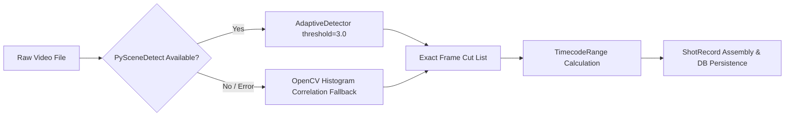

# Video Understanding Specification

**Document Version:** 1.0.0  
**Status:** Approved & Implemented  
**Engine:** `departments/04_media_intelligence` & `departments/05_multimodal_providers`  

---

## 1. Specification Objective

This document defines the technical protocol, precision standards, and algorithmic pipelines used to extract structured, temporal comprehension from uploaded video footage and reference content.

Video understanding answers questions such as:
- Where do cuts and transitions occur, down to the exact frame?
- What is the camera doing at any given second (Static, Pan, Tilt, Zoom, Tracking, Handheld)?
- What shot scale is being employed (Extreme Wide, Wide, Medium, Close-Up, Extreme Close-Up)?
- What visual objects, persons, and text elements are present?
- What editing rhythm (ASL, cut density) governs the footage?

---

## 2. Temporal Shot Boundary Detection

Shot detection is governed by `ShotDetectionService` (`departments/04_media_intelligence/shot_detector.py`).

### Dual-Engine Pipeline

### Algorithmic Parameters:
1. **Primary: PySceneDetect `AdaptiveDetector`**:
   - `adaptive_threshold = 3.0`: Dynamically adapts to local window luminance differences, preventing false cuts during camera flashes or rapid pans.
   - `min_scene_len = 15 frames`: Enforces professional broadcast minimum duration (~0.625s at 24fps) to ignore single-frame compression artifacts.
2. **Secondary: OpenCV Color Histogram Correlation**:
   - Compares 3-channel (HSV) 32-bin histograms between adjacent sampled frames.
   - Correlation drop $\rho < 0.70$ triggers a cut boundary.
   - Zero external model dependencies; runs at >300 frames per second on Apple M4 CPU.

### Output Data Model:
Each shot is persisted into the Central Asset Registry (`shots` table) with:
- `shot_number`: 1-based sequential index.
- `start_sec`, `end_sec`: Rational floating-point boundary.
- `start_frame`, `end_frame`: Integer frame indices.
- `transition_in`, `transition_out`: `HARD_CUT`, `DISSOLVE`, `WIPE`, `FADE_IN`.
- `shot_scale`: Categorized visual scale.
- `confidence`: Calibrated statistical score (0.0 to 1.0).

---

## 3. Cinematography & Camera Movement Detection

Camera motion analysis is executed by `CameraMotionService` (`departments/04_media_intelligence/camera_motion.py`).

### Farneback Optical Flow & Vector Field Decomposition
1. Frames are converted to grayscale and downsampled to 480p for real-time dense optical flow computation (`cv2.calcOpticalFlowFarneback`).
2. Vector field $(u(x, y), v(x, y))$ is decomposed into global statistical moments:
   - Mean flow $(\mu_u, \mu_v)$ and standard deviation $(\sigma_u, \sigma_v)$.
   - Global magnitude $M = \sqrt{\mu_u^2 + \mu_v^2}$.
   - Radial divergence $D_{rad} = \frac{1}{N}\sum [u \cdot \hat{r}_x + v \cdot \hat{r}_y]$.

### Classification Decision Matrix:
| Motion Type | Mathematical Condition | Cinematographic Interpretation |
| :--- | :--- | :--- |
| `STATIC` | $M < 0.40 \text{ px}$ | Locked-off tripod shot |
| `PAN_LEFT` | $|\mu_u| > 1.2 |\mu_v|$ and $\mu_u > 0.5$ | Camera panning left (scene flows right) |
| `PAN_RIGHT`| $|\mu_u| > 1.2 |\mu_v|$ and $\mu_u < -0.5$ | Camera panning right (scene flows left) |
| `TILT_UP` | $|\mu_v| > 1.2 |\mu_u|$ and $\mu_v > 0.5$ | Camera tilting up (scene flows down) |
| `TILT_DOWN`| $|\mu_v| > 1.2 |\mu_u|$ and $\mu_v < -0.5$ | Camera tilting down (scene flows up) |
| `ZOOM_IN` | $D_{rad} > 0.80$ | Lens zooming in / Forward dolly |
| `ZOOM_OUT`| $D_{rad} < -0.80$ | Lens zooming out / Backward dolly |
| `HANDHELD_JITTER` | $\sigma_u + \sigma_v > 3.0 M$ and $M > 1.0$ | High-frequency shake / Handheld camera |
| `TRACKING`| Coherent non-axis-aligned flow | Compound crane or tracking shot |

---

## 4. Multimodal LLM Video Reasoning

For high-level narrative summary, character emotion, and stylistic critique, requests are routed to Google Gemini 2.0 via `GeminiProvider` (`departments/05_multimodal_providers/gemini_provider.py`).

- Uses native multimodal video input with native timestamp grounding (`00:01:23.400`).
- Strict JSON output mode parsing into structured timeline event lists.
- Integrated token usage and cost accounting ($0.0000001 per token).

