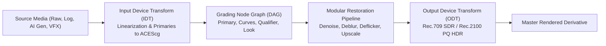

# Color Grading Studio Implementation Specification
**Project:** Universal AI Video Production Studio  
**Department:** 16 — Color Grading, Color Management, Video Restoration & Enhancement  
**Document Version:** 1.0.0  
**Verification Date:** 2026-11-21  

---

## 1. Executive Summary

Department 16 provides an end-to-end, color-managed grading and restoration system capable of transforming raw footage, AI-generated videos, 2D animation, and VFX composites into polished cinematic deliverables. The department operates strictly in a **scene-referred floating-point working space (ACEScg/ACEScct)** before applying target display transforms (ODTs) conforming to Rec.709, Display P3, or Rec.2100 HDR (PQ/HLG).

---

## 2. Key Modules & Subsystems

1. **`color_management/`**:
   - `color_manager.py`: Application-owned color manager. Detects source color space, applies IDTs, transforms to working space, and applies ODTs.
   - `aces_transforms.py`: Standard mathematical matrices (AP0, AP1, XYZ) and transfer curves (sRGB, BT.1886, ACEScct, ST 2084 PQ, camera logs: ARRI LogC3, Sony S-Log3, Canon C-Log3, RED Log3G10).
   - `ocio_manager.py`: OpenColorIO config discovery and validation with built-in analytical fallback.
2. **`grading/`**:
   - `primary_corrector.py`: Photographic EV stops exposure, Lift/Gamma/Gain, Offset, Contrast with middle-gray pivot, Kelvin temperature, tint, saturation, vibrance, and highlight/shadow roll-off.
   - `curves_corrector.py`: Monotonic PCHIP cubic spline curves for Master RGB, Red, Green, Blue, and Hue-selective curves.
   - `secondary_qualifier.py`: 3D HSL qualifier with soft edge feathering and skin-tone isolation.
   - `power_windows.py`: Elliptical and rectangular spatial masks with feathering and rotation.
   - `creative_looks.py`: Cinematic looks: Teal & Orange, Bleach Bypass, Kodak 2383 Film Stock, Monochrome, Warm Sunset, Cool Sci-Fi.
   - `grading_engine.py`: Node graph execution engine processing linear float32 arrays.
3. **`lut/`**:
   - `lut_manager.py`: Ingestion, parsing, and export of 1D and 3D `.cube` files with color-space compatibility validation.
   - `lut_interpolator.py`: Vectorized trilinear 3D lattice interpolation with intensity blending.
4. **`ai_colorist/`**:
   - `ai_colorist_assistant.py`: Evaluates exposure distribution, white-balance casts, dynamic range, clipping, vectorscope skin-tone line alignment, and synthesizes explainable grading recommendations.
5. **`matching/`**:
   - `reference_matcher.py`: Reinhard $L\alpha\beta$ color transfer, histogram CDF matching, and skin-tone preserving shot-to-shot look harmonization.
6. **`restoration/`**:
   - `restoration_pipeline.py`: Orchestrates non-destructive restoration workflows.
   - Filters: `VideoDenoiser` (Bilateral + NLM), `VideoDeblurrer` (Wiener), `VideoDeinterlacer` (YADIF), `VideoDeflickerer` (Luminance MA), `VideoStabilizer` (Affine optical flow), `ScratchDustRemover` (Median difference + Telea inpainting), `LowLightEnhancer` (MSR + CLAHE).
7. **`super_resolution/`**:
   - `upscaler.py`: 2x, 4x upscaling with Lanczos-4 baseline, spatial tiling ($512\text{px}$) with cosine seam blending, memory monitoring, and AI detail synthesis labeling.
8. **`hdr/`**:
   - `tone_mapper.py`: ACES RRT, Reinhard extended, and Hable (Uncharted 2) filmic tone curves for HDR to SDR delivery.
9. **`qc/`**:
   - `color_qc.py`: Out-of-range value auditing, clipping detection, and HDR metadata validation.
   - `restoration_qc.py`: Duration, frame rate, audio sync verification, and PSNR/SSIM calculation.
10. **`integrations/`**:
    - `timeline_bridge.py`: OpenTimelineIO clip metadata integration.
    - `director_bridge.py`: AI Director blueprint style translation.
    - `asset_bridge.py`: Central Asset Database non-destructive derivative registration.
    - `generation_bridge.py`: Normalization and color conformance for AI-generated media from Part 11.
